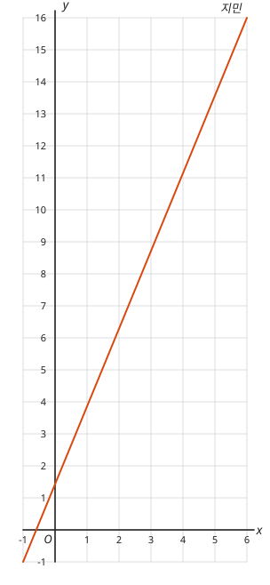
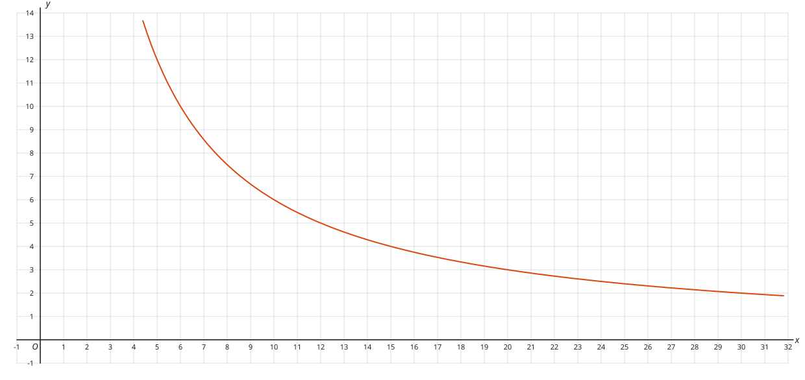

# 중1 수학 서술형 문항 (a1_9s02-07) — 총 10점

- 성취기준: 9수02-07 / 역량: 추론, 의사소통, 연결 / 과제 패턴: multi_representation
- 출제 의도: 속력이 일정할 때 걸린 시간에 따른 이동 거리를 표로 완성하는 소문항(1-1)은 D·E 수준이 기본 계산을 해내는지 확인한다. 이어서 표에서 찾은 규칙을 식으로 나타내고 그 과정을 설명하는 소문항(1-2)은 C·D 수준의 관계 표현 능력을 평가한다. 이동 거리가 일정할 때 속력에 따른 걸린 시간을 표로 완성하는 소문항(1-3)은 C·D 수준에서 두 양의 변화 규칙을 찾는 능력을 평가한다. 마지막 소문항(1-4)은 A·B 수준을 겨냥한다. 앞에서 만든 표와 제시된 그래프를 근거로 두 상황이 정비례인지 반비례인지 판단하고, 두 관계의 뜻을 구별하여 이유를 논리적으로 설명하는 추론과 의사소통 능력을 평가한다.
- 사용 숫자: {'v': 3, 'k': 5, 'j': 2} (수치 명세 m1_9s02-07_multi_representation_v1, 템플릿 방식 — 숫자만 바꾸기 가능)

## 평가 문항

지민이는 산책로에서 일정한 속력으로 걷는다. 이 속력은 시속 3 km이다. 지민이가 걸은 시간에 따라 이동한 거리를 표 1에 정리하려고 한다. 한편 현우는 60 km 떨어진 목적지까지 자동차로 가려고 한다. 속력을 시속 5 km, 시속 10 km, 시속 15 km, 시속 30 km로 각각 일정하게 유지한다고 할 때, 걸리는 시간을 표 2에 정리하려고 한다. 그림 1은 지민이의 상황에서 걸린 시간과 이동 거리의 관계를, 그림 2는 현우의 상황에서 속력과 걸린 시간의 관계를 각각 그래프로 나타낸 것이다.

**표 1: 지민이가 걸은 시간에 따른 이동 거리**

| 걸린 시간(시간) | 1 | 2 | 3 | 4 | 5 |
|---|---|---|---|---|---|
| 이동 거리(km) | ( ) | ( ) | ( ) | ( ) | ( ) |

**표 2: 현우의 속력에 따른 걸린 시간**

| 속력(km/h) | 5 | 10 | 15 | 30 |
|---|---|---|---|---|
| 걸린 시간(시간) | ( ) | ( ) | ( ) | ( ) |

**1-1.** 지민이가 걸은 시간에 따른 이동 거리를 구하여 표 1의 빈칸을 모두 채우시오. [2점]

**1-2.** 1-1에서 완성한 표 1을 이용하여 걸린 시간 $x$시간과 이동 거리 $y$ km 사이의 관계식을 나타내고, 그 식을 얻은 과정을 〈조건〉에 맞게 설명하시오. [3점]

> 〈조건〉 표 1에 나타난 값을 두 가지 이상 근거로 들어 설명할 것

> 〈조건〉 두 양 사이의 관계를 $x$와 $y$를 사용한 식으로 나타낼 것

**1-3.** 현우가 60 km 떨어진 목적지까지 속력을 일정하게 유지하며 갈 때, 속력에 따른 걸린 시간을 구하여 표 2의 빈칸을 모두 채우시오. [2점]

> 〈조건〉 표를 완성한 뒤, 각 열에서 속력과 걸린 시간의 곱을 표 아래에 쓸 것

**1-4.** 1-2에서 구한 관계식과 1-3에서 완성한 표 2, 그림 1, 그림 2를 근거로 지민이의 상황과 현우의 상황이 각각 정비례 관계인지 반비례 관계인지 판단하고, 그 이유를 〈조건〉에 맞게 설명하시오. [3점]

> 〈조건〉 정비례 관계와 반비례 관계의 뜻을 각각 쓰고, 두 관계의 차이가 드러나게 할 것

> 〈조건〉 각 상황에서 표의 값을 두 가지 이상 근거로 들 것

> 〈조건〉 각 상황에서 그래프의 특징을 한 가지씩 언급할 것

## 채점기준표

| 문항 | 평가 요소 | 채점 요소 | 배점 | 수행 수준 |
|---|---|---|---|---|
| 1-1 | 속력이 일정할 때 걸린 시간에 따른 이동 거리를 표로 나타내기 | 표 1의 빈칸을 정확한 값으로 채우기 | 2 | 표 1의 다섯 칸의 이동 거리를 모두 정확하게 구함. |
| 1-1 | 속력이 일정할 때 걸린 시간에 따른 이동 거리를 표로 나타내기 | 표 1의 빈칸을 정확한 값으로 채우기 | 1 | 표 1의 다섯 칸 중 한 칸 이상 네 칸 이하만 정확하게 구함. |
| 1-2 | 걸린 시간과 이동 거리 사이의 관계를 표에서 찾아 식으로 나타내기 | 표의 규칙을 근거로 관계식을 세우는 과정 설명하기 | 3 | 표 1의 값 두 개 이상을 근거로 규칙을 설명하고 $x$와 $y$를 사용한 관계식을 바르게 나타냄. |
| 1-2 | 걸린 시간과 이동 거리 사이의 관계를 표에서 찾아 식으로 나타내기 | 표의 규칙을 근거로 관계식을 세우는 과정 설명하기 | 2 | 관계식은 바르게 나타냈으나 조건 C1의 표 1의 값을 근거로 한 설명이 없거나 한 개의 값만 근거로 듦. |
| 1-2 | 걸린 시간과 이동 거리 사이의 관계를 표에서 찾아 식으로 나타내기 | 표의 규칙을 근거로 관계식을 세우는 과정 설명하기 | 1 | 표 1에서 규칙을 설명했으나 조건 C2의 $x$와 $y$ 사이의 관계식을 바르게 나타내지 못함. |
| 1-3 | 이동 거리가 일정할 때 속력에 따른 걸린 시간을 표로 나타내고 두 양의 곱 확인하기 | 표 2의 빈칸을 정확한 값으로 채우고 속력과 걸린 시간의 곱 쓰기 | 2 | 표 2의 네 칸의 걸린 시간을 모두 정확하게 구하고 조건 C1에 따라 네 열의 곱을 모두 씀. |
| 1-3 | 이동 거리가 일정할 때 속력에 따른 걸린 시간을 표로 나타내고 두 양의 곱 확인하기 | 표 2의 빈칸을 정확한 값으로 채우고 속력과 걸린 시간의 곱 쓰기 | 1 | 표 2의 네 칸 중 일부만 정확하게 구했거나, 네 칸은 정확하게 구했으나 조건 C1의 곱을 쓰지 않음. |
| 1-4 | 정비례 관계와 반비례 관계를 구별하여 두 상황을 판단하고 이유 설명하기 | 표와 그래프를 근거로 두 상황의 관계를 판단하고 이유 설명하기 | 3 | 두 상황의 관계를 모두 바르게 판단하고, 조건 C1~C3에 맞게 두 관계의 뜻을 구별하여 쓰고 표의 값과 그래프의 특징을 근거로 한 이유를 두 상황 모두에 대해 설명함. |
| 1-4 | 정비례 관계와 반비례 관계를 구별하여 두 상황을 판단하고 이유 설명하기 | 표와 그래프를 근거로 두 상황의 관계를 판단하고 이유 설명하기 | 2 | 두 상황의 관계를 모두 바르게 판단했으나, 한 상황에 대해서만 표나 그래프를 근거로 설명하거나 조건 C1의 두 관계의 뜻을 구별하여 쓰지 않음. |
| 1-4 | 정비례 관계와 반비례 관계를 구별하여 두 상황을 판단하고 이유 설명하기 | 표와 그래프를 근거로 두 상황의 관계를 판단하고 이유 설명하기 | 1 | 한 상황의 관계만 바르게 판단했거나, 두 상황을 판단했으나 이유를 쓰지 않음. |

## 예시답안

- **1-1** (표에서 두 값의 비 또는 곱이 일정함을 이용): 이동 거리는 (속력)×(걸린 시간)이므로 걸린 시간이 1, 2, 3, 4, 5시간일 때 이동 거리는 각각 $3 \times 1 = 3$, $3 \times 2 = 6$, $3 \times 3 = 9$, $3 \times 4 = 12$, $3 \times 5 = 15$ (km)이다. 따라서 표 1의 빈칸은 차례로 3, 6, 9, 12, 15이다.
- **1-2** (표에서 두 값의 비 또는 곱이 일정함을 이용): 표 1에서 이동 거리를 걸린 시간으로 나누면 $3 \div 1 = 3$, $6 \div 2 = 3$, $9 \div 3 = 3$, $12 \div 4 = 3$, $15 \div 5 = 3$로 모두 3로 일정하다. 따라서 $y$는 $x$의 3배이므로 관계식은 $y=3x$이다.
- **1-2** (한 값이 2배, 3배가 될 때 다른 값의 변화를 이용): 걸린 시간이 1시간에서 2시간으로 2배가 되면 이동 거리는 3 km에서 6 km로 2배가 되고, 3시간으로 3배가 되면 9 km로 3배가 된다. 또 2시간에서 4시간으로 2배가 되면 이동 거리도 6 km에서 12 km로 2배가 된다. 걸린 시간이 2배, 3배가 될 때 이동 거리도 2배, 3배가 되므로 $y$는 $x$에 정비례한다. 1시간에 3 km를 가므로 관계식은 $y=3x$이다.
- **1-3** (표에서 두 값의 비 또는 곱이 일정함을 이용): 걸린 시간은 (이동 거리)÷(속력)이므로 속력이 5, 10, 15, 30일 때 각각 $60 \div 5 = 12$, $60 \div 10 = 6$, $60 \div 15 = 4$, $60 \div 30 = 2$ (시간)이다. 따라서 표 2의 빈칸은 차례로 12, 6, 4, 2이다. 각 열에서 속력과 걸린 시간의 곱은 $5 \times 12 = 60$, $10 \times 6 = 60$, $15 \times 4 = 60$, $30 \times 2 = 60$로 모두 같다.
- **1-4** (표에서 두 값의 비 또는 곱이 일정함을 이용): 정비례 관계는 $x$가 2배, 3배, ...가 될 때 $y$도 2배, 3배, ...가 되는 관계(비 $y \div x$가 일정한 관계)이고, 반비례 관계는 $x$가 2배, 3배, ...가 될 때 $y$가 $\frac{1}{2}$배, $\frac{1}{3}$배, ...가 되는 관계(곱 $xy$가 일정한 관계)이다. 지민이의 표 1에서 $y \div x$는 $6 \div 2 = 3$, $9 \div 3 = 3$로 일정하고 그림 1은 원점을 지나는 직선이므로 정비례 관계이다. 현우의 표 2에서 속력과 걸린 시간의 곱은 $5 \times 12 = 60$, $10 \times 6 = 60$로 일정하고 그림 2는 원점을 지나지 않는 한 쌍의 매끄러운 곡선이므로 반비례 관계이다.
- **1-4** (한 값이 2배, 3배가 될 때 다른 값의 변화를 이용): 지민이는 걸린 시간이 2시간에서 4시간으로 2배가 될 때 이동 거리가 6 km에서 12 km로 2배가 되므로 정비례 관계이고, 그림 1은 원점을 지나는 직선이다. 현우는 속력이 시속 5 km에서 시속 10 km로 2배가 될 때 걸린 시간이 12시간에서 6시간으로 $\frac{1}{2}$배가 되고, 시속 15 km로 3배가 될 때 4시간으로 $\frac{1}{3}$배가 된다. 따라서 반비례 관계이고, 그림 2는 속력이 커질수록 걸린 시간이 줄어드는 곡선이다. 정비례는 한 값이 2배, 3배가 되면 다른 값도 2배, 3배가 되고, 반비례는 다른 값이 $\frac{1}{2}$배, $\frac{1}{3}$배가 되는 점이 다르다.

## 채점 시 유의점
- 수와 식으로 표현한 문제해결 과정이 수학적으로 논리적이면 예시답안과 달라도 정답으로 인정한다.
- 성취기준이 값을 구하는 것이므로 단위 표기는 평가하지 않는다.
- 앞 소문항의 값이 틀렸더라도 그 값을 바탕으로 이후 계산·판단이 논리적이면 해당 수준 점수를 부여한다. 예를 들어 1-2에서 틀린 표 1의 값으로 식을 세웠더라도 그 값에서 규칙을 바르게 찾았다면 해당 수준을 준다.
- 표현 방식이 달라도 이유가 충분히 설명되었으면 정답으로 인정한다. 예를 들어 '비가 일정하다'와 '$y$가 $x$의 3배이다'는 같은 의미로 본다.

- 단위: 평가하지 않음

## 교사 확인 사항
- (T1, 1-4) 1-4에서 지민이의 상황과 현우의 상황을 구분하여 각각 판단하고 근거를 썼는지 확인한다.
- (T2, 1-1, 1-3) 표 1과 표 2를 채울 때의 단순 계산 실수와, 이동 거리·속력·시간 사이의 관계를 잘못 이해한 개념 오류를 구분하여 채점한다.
- (T3, 1-2, 1-4) '정비례', '반비례', '일정하다' 같은 용어와 $x$, $y$를 사용한 식 표기를 정확히 썼는지 확인한다(예: 식 대신 '3x'만 쓴 경우의 처리를 협의한다).

## 피드백 시 유의점
- 표 1에서 이동 거리가 3씩 늘어나는 것만 보고 $y=x+3$처럼 덧셈으로 식을 쓰는 학생이 있는지 확인한다. $x=1$을 대입해 표 1의 값과 맞는지 점검하고, $y \div x$가 일정한 값임을 표로 확인하게 한다.
- '한 값이 커질 때 다른 값이 작아지면 반비례'라고만 판단하는 오개념이 있는지 확인한다. 표 2에서 속력이 2배, 3배가 될 때 걸린 시간이 $\frac{1}{2}$배, $\frac{1}{3}$배가 되는지, 속력과 시간의 곱이 일정한지를 확인하여 판단하게 한다.
- 그림 2의 곡선을 속력이 커지면 걸린 시간이 직선으로 줄어드는 그래프로 이해하는 학생이 있는지 확인한다. 표 2의 점들을 좌표평면에 찍어 보며 그래프가 원점을 지나는 직선과 어떻게 다른지 비교하게 한다.

## 검증 결과
- 오류 0개, 경고 2개
  - 경고: W3 1-1: 평가 요소 '속력이 일정할 때 걸린 시간에 따른 이동 거리를 표로 나타내기'는 '~하기' 형태가 아니다
  - 경고: W3 1-2: 평가 요소 '걸린 시간과 이동 거리 사이의 관계를 표에서 찾아 식으로 나타내기'는 '~하기' 형태가 아니다

## AI 점검 의견 (수정 권고)
- [보통] 1-4 예시답안 M1: 그림 2를 '원점을 지나지 않는 한 쌍의 매끄러운 곡선'이라고 썼다. 이 상황에서 속력은 양수이므로 그림 2에는 한 갈래의 곡선만 있고, '한 쌍'은 그림과 맞지 않는다. 또 '비 $y \div x$'는 엄밀히는 비의 값이므로 비와 비율의 구별이 흐려진다. -> '원점을 지나지 않고 속력이 커질수록 걸린 시간이 줄어드는 곡선'으로 고친다. '비 $y \div x$'는 '$y \div x$의 값'으로 쓴다.
- [보통] 1-3 조건 C1: 각 열에서 속력과 걸린 시간의 곱을 쓰라는 조건이 '곱이 일정하다'는 반비례의 핵심 근거를 미리 알려 준다. 1-4에서 반비례를 판단하는 단서를 학생이 스스로 찾을 기회가 사라진다. -> 곱을 쓰라는 조건을 빼고 표 완성만 묻는다. 곱의 일정함은 1-4에서 학생이 스스로 찾아 쓰게 한다.
- [보통] 1-4 채점기준: 조건 C2(각 상황에서 표의 값 두 가지 이상)와 C3(그래프 특징)를 어겼을 때의 수준이 분명하지 않다. 두 상황 모두 판단하고 설명했지만 표의 값이 하나뿐이거나 그래프 언급이 없는 답안은 3점인지 2점인지 알 수 없다. 두 상황 모두 판단이 틀린 답안은 어느 수준에도 속하지 않는다. -> 수준 2에 '표의 값 두 개 이상 또는 그래프 특징 중 하나가 빠짐'을 명시하고, 수준 1에 '표나 그래프 근거 없이 판단만 함'을 명시한다. 두 상황 모두 틀린 답안은 어느 수준에 둘지 유의점에 쓴다.
- [보통] 1-2 채점기준 및 발문: 관계식도 틀리고 설명도 없는 답안, 관계식은 틀렸으나 설명이 있는 답안의 경계가 불분명하다. 수준 1은 '규칙을 설명했으나 식이 틀림'만 다룬다. 발문도 식 나타내기와 과정 설명하기 두 수행을 한 문장에 묻는다. -> 식 구하기와 과정 설명하기를 별도 채점 요소로 나누고 각각 수준을 쓴다. 수준 서술에는 '식도 설명도 없는 경우'까지 포괄되게 쓴다.
- [경미] 1-4 발문 및 조건: 발문이 근거 자료로 1-2의 관계식, 표 2, 그림 1, 그림 2만 들고 표 1은 빠뜨렸다. 그런데 조건 C2는 각 상황에서 표의 값을 근거로 들라고 한다. 조건 C1도 '뜻을 쓰기'와 '차이가 드러나게 하기' 두 요구를 함께 담고 있다. -> 발문에 '1-1에서 완성한 표 1'을 추가한다. C1은 뜻을 쓰는 조건과 차이를 드러내는 조건으로 나눈다.
- [경미] 제시문, 1-3 채점기준: 자동차가 시속 5 km, 10 km로 달린다는 설정은 현실성이 떨어져 학생을 헷갈리게 한다. 1-3 수준 1의 '일부만'도 몇 칸인지 정해져 있지 않다. -> 현우의 이동 수단을 자전거나 달리기 등 시속 5~30 km에 맞는 것으로 바꾼다. 수준 1의 '일부만'은 '한 칸 이상 세 칸 이하'처럼 칸 수로 쓴다.

---
사용량: 호출 5회, 입력 40210 토큰, 출력 27149 토큰, 추정 비용 약 $0.528 (단가는 추정)