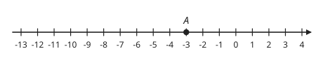

# 중1 수학 서술형 문항 (b1_9s01-05) — 총 10점

- 성취기준: 9수01-05 / 역량: 추론, 의사소통, 문제해결 / 과제 패턴: judge_claim
- 출제 의도: 수직선 위 이동 상황에서 정수의 덧셈과 뺄셈을 해석하고(1-1, 성취수준 D·E·C 겨냥), 괄호와 거듭제곱이 없는 정수와 유리수의 혼합계산을 계산 순서에 따라 과정을 보이며 해결하는 능력(1-2, 성취수준 C·D 겨냥)을 본다. 이어서 가상의 학생 지민의 풀이에서 오류를 찾아 음수끼리의 곱셈과 나눗셈에서 부호가 정해지는 이유를 수직선이나 규칙성 같은 모델로 설명하고 올바른 계산으로 고치는 능력(1-3, 성취수준 A·B 겨냥)을 평가한다. 이를 통해 추론, 의사소통, 문제해결 역량을 함께 확인한다.
- 사용 숫자: {'s': -3, 'a': 4, 'b': 9, 'p': 3, 'q': 5, 'k': 3, 'd': 2, 'e': 4, 'r': 2} (수치 명세 m1_9s01-05_judge_claim_v1, 템플릿 방식 — 숫자만 바꾸기 가능)

## 평가 문항

지민이는 수직선 위에서 말을 움직이는 놀이를 하고 있다. 말은 처음에 좌표가 -3인 점 A에 놓여 있고, 수직선의 눈금 한 칸의 길이는 1이다. 지민이는 말을 먼저 오른쪽으로 4칸 움직인 다음, 이어서 왼쪽으로 9칸 움직였다. 그림은 말의 처음 위치를 나타낸 것이다. 지민이는 이 이동을 계산식으로 나타내 보고, 정수와 유리수가 섞인 계산 연습도 해 보기로 했다.

**1-1.** 지민이가 말을 오른쪽으로 4칸, 이어서 왼쪽으로 9칸 움직인 뒤 말이 놓인 위치의 좌표를 구하시오. 오른쪽으로의 이동은 양수, 왼쪽으로의 이동은 음수로 생각하여 덧셈과 뺄셈으로 나타낸 식을 쓰고, 식의 부호와 수가 각각 이동의 방향과 거리 중 무엇을 뜻하는지 함께 쓰시오. [2점]

**1-2.** 지민이는 정수와 유리수가 섞인 다음 식을 계산해 보기로 했다.

$ 3 - 5 \times \frac{1}{3} - 8 \div 2 $

〈조건〉에 맞게 이 식의 값을 구하시오. [3점]

> 〈조건〉 계산 과정을 단계별로 쓰고, 각 단계에서 어떤 부분을 먼저 계산했는지 밝힐 것

**1-3.** 지민이는 다음 식을 아래와 같이 계산하고, 답이 $- \frac{11}{3}$ 라고 하였다.

식: $2 + (-5) \times \left(- \frac{1}{3}\right) - 8 \div 2$

지민이의 풀이
① $(-5) \times \left(- \frac{1}{3}\right) = - \frac{5}{3}$
② $2 + \left(- \frac{5}{3}\right) - 4 = - \frac{11}{3}$

지민이의 계산이 옳은지 판단하고, 〈조건〉에 맞게 설명하시오. [5점]

> 〈조건〉 지민이의 풀이에서 잘못된 부분을 찾고, 음수끼리의 곱셈에서 부호가 그렇게 정해지는 이유를 수직선이나 곱셈 결과의 규칙성 등 모델을 이용하여 설명할 것

> 〈조건〉 올바른 계산 과정과 최종 값을 쓰고, 지민이의 답이 옳은지 결론을 쓸 것

## 채점기준표

| 문항 | 평가 요소 | 채점 요소 | 배점 | 수행 수준 |
|---|---|---|---|---|
| 1-1 | 수직선과 이동 모델로 정수의 덧셈과 뺄셈의 원리 설명하기 | 이동을 덧셈과 뺄셈의 식으로 나타내고 최종 위치의 좌표 구하기 | 2 | 이동의 방향과 거리를 식의 부호와 수에 바르게 대응시켜 식을 세우고 최종 위치의 좌표를 정확하게 구함. |
| 1-1 | 수직선과 이동 모델로 정수의 덧셈과 뺄셈의 원리 설명하기 | 이동을 덧셈과 뺄셈의 식으로 나타내고 최종 위치의 좌표 구하기 | 1 | 이동을 식으로 나타내는 데 일부 오류가 있거나 식은 바르게 세웠으나 좌표 계산에 오류가 있음. |
| 1-2 | 괄호와 거듭제곱이 없는 정수와 유리수의 혼합계산 순서에 따라 계산하기 | 계산 순서를 밝히며 단계별로 계산하여 값 구하기 | 3 | 곱셈과 나눗셈을 덧셈과 뺄셈보다 먼저 계산하는 순서를 밝히고, 단계별 계산을 거쳐 값을 정확하게 구함. |
| 1-2 | 괄호와 거듭제곱이 없는 정수와 유리수의 혼합계산 순서에 따라 계산하기 | 계산 순서를 밝히며 단계별로 계산하여 값 구하기 | 2 | 계산 순서는 바르게 적용했으나 분수 계산이나 부호 처리에 일부 오류가 있어 값이 틀림. |
| 1-2 | 괄호와 거듭제곱이 없는 정수와 유리수의 혼합계산 순서에 따라 계산하기 | 계산 순서를 밝히며 단계별로 계산하여 값 구하기 | 1 | 계산 순서를 바르게 적용하는 데 어려움이 있어 일부 단계만 구함. |
| 1-3 | 음수끼리의 곱셈과 나눗셈에서 부호가 정해지는 과정 설명하기 | 잘못된 부분을 찾고 부호가 정해지는 이유 설명하기 | 3 | 잘못된 단계를 정확히 찾고, 수직선이나 규칙성 등의 모델을 이용하여 음수끼리 곱한 결과의 부호가 정해지는 이유를 타당하게 설명함. |
| 1-3 | 음수끼리의 곱셈과 나눗셈에서 부호가 정해지는 과정 설명하기 | 잘못된 부분을 찾고 부호가 정해지는 이유 설명하기 | 2 | 잘못된 단계를 정확히 찾았으나 부호 규칙만 말하거나 모델을 이용한 이유 설명이 일부 부족함. |
| 1-3 | 음수끼리의 곱셈과 나눗셈에서 부호가 정해지는 과정 설명하기 | 잘못된 부분을 찾고 부호가 정해지는 이유 설명하기 | 1 | 잘못된 단계를 정확히 찾지 못하거나 근거 없이 설명하는 등 어려움이 있음. |
| 1-3 | 혼합계산 순서에 따라 계산하기 | 부호를 고쳐 올바르게 계산하고 판단 결론 쓰기 | 2 | 부호를 바르게 고쳐 계산 순서에 맞게 올바른 값을 정확하게 구하고, 지민이의 답이 옳지 않다는 결론을 씀. |
| 1-3 | 혼합계산 순서에 따라 계산하기 | 부호를 고쳐 올바르게 계산하고 판단 결론 쓰기 | 1 | 부호를 고치는 데 일부 오류가 있거나 계산 과정에 오류가 있어 올바른 값을 구하지 못하거나 결론이 불분명함. |

## 예시답안

- **1-1** (계산 순서와 부호 규칙을 직접 적용하여 설명): 오른쪽 이동은 덧셈, 왼쪽 이동은 뺄셈으로 나타낸다. 부호는 이동 방향을, 수는 이동한 거리(칸 수)를 뜻한다. 식은 $-3 + 4 - 9$이다. 먼저 $-3 + 4 = 1$이고, 이어서 $1 - 9 = -8$이다. 따라서 말의 좌표는 $-8$이다.
- **1-1** (수직선 이동이나 곱셈 결과의 규칙성(패턴) 같은 모델을 이용하여 설명): 수직선에서 점 A의 좌표 -3에서 오른쪽으로 4칸, 왼쪽으로 9칸 이동한 결과는 한 번에 $4 - 9 = -5$만큼 이동한 것과 같다. 오른쪽과 왼쪽 이동이 서로 부분적으로 상쇄되어 실제 이동한 거리는 5칸이다. 따라서 말의 좌표는 $-3 + (-5) = -8$이다.
- **1-2** (계산 순서와 부호 규칙을 직접 적용하여 설명): 덧셈·뺄셈보다 곱셈·나눗셈을 먼저 계산한다. 곱셈: $5 \times \frac{1}{3} = \frac{5}{3}$. 나눗셈: $8 \div 2 = 4$. 식은 $3 - \frac{5}{3} - 4$이 된다. 덧셈·뺄셈은 왼쪽부터 계산한다. $3 - \frac{5}{3} = \frac{4}{3}$, $\frac{4}{3} - 4 = - \frac{8}{3}$. 따라서 값은 $- \frac{8}{3}$이다.
- **1-2** (수직선 이동이나 곱셈 결과의 규칙성(패턴) 같은 모델을 이용하여 설명): 곱셈과 나눗셈을 먼저 계산하여 $5 \times \frac{1}{3} = \frac{5}{3}$, $8 \div 2 = 4$를 얻으므로 식은 $3 - \frac{5}{3} - 4$이다. 수직선에서 3에서 출발하여 왼쪽으로 4칸 이동하면 $3 - 4 = -1$이다. 여기서 왼쪽으로 $\frac{5}{3}$칸 더 이동하면 $-1 - \frac{5}{3} = - \frac{8}{3}$이다. 따라서 값은 $- \frac{8}{3}$이다.
- **1-3** (계산 순서와 부호 규칙을 직접 적용하여 설명): 지민이의 오류는 ①에서 음수끼리의 곱 $(-5) \times \left(- \frac{1}{3}\right)$의 부호를 음수로 정한 것이다. $(-5) \times \frac{1}{3} = - \frac{5}{3}$이다. 그런데 $- \frac{1}{3} = (-1) \times \frac{1}{3}$이므로, $(-5) \times \left(- \frac{1}{3}\right)$은 $- \frac{5}{3}$에 $-1$을 곱한 것이다. $-1$을 곱하면 수직선에서 원점을 기준으로 반대편의 수가 되므로 $- \frac{5}{3}$의 반대 수인 $\frac{5}{3}$가 된다. 즉 부호가 같은 두 수의 곱은 양수이다. 올바른 계산은 $2 + \frac{5}{3} - 4 = - \frac{1}{3}$이다. 지민이의 답 $- \frac{11}{3}$는 옳지 않고 올바른 값은 $- \frac{1}{3}$이다. 두 값의 차는 $\frac{10}{3}$이다.
- **1-3** (수직선 이동이나 곱셈 결과의 규칙성(패턴) 같은 모델을 이용하여 설명): 지민이의 오류는 ①에서 음수끼리 곱한 결과를 음수로 정한 것이다. 규칙성으로 확인한다. $(-5) \times 2 = -10$, $(-5) \times 1 = -5$, $(-5) \times 0 = 0$이다. 곱하는 수가 1씩 줄어들 때마다 결과는 5씩 커진다. 이 규칙을 이어 가면 $(-5) \times (-1) = 5$로 양수이다. 그러므로 $(-5) \times \left(- \frac{1}{3}\right) = \{(-5) \times (-1)\} \times \frac{1}{3} = 5 \times \frac{1}{3} = \frac{5}{3}$이다. 올바른 계산은 $2 + \frac{5}{3} - 4 = - \frac{1}{3}$이다. 따라서 지민이의 답 $- \frac{11}{3}$는 옳지 않고 올바른 값은 $- \frac{1}{3}$이다.

## 채점 시 유의점
- 수와 식으로 표현한 문제해결 과정이 수학적으로 논리적이면 예시답안과 달라도 정답으로 인정한다.
- 앞 소문항의 값이 틀렸더라도 그 값을 바탕으로 이후 계산·판단이 논리적이면 해당 수준 점수를 부여한다.
- 표현 방식이 달라도(수직선 그림, 규칙성 표, 부호 규칙 등) 음수끼리의 곱의 부호가 정해지는 이유가 충분히 설명되었으면 정답으로 인정한다.
- 분수를 약분하거나 대분수로 고치지 않아도 풀이 과정이 맞으면 정답으로 인정한다.

- 단위: 평가하지 않음

## 교사 확인 사항
- (T1, 1-2, 1-3) 1-2와 1-3에서 계산 순서나 분수 계산의 실수와 음수끼리의 곱의 부호에 대한 개념 이해 오류를 구분하여 채점한다.
- (T2, 1-3) 1-3에서 음수끼리의 곱이 양수라는 결론만 쓰고 모델을 이용한 이유 설명이 없는 경우의 점수(수준 2)를 사전에 협의한다.
- (T3, 1-3) 1-3에서 수직선이나 규칙성 외에 학생이 제시한 다른 설명 모델에 오류가 없는지 확인한다.

## 피드백 시 유의점
- 수직선에서 방향은 부호로, 거리는 수의 크기로 나타낸다는 점을 그림과 식을 연결하여 다시 확인하게 한다.
- 곱하는 수가 1씩 줄어들 때 곱이 일정하게 변하는 표를 만들어, 음수끼리의 곱이 양수가 되는 과정을 스스로 설명해 보게 한다.
- 혼합계산에서는 곱셈과 나눗셈을 먼저 계산한 뒤 덧셈과 뺄셈을 왼쪽부터 계산한다는 순서를 단계마다 표시하며 풀게 한다.

## 검증 결과
- 오류 0개, 경고 0개

## AI 점검 의견 (수정 권고)
- [보통] 1-3: 점수 요소 1의 수준 2('부호 규칙만 말함')와 수준 1('근거 없이 설명함')이 겹친다. 오류 단계를 찾았지만 모델 없이 규칙만 쓴 답이 어느 수준인지 불분명하다. 또 수준 1이 '단계를 못 찾음'과 '근거 없음'이라는 서로 다른 결함을 한 문장에 묶고 있다. -> 수준 2는 '오류 단계를 찾고 결과가 양수임을 말했으나 모델 없이 규칙만 제시함'으로, 수준 1은 '오류 단계를 정확히 찾지 못함 또는 부호 결론이 틀림'으로 나누어 쓴다. T2의 사전 협의 내용도 수준 서술에 반영한다.
- [보통] 1-3 예시답안 M1: M1은 '계산 순서와 부호 규칙을 직접 적용'하는 방법인데, 수준 3은 모델을 이용한 설명을 요구한다. M1이 수준 3에 해당하는지 불분명해서 채점자마다 판단이 달라질 수 있다. 또 '$-1$을 곱하면 반대 수가 된다'는 설명은 증명해야 할 내용을 전제로 쓴 순환 서술이다. -> M1을 모델 없이 규칙만 쓴 답(수준 2 예시)으로 다시 위치시키거나, 수직선 위 반대 수 이동을 규칙성(M2)과 연결해 근거를 보완한다. 수준 3 예시는 모델을 이용한 M2 중심으로 한다.
- [보통] 1-1: 발문은 '오른쪽은 양수, 왼쪽은 음수'로 생각하라고 하는데, 예시답안은 '오른쪽은 덧셈, 왼쪽은 뺄셈'인 $-3+4-9$를 쓴다. 식 안의 부호가 이동 방향인지 연산 기호인지 섞여 있다. 또 $-3$은 이동이 아니라 처음 위치(좌표)인데 '부호는 이동 방향'이라고만 써서 부정확하다. -> 발문을 '이동을 정수로 나타내어 처음 위치에 더하는 식'으로 정리하고, 예시답안도 $-3+(+4)+(-9)$ 같은 형태를 함께 인정한다. $-3$은 처음 위치를 뜻한다는 점을 따로 쓰고, 채점 기준에 부호와 수의 의미 서술 여부를 명시한다.
- [경미] 1-3: 평가요소와 출제 의도는 '음수끼리의 곱셈과 나눗셈'의 부호를 다룬다고 쓰지만, 문항은 곱셈 $(-5)\times(-\frac{1}{3})$만 다룬다. 나눗셈 부호는 평가되지 않아 의도와 문항이 어긋난다. -> 평가요소 문구를 '음수끼리의 곱셈에서 부호가 정해지는 이유'로 줄이거나, 나눗셈에서 부호를 판단하는 과정을 한 군데 추가한다.
- [경미] 1-2, 1-3 (dependsOn, scoringNotes): 1-2와 1-3은 앞 소문항의 값을 쓰지 않고 독립적으로 풀리는데도 dependsOn이 이어져 있다. 그래서 '앞 소문항 값이 틀려도 이후 판단이 논리적이면 인정'이라는 채점 유의 사항이 실제로는 적용될 곳이 없다. -> dependsOn을 비우고, 해당 채점 유의 사항을 삭제하거나 각 소문항을 독립적으로 채점한다는 문구로 바꾼다.
- [경미] 1-2 예시답안 M2: M2는 $3-\frac{5}{3}-4$를 $3-4-\frac{5}{3}$ 순서로 바꿔 계산하면서 순서를 바꾼 이유를 쓰지 않는다. 학생에게는 앞에서부터 계산한다는 C1의 흐름과 어긋나 보일 수 있다. -> 항의 순서를 바꿔도 되는 이유(덧셈의 교환법칙, 부호를 붙인 수로 보기)를 한 문장 덧붙이거나, 왼쪽부터 계산하는 방법만 예시답안으로 둔다.

---
사용량: 호출 7회, 입력 46280 토큰, 출력 45697 토큰, 추정 비용 약 $0.824 (단가는 추정)