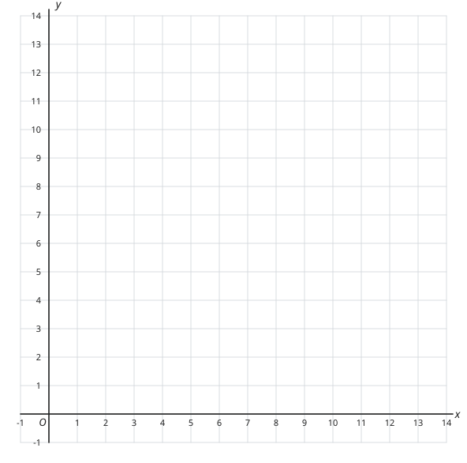

# 중1 수학 서술형 문항 (b1_9s02-07) — 총 10점

- 성취기준: 9수02-07 / 역량: 추론, 의사소통, 연결 / 과제 패턴: multi_representation
- 출제 의도: 이 문항은 속력, 거리, 시간이 나오는 실생활 상황에서 정비례와 반비례 관계를 표, 식, 그래프로 나타내고 설명하는 능력을 평가한다. 1-1은 D·E·C 수준 학생이 표의 빈칸을 정확히 계산하는지 확인한다. 1-2는 C·D 수준 학생이 표에서 규칙을 찾아 관계식을 세우고 그 과정을 설명하는지 확인한다. 1-3은 C·D 수준 학생이 거리가 일정할 때 속력과 시간의 관계를 점으로 찍어 그래프로 나타내는지 확인한다. 1-4는 A·B 수준 학생이 정비례와 반비례의 뜻을 정확히 말하고, 앞에서 다룬 두 상황이 각각 어느 관계인지 표, 식, 그래프를 근거로 설명하며 두 관계의 차이를 구분하는지 확인한다. 이를 통해 추론, 의사소통, 연결 역량을 함께 살핀다.
- 사용 숫자: {'v': 10, 'k': 2, 'j': 2} (수치 명세 m1_9s02-07_multi_representation_v1, 템플릿 방식 — 숫자만 바꾸기 가능)

## 평가 문항

지민이는 자전거를 타고 일정한 속력인 시속 10 km로 달리고 있다. 달린 시간을 $x$시간, 그동안 이동한 거리를 $y$ km라 하고, 그 값을 표 T1에 정리하려 한다. 한편 현우는 24 km 떨어진 곳까지 이동하려고 한다. 현우는 속력을 시속 2 km, 4 km, 6 km, 12 km 중 하나로 정해 목적지까지 일정한 속력으로 이동한다. 속력별로 걸린 시간은 표 T2에 정리하려 하며, 속력을 가로축에, 걸린 시간을 세로축에 나타낼 좌표평면은 그림 F1과 같다.

**지민이가 시속 10 km로 달린 시간과 이동 거리**

| 달린 시간 $x$ (시간) | 1 | 2 | 3 | 4 | 5 |
|---|---|---|---|---|---|
| 이동 거리 $y$ (km) | 10 |  |  |  |  |

**현우가 24 km를 이동할 때 속력에 따른 걸린 시간**

| 속력 (km/h) | 2 | 4 | 6 | 12 |
|---|---|---|---|---|
| 걸린 시간 (시간) |  |  |  |  |

**1-1.** 지민이가 일정한 속력으로 달릴 때, 표 T1의 빈칸을 모두 채우시오. [2점]

**1-2.** 표 T1을 보고 $x$와 $y$ 사이의 관계를 식으로 나타내고, 그렇게 판단한 과정을 설명하시오. [2점]

**1-3.** 현우가 속력별로 걸리는 시간을 구하여 표 T2의 빈칸을 채우고, 속력과 걸린 시간의 순서쌍을 그림 F1의 좌표평면에 점으로 나타낸 뒤 그래프를 그리시오. [2점]

**1-4.** 지민이의 상황(표 T1)과 현우의 상황(표 T2)은 각각 정비례 관계인지 반비례 관계인지 판단하고, 〈조건〉에 맞게 설명하시오. [4점]

> 〈조건〉 정비례 관계와 반비례 관계의 뜻을 각각 쓸 것

> 〈조건〉 두 상황이 각각 어떤 관계인지 판단하고, 1-2의 식과 1-3의 표 또는 그래프 중 근거를 들어 설명할 것

> 〈조건〉 한쪽 값이 2배, 3배가 될 때 다른 쪽 값이 어떻게 변하는지 비교하여 두 관계의 차이를 쓸 것

## 채점기준표

| 문항 | 평가 요소 | 채점 요소 | 배점 | 수행 수준 |
|---|---|---|---|---|
| 1-1 | 속력이 일정할 때 시간에 따른 이동 거리를 구하여 표의 빈칸 채우기 | 달린 시간에 따른 이동 거리를 계산하여 표의 빈칸 채우기 | 2 | 속력과 시간 사이의 관계를 이용해 표의 빈칸을 모두 정확하게 구함. |
| 1-1 | 속력이 일정할 때 시간에 따른 이동 거리를 구하여 표의 빈칸 채우기 | 달린 시간에 따른 이동 거리를 계산하여 표의 빈칸 채우기 | 1 | 표의 빈칸 중 일부만 구했거나 계산에 오류가 있음. |
| 1-2 | 표에서 규칙을 찾아 시간과 이동 거리 사이의 관계식을 세우고 그 과정 설명하기 | 표의 규칙을 근거로 관계식 세우고 과정 설명하기 | 2 | 표에서 두 값 사이의 규칙을 찾아 관계식을 바르게 세우고 그렇게 판단한 과정을 설명함. |
| 1-2 | 표에서 규칙을 찾아 시간과 이동 거리 사이의 관계식을 세우고 그 과정 설명하기 | 표의 규칙을 근거로 관계식 세우고 과정 설명하기 | 1 | 규칙은 찾았으나 관계식에 오류가 있거나, 관계식은 세웠으나 과정 설명이 부족함. |
| 1-3 | 거리가 일정할 때 속력과 걸린 시간의 관계를 좌표평면에 나타내기 | 걸린 시간을 구해 순서쌍을 점으로 찍고 그래프 그리기 | 2 | 걸린 시간을 정확하게 구해 순서쌍을 좌표평면에 바르게 나타내고 반비례 관계의 그래프 모양으로 그림. |
| 1-3 | 거리가 일정할 때 속력과 걸린 시간의 관계를 좌표평면에 나타내기 | 걸린 시간을 구해 순서쌍을 점으로 찍고 그래프 그리기 | 1 | 걸린 시간이나 점의 위치에 일부 오류가 있거나, 점은 찍었으나 그래프의 모양을 바르게 그리지 못함. |
| 1-4 | 정비례와 반비례 관계의 뜻을 말하고 두 관계의 차이 구분하기 | 정비례와 반비례의 뜻을 말하고 두 관계의 차이 구분하기 | 2 | 정비례와 반비례의 뜻을 바르게 말하고 한쪽 값의 변화에 따른 다른 쪽 값의 변화를 비교하여 두 관계의 차이를 구분함. |
| 1-4 | 정비례와 반비례 관계의 뜻을 말하고 두 관계의 차이 구분하기 | 정비례와 반비례의 뜻을 말하고 두 관계의 차이 구분하기 | 1 | 두 관계 중 하나의 뜻만 바르게 말했거나, 두 관계의 차이 구분이 불충분함. |
| 1-4 | 두 상황의 관계를 표, 식, 그래프로 판단하고 반비례임을 설명하기 | 두 상황의 관계를 표, 식, 그래프를 근거로 판단하고 설명하기 | 2 | 두 상황이 각각 정비례와 반비례임을 표, 식, 그래프 중 알맞은 근거를 들어 바르게 판단하고 설명함. |
| 1-4 | 두 상황의 관계를 표, 식, 그래프로 판단하고 반비례임을 설명하기 | 두 상황의 관계를 표, 식, 그래프를 근거로 판단하고 설명하기 | 1 | 한 상황만 바르게 판단했거나, 판단은 했으나 근거가 부족함. |

## 예시답안

- **1-1** (표에서 두 값의 몫 또는 곱이 일정함을 이용): 표에서 달린 시간이 1시간 늘 때마다 이동 거리가 10 km씩 늘어난다. 이동 거리는 속력 × 시간이므로 $x=2$일 때 $10 \times 2 = 20$, $x=3$일 때 $10 \times 3 = 30$, $x=4$일 때 $10 \times 4 = 40$, $x=5$일 때 $10 \times 5 = 50$이다. 따라서 빈칸에는 차례로 20, 30, 40, 50를 쓴다.
- **1-1** (관계식과 그래프의 모양을 이용): 속력이 일정하므로 $y = 10x$로 놓고 $x$에 2, 3, 4, 5를 차례로 대입한다. $y = 10 \times 2 = 20$, $10 \times 3 = 30$, $10 \times 4 = 40$, $10 \times 5 = 50$이다.
- **1-2** (표에서 두 값의 몫 또는 곱이 일정함을 이용): $y$를 $x$로 나눈 값을 구하면 $10 \div 1$, $20 \div 2$, $30 \div 3$, $40 \div 4$, $50 \div 5$ 모두 10로 일정하다. 따라서 $y$는 $x$의 10배이므로 관계식은 $y = 10x$이다.
- **1-2** (관계식과 그래프의 모양을 이용): $x$가 2에서 4로 2배가 될 때 $y$도 20에서 40로 2배가 된다. $x$가 2배, 3배, ...가 되면 $y$도 2배, 3배, ...가 되므로 $y$는 $x$에 정비례한다. 속력이 시속 10 km이므로 $y = 10x$이다.
- **1-3** (표에서 두 값의 몫 또는 곱이 일정함을 이용): 걸린 시간은 거리 ÷ 속력이므로 $24 \div 2 = 12$, $24 \div 4 = 6$, $24 \div 6 = 4$, $24 \div 12 = 2$이다. 표의 빈칸에는 차례로 12, 6, 4, 2를 쓴다. 속력과 걸린 시간의 곱은 $2 \times 12 = 4 \times 6 = 6 \times 4 = 12 \times 2 = 24$로 일정하다. 순서쌍 $(2, 12)$, $(4, 6)$, $(6, 4)$, $(12, 2)$를 좌표평면에 점으로 찍고, 두 좌표축과 만나지 않는 매끄러운 곡선으로 잇는다.
- **1-3** (관계식과 그래프의 모양을 이용): 거리가 24 km로 일정하므로 걸린 시간 $t$와 속력 $s$ 사이의 관계식은 $t = 24 \div s$이다. $s$에 2, 4, 6, 12를 대입하면 $t$는 차례로 12, 6, 4, 2이다. 속력이 2에서 4로 2배가 되면 걸린 시간은 12에서 6로 $\frac{1}{2}$배가 된다. 네 점을 좌표평면에 찍고 속력이 커질수록 걸린 시간이 줄어드는 곡선으로 잇는다.
- **1-4** (표에서 두 값의 몫 또는 곱이 일정함을 이용): 정비례는 $x$가 2배, 3배, ...가 될 때 $y$도 2배, 3배, ...가 되는 관계이고, 반비례는 $x$가 2배, 3배, ...가 될 때 $y$가 $\frac{1}{2}$배, $\frac{1}{3}$배, ...가 되는 관계이다. 지민이의 표 T1에서는 $y \div x$의 값이 10로 항상 같고 $x$가 2배가 되면 $y$도 2배가 되므로 정비례이다. 현우의 표 T2에서는 속력과 걸린 시간의 곱이 24로 항상 같고 속력이 2배가 되면 걸린 시간은 절반이 되므로 반비례이다. 두 관계의 차이는 한쪽이 커질 때 다른 쪽도 같은 비율로 커지는지(정비례), 같은 비율로 작아지는지(반비례)이다.
- **1-4** (관계식과 그래프의 모양을 이용): 지민이의 관계식은 $y = 10x$로 $y$가 $x$에 정비례하며, 그래프는 원점을 지나는 직선이다. 현우의 관계식은 속력을 $s$, 걸린 시간을 $t$라 할 때 $t = 24 \div s$이므로 $st = 24$이다. 그래프는 점 $(2, 12)$, $(4, 6)$, $(6, 4)$, $(12, 2)$를 지나고 두 좌표축에 한없이 가까워지지만 만나지 않는 곡선이므로 $t$는 $s$에 반비례한다. 정비례는 원점을 지나는 직선, 반비례는 좌표축과 만나지 않는 곡선이라는 점에서 그래프의 모양도 다르다.

## 채점 시 유의점
- 수와 식으로 표현한 문제해결 과정이 수학적으로 논리적이면 예시답안과 달라도 정답으로 인정한다.
- 앞 소문항의 값이 틀렸더라도 그 값을 바탕으로 이후 계산·판단이 논리적이면 해당 수준 점수를 부여한다.
- 표현 방식이 달라도 정비례와 반비례의 뜻과 판단 이유가 충분히 설명되었으면 정답으로 인정한다.
- 대략 비슷한 위치에 점을 찍거나 그래프의 모양이 크게 벗어나지 않으면 정답으로 인정한다.

- 단위: 평가하지 않음

## 교사 확인 사항
- (T1, 1-3) 1-3에서 점을 찍은 뒤 직선으로 이은 경우, 또는 점 두 개만 찍어 연결한 경우의 점수를 사전에 협의한다.
- (T2, 1-1, 1-2, 1-3) 계산 실수(표의 값 오류)와 정비례·반비례 개념 이해 오류를 구분하여 채점한다.
- (T3, 1-4) 1-4에서 '정비례', '반비례', '비례상수' 등 수학 용어와 기호를 정확히 사용했는지 확인한다.

## 피드백 시 유의점
- 두 표에서 '몫이 일정한 경우'와 '곱이 일정한 경우'를 나누어 정리해 보게 하여 정비례와 반비례를 구분하도록 지도한다.
- 그래프를 직선으로 이은 학생에게는 속력이 매우 커질 때 걸린 시간이 어떻게 변하는지 생각해 보게 하여 곡선이 되는 이유를 이해하게 한다.
- 정비례와 반비례의 뜻을 말로만 쓴 학생에게는 표의 값을 예로 들어 '몇 배가 되면 몇 배가 되는지' 구체적으로 쓰게 한다.

## 검증 결과
- 오류 3개, 경고 2개
  - 오류: M23 1-4: 조건 C1가 어떤 채점 요소의 수준 서술에도 연결되지 않았다
  - 오류: M23 1-4: 조건 C3가 어떤 채점 요소의 수준 서술에도 연결되지 않았다
  - 오류: M23 1-4: 조건 C2가 어떤 채점 요소의 수준 서술에도 연결되지 않았다
  - 경고: W3 1-1: 평가 요소 '속력이 일정할 때 시간에 따른 이동 거리를 구하여 표의 빈칸 채우기'는 '~하기' 형태가 아니다
  - 경고: W3 1-3: 평가 요소 '거리가 일정할 때 속력과 걸린 시간의 관계를 좌표평면에 나타내기'는 '~하기' 형태가 아니다

---
사용량: 호출 6회, 입력 38459 토큰, 출력 28939 토큰, 추정 비용 약 $0.549 (단가는 추정)