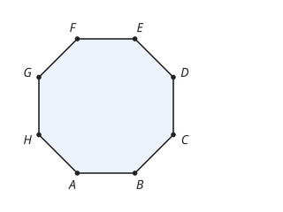

# 중1 수학 서술형 문항 (cheonjae_v2) — 총 10점

- 성취기준: 9수03-05 / 역량: 추론, 문제해결, 의사소통 / 과제 패턴: compare_methods_apply
- 출제 의도: 1-1은 다각형의 내각과 외각의 뜻을 알고 한 꼭짓점에서 두 각의 크기의 합을 구하는 기본 계산 소문항으로, 성취수준 D·E 학생도 해결할 수 있도록 하였다. 1-2는 한 꼭짓점에서 대각선을 그어 다각형을 삼각형으로 나누고, 이를 이용해 내각의 크기의 합을 구하는 과정을 말과 식으로 설명하는 능력을 평가하며 성취수준 C·D를 겨냥한다. 1-3은 두 학생이 대각선의 총 개수를 구한 방법을 비교하여 옳은 방법과 잘못된 방법을 가려내고, 틀린 이유를 설명한 뒤 변의 수가 더 많은 다각형에 옳은 방법을 적용하는 능력을 평가하며 성취수준 A·B를 겨냥한다. 이를 통해 추론, 문제해결, 의사소통 역량을 함께 확인한다.
- 사용 숫자: {'n': 8, 'p': 7, 'm': 10} (수치 명세 m1_9s03-05_compare_methods_apply_v1, 템플릿 방식 — 숫자만 바꾸기 가능)

## 평가 문항

지민이와 현우는 학교 축제에서 사용할 8각형 모양의 무대 바닥을 설계하고 있다. 그림은 무대 바닥을 위에서 본 모양이며, 꼭짓점을 시계 반대 방향으로 A, B, C, D, E, F, G, H라 하였다. 두 학생은 무대 바닥의 각의 크기를 확인하고, 서로 다른 두 꼭짓점 사이에 조명 줄을 연결하는 방법을 정하려고 한다.

**1-1.** 그림의 8각형 ABCDEFGH에서 이웃한 두 변으로 이루어진 내부의 각을 내각이라 하고, 변 HA를 점 A 쪽으로 연장한 선과 변 AB가 이루는 각을 꼭짓점 A에서의 외각이라 한다. 꼭짓점 A에서 내각과 외각의 크기의 합을 구하시오. [2점]

**1-2.** 지민이와 현우는 8각형 모양의 무대 바닥의 내각의 크기의 합을 구하기 위해 각각 다음과 같이 8각형을 삼각형으로 나누기로 하였다. 지민: 꼭짓점 A에서 이웃하지 않는 모든 꼭짓점으로 대각선을 그어 삼각형으로 나눈다. 현우: 8각형 내부에 한 점 O를 잡고, O와 모든 꼭짓점을 선분으로 이어 삼각형으로 나눈다. 두 학생의 방법 중 한 가지를 선택하여 8각형의 내각의 크기의 합을 구하는 과정을 〈조건〉에 맞게 설명하시오. [4점]

> 〈조건〉 선택한 방법으로 8각형을 삼각형으로 나눈 그림을 그릴 것

> 〈조건〉 나누어진 삼각형의 개수를 식에 사용할 것

**1-3.** 지민이와 현우는 7각형 모양의 보조 무대에서 이웃하지 않는 두 꼭짓점을 잇는 조명 줄(대각선)의 총 개수를 다음과 같이 서로 다른 방법으로 구하였다. 지민: 한 꼭짓점에서 그을 수 있는 대각선이 4개이고 꼭짓점이 7개이므로 대각선의 총 개수는 $7\times4=28$(개)이다. 현우: 꼭짓점 A, B, C, …의 순서로 대각선을 그으면서, 이미 그은 대각선은 다시 세지 않고 새로 그어지는 대각선만 센다. 꼭짓점 A에서 4개, B에서 4개, C에서 3개, …로 새로 그어지는 대각선의 개수를 모두 더하면 14개이다. 두 학생의 방법을 비교하고, 10각형 모양의 무대에서 대각선의 총 개수를 구하는 과정을 〈조건〉에 맞게 서술하시오. [4점]

> 〈조건〉 지민이와 현우의 방법이 각각 옳은지 판단하고, 옳지 않은 방법이 있으면 그 이유를 설명할 것

> 〈조건〉 10각형의 대각선의 개수를 구하는 계산 과정을 식으로 나타낼 것

## 채점기준표

| 문항 | 평가 요소 | 채점 요소 | 배점 | 수행 수준 |
|---|---|---|---|---|
| 1-1 | 다각형의 내각과 외각의 뜻을 알고 한 꼭짓점에서 내각과 외각의 크기의 합 구하기 | 한 꼭짓점에서 내각과 외각의 크기의 합 구하기 | 2 | 꼭짓점 A에서 내각과 외각의 크기의 합을 정확하게 구함. |
| 1-1 | 다각형의 내각과 외각의 뜻을 알고 한 꼭짓점에서 내각과 외각의 크기의 합 구하기 | 한 꼭짓점에서 내각과 외각의 크기의 합 구하기 | 1 | 내각과 외각의 뜻을 잘못 적용하여 한 꼭짓점에서의 두 각의 합이 아닌 다른 값(예: 모든 외각의 크기의 합)을 구했거나 값을 구하지 못함. |
| 1-2 | 한 꼭짓점에서 대각선을 그어 삼각형으로 나누어 다각형의 내각의 크기의 합을 구하는 과정 설명하기 | 선택한 방법으로 8각형을 삼각형으로 나눈 그림 나타내기 | 2 | 선택한 방법과 같게 8각형을 삼각형으로 모두 나누어 그림으로 나타냄. |
| 1-2 | 한 꼭짓점에서 대각선을 그어 삼각형으로 나누어 다각형의 내각의 크기의 합을 구하는 과정 설명하기 | 선택한 방법으로 8각형을 삼각형으로 나눈 그림 나타내기 | 1 | 선택한 방법과 다르게 나누었거나 나뉜 도형 중 삼각형이 아닌 것이 있거나, 그림 없이 글로만 나누는 방법을 씀. |
| 1-2 | 한 꼭짓점에서 대각선을 그어 삼각형으로 나누어 다각형의 내각의 크기의 합을 구하는 과정 설명하기 | 삼각형의 개수를 이용하여 내각의 크기의 합을 구하는 과정 설명하기 | 2 | 삼각형의 개수와 삼각형의 세 내각의 크기의 합을 이용한 식으로 내각의 크기의 합을 정확하게 구하고, 선택한 방법에 필요한 처리(내부의 한 점 둘레의 각을 빼는 등)를 설명함. |
| 1-2 | 한 꼭짓점에서 대각선을 그어 삼각형으로 나누어 다각형의 내각의 크기의 합을 구하는 과정 설명하기 | 삼각형의 개수를 이용하여 내각의 크기의 합을 구하는 과정 설명하기 | 1 | 삼각형의 개수를 이용한 식은 세웠으나 삼각형의 개수나 빼야 할 각의 처리에 오류가 있거나, 식 없이 합만 구함. |
| 1-3 | 두 학생이 대각선의 총 개수를 구한 방법을 비교하여 옳고 그름을 판단하고 이유 설명하기 | 두 학생의 방법이 옳은지 판단하고 옳지 않은 방법의 이유 설명하기 | 2 | 두 학생의 방법을 각각 올바르게 판단하고, 옳지 않은 방법에서 같은 대각선이 두 번씩 세어진다는 점을 근거로 이유를 설명함. |
| 1-3 | 두 학생이 대각선의 총 개수를 구한 방법을 비교하여 옳고 그름을 판단하고 이유 설명하기 | 두 학생의 방법이 옳은지 판단하고 옳지 않은 방법의 이유 설명하기 | 1 | 한 학생의 방법만 판단했거나, 판단은 올바르나 이유를 설명하지 않았거나 같은 대각선이 두 번씩 세어진다는 점과 관계없는 이유를 듦. |
| 1-3 | 옳은 방법을 변의 수가 더 많은 다각형에 적용하여 대각선의 개수 구하기 | 10각형의 대각선의 개수를 식으로 구하기 | 2 | 10각형의 대각선의 개수를 구하는 계산 과정을 식으로 나타내고 같은 대각선이 두 번씩 세어진 것(또는 중복)을 바르게 처리하여 정확하게 구함. |
| 1-3 | 옳은 방법을 변의 수가 더 많은 다각형에 적용하여 대각선의 개수 구하기 | 10각형의 대각선의 개수를 식으로 구하기 | 1 | 식은 세웠으나 중복 처리에 오류가 있거나 계산이 틀려 값이 맞지 않거나, 식 없이 값만 구함. |

## 예시답안

- **1-1** (한 꼭짓점 기준 방법): 내각은 꼭짓점 A에서 이웃한 두 변 HA, AB로 이루어진 내부의 각이고, 외각은 변 HA의 연장선과 변 AB가 이루는 각이다. 내각과 외각은 변 HA를 연장한 한 직선 위에서 이웃하여 이루는 각이므로 두 각의 크기의 합은 평각인 $180^\circ$이다. 따라서 구하는 크기의 합은 $180^\circ$이다.
- **1-2** (한 꼭짓점 기준 방법): 지민이의 방법을 선택한다. 꼭짓점 A에서 이웃하지 않는 5개의 꼭짓점으로 대각선을 모두 그으면(그림: A에서 나온 대각선으로 8각형이 나뉜 모양) 8각형은 8-2=6(개)의 삼각형으로 나뉜다. 삼각형의 세 내각의 크기의 합은 $180^\circ$이고, 이 삼각형들의 내각을 모두 모으면 8각형의 내각이 되므로 8각형의 내각의 크기의 합은 $180^\circ\times 6=1080^\circ$이다.
- **1-2** (다른 기준 방법): 현우의 방법을 선택한다. 8각형 내부에 한 점 O를 잡고 O와 모든 꼭짓점을 선분으로 이으면(그림: O에서 꼭짓점으로 선분이 퍼진 모양) 8개의 삼각형으로 나뉜다. 삼각형 8개의 내각의 크기의 합은 $180^\circ\times 8=1440^\circ$이다. 이 중 점 O 둘레에 모인 각의 크기의 합 $360^\circ$는 8각형의 내각이 아니므로 빼면 8각형의 내각의 크기의 합은 $1440^\circ-360^\circ=1080^\circ$이다.
- **1-3** (한 꼭짓점 기준 방법): 지민이의 방법은 옳지 않다. 한 꼭짓점에서 그을 수 있는 대각선 4개에 꼭짓점 7개를 곱하면 한 대각선이 양 끝의 두 꼭짓점에서 각각 한 번씩 두 번 세어지므로 실제 개수의 2배인 28개가 된다. 2로 나누면 $7\times4\div 2=14$(개)로 현우의 방법으로 구한 14개와 같다. 현우의 방법은 이미 그은 대각선을 다시 세지 않으므로 옳다. 10각형은 한 꼭짓점에서 그을 수 있는 대각선이 10-3=7(개)이고 꼭짓점이 10개이므로 대각선의 총 개수는 $10\times7\div 2=35$(개)이다.
- **1-3** (다른 기준 방법): 지민이의 방법은 같은 대각선을 양 끝의 꼭짓점에서 두 번씩 세어 옳지 않고, 현우의 방법은 새로 그어지는 대각선만 세므로 옳다. 현우의 방법으로 10각형에서 꼭짓점 A에서 7개, B에서 새로 그어지는 7개, C에서 6개, …로 한 개씩 줄어 마지막 두 꼭짓점에서는 새로 그어지는 대각선이 0개이므로 합은 $7+7+6+\cdots+1=35$(개)이다.

## 채점 시 유의점
- 수와 식으로 표현한 문제해결 과정이 수학적으로 논리적이면 예시답안과 달라도 정답으로 인정한다. 1-2에서는 지민이와 현우 중 어느 방법을 선택해도 되며, 그림의 분할이 선택한 방법과 일치하고 삼각형의 개수가 맞는지 확인한다. 1-3에서는 지민이의 식을 2로 나누어 바르게 고쳐 적용한 답도 인정한다.
- 성취기준이 값을 구하는 것이므로 단위(°, 개) 표기는 평가하지 않는다.
- 앞 소문항의 값이 틀렸더라도 그 값을 바탕으로 한 이후 계산·판단이 논리적이면 해당 수준 점수를 부여한다.
- 표현 방식이 달라도 이유가 충분히 설명되었으면 정답으로 인정한다. 1-3에서 '같은 대각선이 두 번씩 센다', '중복해서 센다' 등 표현이 달라도 같은 의미이면 인정한다.

- 단위: 평가하지 않음

## 교사 확인 사항
- (T1, 1-3) 1-3에서 지민이와 현우의 방법을 구분하여 각각 옳은지 판단했는지 확인한다. 한 학생의 방법만 판단한 답의 점수를 사전에 협의한다.
- (T2, 1-2) 1-2에서 삼각형의 개수를 잘못 센 경우(개념 오류)와 개수는 맞으나 곱셈·뺄셈을 틀린 경우(계산 실수)를 구분하여 채점하는 기준을 협의한다.

## 피드백 시 유의점
- 내부의 한 점을 이용한 방법에서 삼각형 개수만큼 180°를 곱한 값을 내각의 크기의 합으로 쓰는 오개념이 있는지 확인한다. 점 O 둘레에 모인 각이 다각형의 내각이 아님을 그림에 색칠하여 보이고, 한 꼭짓점에서 내각과 외각의 합이 평각이라는 1-1의 결과와 연결하여 지도한다.
- 한 꼭짓점에서 대각선을 그을 때 삼각형이 꼭짓점의 개수만큼 생긴다고 생각하는 오개념이 있는지 확인한다. 사각형, 오각형, 육각형에서 직접 대각선을 그어 삼각형의 개수를 세어 보고 변의 수와 비교하게 한다.
- '한 꼭짓점의 대각선 개수에 꼭짓점의 개수를 곱한 값'을 그대로 총 개수로 쓰는 오개념이 있는지 확인한다. 사각형에서 대각선을 직접 그려 센 개수와 곱셈 결과를 비교하여 같은 대각선이 두 번씩 세어진다는 것을 스스로 발견하게 한다.

## 검증 결과
- 오류 0개, 경고 0개

## AI 점검 의견 (수정 권고)
- [보통] 1-3: 한 소문항에서 두 방법의 비교, 옳고 그름의 판단, 이유 설명, 10각형 대각선 개수 구하기를 한꺼번에 묻고, 조건 C1에도 '판단'과 '이유 설명'이 함께 들어 있다. 또 '옳은 방법'을 적용하라고 하면서 지민이의 방법을 고쳐 쓸지 현우의 방법을 쓸지 정하지 않아 풀이 경로와 채점 대상이 갈라진다. -> 판단·이유 설명 소문항과 10각형 적용 소문항으로 나누거나, 조건을 하나에 요구 하나씩 나누어 쓴다. 10각형에는 어느 학생의 방법을 쓸지 발문에서 정하거나 두 방법 모두 인정한다고 유의점에 밝힌다.
- [보통] 1-3 채점기준: '판단·이유' 요소에는 두 학생의 옳고 그름을 모두 잘못 판단한 답이 들어갈 수준이 없다. 또 '한 학생의 방법만 판단한 답'은 이미 1점 수준에 적혀 있는데 teacherChecks T1은 이를 따로 협의하라고 하여 서로 어긋난다. '적용' 요소의 2점 서술은 '같은 대각선이 두 번씩 세어진 것의 처리'를 요구하므로 중복 처리가 필요 없는 현우의 방법으로 구한 답은 어느 수준인지 불분명하다. -> 판단 요소의 수준을 '두 방법 모두 올바르게 판단 / 한 방법만 올바르게 판단 / 그 외'처럼 개수로 가른다. 적용 요소는 '2로 나누는 방법'과 '새로 그어지는 대각선을 더하는 방법' 각각에 대해 2점 서술을 쓰고, T1은 삭제하거나 수준 서술과 일치시킨다.
- [보통] 1-2 채점기준: 설명 요소의 2점 서술에 개수, 식, 선택한 방법의 처리, 정확성이 한 문장에 겹쳐 있다. 1점 서술도 '개수나 처리의 오류'와 '식 없이 합만 구함'이 섞여 있어 교사마다 판정이 달라질 수 있다. 또 4점 중 2점이 그림 그리기에 배정되어 핵심인 설명(2점)과 비중이 같다. -> 설명 요소를 '삼각형 개수 구하기', '식 세우기·계산' 등 관찰 가능한 단위로 나누어 서술한다. 그림에 2점, 설명에 2점이 적절한지 중요도를 다시 따져 배점을 조정한다.
- [경미] 1-3 / 1-2 조건·제시문: 1-3 제시문이 현우의 결과 14개를 주고 있고 조건 C1이 '옳지 않은 방법이 있으면'이라고 하여, 지민이의 28이 틀렸다는 판단이 거의 드러난다. 1-2의 C2 '삼각형의 개수를 식에 사용할 것'도 풀이 전략(삼각형 개수 × 180°)을 암시한다. -> 1-3 제시문에는 현우의 최종 합계 14개를 쓰지 않고 방법만 제시하거나, C1에서 '옳은지 판단하고'로 중립적으로 쓴다. 1-2의 C2는 '식으로 나타낼 것' 정도로 바꾸어 방법을 정해 주지 않는다.
- [경미] 1-2 평가 요소: 평가 요소와 intent는 '한 꼭짓점에서 대각선을 그어 삼각형으로 나누기'를 평가한다고 쓰는데, 학생이 현우의 방법(내부의 한 점)을 선택해도 되므로 평가 요소와 어긋난다. -> 평가 요소와 intent를 '다각형을 삼각형으로 나누어 내각의 크기의 합을 구하는 과정 설명하기'처럼 두 방법을 모두 포괄하게 고친다.
- [경미] 제시문 / dependsOn: 제시문의 '서로 다른 두 꼭짓점 사이에 조명 줄을 연결'에는 이웃한 꼭짓점(변)도 포함되어 1-3의 대각선 정의와 맞지 않고, 8각형 설정은 1-3(7각형·10각형)에서 쓰이지 않는다. 또 1-2가 1-1에, 1-3이 1-2에 의존한다고 되어 있으나 앞 결과를 쓰지 않는다. -> '이웃하지 않는 두 꼭짓점 사이'로 고치고 풀이에 쓰지 않는 조명 줄 설명은 줄인다. dependsOn은 실제로 앞 결과를 쓰는 경우에만 적고, 쓴다면 발문에 소문항 번호를 밝힌다.

---
사용량: 호출 5회, 입력 50109 토큰, 출력 40153 토큰, 추정 비용 약 $0.753 (단가는 추정)