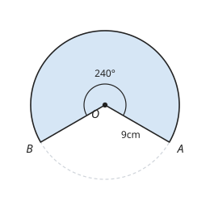

# 중1 수학 서술형 문항 (p1_sector) — 총 10점

- 성취기준: 9수03-06 / 역량: 추론, 의사소통, 문제해결 / 과제 패턴: judge_claim
- 출제 의도: 부채꼴의 호의 길이와 넓이가 중심각의 크기에 정비례한다는 관계를 이해하고, 이를 이용해 계산하고 설명하며 중심각을 구할 수 있는지 평가한다. 1-1은 반지름 $r$ cm, 중심각 $\theta$인 부채꼴의 호의 길이와 넓이를 구하는 쉬운 계산으로 성취수준 D·E·C를 겨냥한다. 1-2는 지민의 주장('반지름을 2배로 하면 호의 길이와 넓이가 모두 2배가 된다')이 옳은지 1-1의 값과 반지름을 2배로 한 부채꼴의 값을 비교하여 판단하고 과정을 서술하게 하며, 성취수준 C·D를 겨냥한다. 호의 길이는 2배, 넓이는 4배가 되므로 주장은 틀리다. 1-3은 반지름을 2배로 한 부채꼴의 호의 길이(또는 넓이)가 원래 부채꼴과 같아지려면 중심각이 얼마여야 하는지 구하고 그 이유를 논술하게 하며, 성취수준 A·B를 겨냥한다. 중심각 값은 호의 길이가 같을 때 $\frac{\theta}{2}$, 넓이가 같을 때 $\frac{\theta}{4}$가 되므로 코드가 계산 결과가 자연스럽게 떨어지는 값으로 고른다. 수행평가에서 과정 서술과 추론, 의사소통, 문제해결 역량을 함께 확인한다.

## 평가 문항

지민은 미술 시간에 원 모양의 색종이를 잘라 부채꼴 모양의 장식을 만들었다. 이 장식은 중심이 O이고 반지름의 길이가 $9$ cm, 중심각의 크기가 $240^\circ$인 부채꼴 $OAB$이다(그림 참조). 지민은 같은 모양의 장식을 더 크게 만들기 위해 반지름만 2배로 늘린 새 부채꼴을 만들려고 한다. 이때 지민은 '반지름을 2배로 하면 호의 길이와 넓이가 모두 2배가 될 것이다.'라고 생각하였다. 단, 원주율은 $\pi$로 나타낸다.

**1-1.** 부채꼴 $OAB$의 호의 길이와 넓이를 각각 구하시오. 풀이 과정을 함께 쓰시오. [2점]

**1-2.** 지민이는 "반지름을 2배로 하면 호의 길이와 넓이가 모두 2배가 될 것이다."라고 생각하였다. 지민이의 생각이 옳은지 판단하고, 〈조건〉에 맞게 그 이유를 설명하시오. [3점]

> 〈조건〉 반지름을 2배로 한 부채꼴의 호의 길이와 넓이를 구하여 1-1에서 구한 값과 비교할 것

**1-3.** 반지름만 2배로 늘린 부채꼴의 중심각의 크기를 바꾸어, ① 호의 길이가 부채꼴 $OAB$의 호의 길이와 같아지게 하려면, ② 넓이가 부채꼴 $OAB$의 넓이와 같아지게 하려면 중심각의 크기를 각각 몇 도로 해야 하는지 구하시오. 그리고 〈조건〉에 맞게 그 이유를 설명하시오. [5점]

> 〈조건〉 호의 길이가 같아지는 경우와 넓이가 같아지는 경우를 구분하여 각각 중심각의 크기를 구할 것

> 〈조건〉 호의 길이와 넓이가 중심각의 크기에 정비례한다는 관계와, 반지름이 2배가 될 때의 변화를 이용하여 설명할 것

## 채점기준표

| 문항 | 평가 요소 | 채점 요소 | 배점 | 수행 수준 |
|---|---|---|---|---|
| 1-1 | 부채꼴의 중심각의 크기와 호의 길이 사이의 관계 알기 | 중심각의 크기에 비례하는 관계를 이용하여 호의 길이와 넓이를 식과 함께 구하기 | 2 | 호의 길이와 넓이를 모두 식과 함께 정확하게 구함. |
| 1-1 | 부채꼴의 중심각의 크기와 호의 길이 사이의 관계 알기 | 중심각의 크기에 비례하는 관계를 이용하여 호의 길이와 넓이를 식과 함께 구하기 | 1 | 호의 길이와 넓이 중 하나만 정확하게 구했거나, 두 값을 구하는 식은 세웠으나 계산에 오류가 있음. |
| 1-2 | 부채꼴의 호의 길이와 넓이를 구하는 과정 설명하기 | 반지름을 2배로 한 부채꼴의 호의 길이와 넓이를 구하여 비교하고 주장 판단하기 | 3 | 반지름을 2배로 한 부채꼴의 호의 길이와 넓이를 정확하게 구해 비교하고, 호의 길이는 2배, 넓이는 4배가 되므로 지민이의 생각이 옳지 않다고 근거와 함께 판단함. |
| 1-2 | 부채꼴의 호의 길이와 넓이를 구하는 과정 설명하기 | 반지름을 2배로 한 부채꼴의 호의 길이와 넓이를 구하여 비교하고 주장 판단하기 | 2 | 지민이의 생각이 옳지 않다고 판단하고 비교했으나, 새 부채꼴의 값 계산에 일부 오류가 있거나 배수 관계의 설명이 일부 부족함. |
| 1-2 | 부채꼴의 호의 길이와 넓이를 구하는 과정 설명하기 | 반지름을 2배로 한 부채꼴의 호의 길이와 넓이를 구하여 비교하고 주장 판단하기 | 1 | 판단을 하지 못했거나, 계산이나 비교 없이 결론만 제시하여 판단의 근거가 부족함. |
| 1-3 | 부채꼴의 중심각의 크기와 호의 길이 사이의 관계 알기 | 호의 길이·넓이와 중심각의 크기 사이의 관계를 이용하여 중심각을 바꾸는 이유 설명하기 | 2 | 호의 길이와 넓이가 중심각의 크기에 정비례하고 반지름이 2배일 때 호의 길이는 2배, 넓이는 4배가 됨을 이용하여 중심각을 각각 $\frac{1}{2}$, $\frac{1}{4}$로 줄여야 하는 이유를 정확하게 설명함. |
| 1-3 | 부채꼴의 중심각의 크기와 호의 길이 사이의 관계 알기 | 호의 길이·넓이와 중심각의 크기 사이의 관계를 이용하여 중심각을 바꾸는 이유 설명하기 | 1 | 중심각의 크기와 호의 길이 또는 넓이 사이의 관계를 언급했으나 이유 설명이 부족하거나 일부 오류가 있음. |
| 1-3 | 중심각의 크기와 호의 길이, 넓이 사이의 관계를 이용하여 부채꼴의 중심각의 크기 구하기 | 호의 길이가 같은 경우와 넓이가 같은 경우의 중심각의 크기 구하기 | 3 | 호의 길이가 같은 경우 $120^\circ$, 넓이가 같은 경우 $60^\circ$를 식과 함께 정확하게 구함. |
| 1-3 | 중심각의 크기와 호의 길이, 넓이 사이의 관계를 이용하여 부채꼴의 중심각의 크기 구하기 | 호의 길이가 같은 경우와 넓이가 같은 경우의 중심각의 크기 구하기 | 2 | 두 경우 중 한 경우만 정확하게 구했거나, 두 경우 모두 식은 바르게 세웠으나 계산에 일부 오류가 있음. |
| 1-3 | 중심각의 크기와 호의 길이, 넓이 사이의 관계를 이용하여 부채꼴의 중심각의 크기 구하기 | 호의 길이가 같은 경우와 넓이가 같은 경우의 중심각의 크기 구하기 | 1 | 중심각을 구하려는 시도는 했으나 두 경우 모두 구하는 데 어려움이 있음. |

## 예시답안

- **1-1** (호의 길이와 넓이 공식 이용): 호의 길이는 $2\pi \times 9 \times \frac{240}{360} = 12\pi$ (cm), 넓이는 $\pi \times 9^2 \times \frac{240}{360} = 54\pi$ (cm$^2$)이다. 따라서 호의 길이는 $12\pi$ cm, 넓이는 $54\pi$ cm$^2$이다.
- **1-1** (중심각과 호·넓이의 비례식 이용): 반지름이 $9$ cm인 원의 둘레는 $2\pi \times 9 = 18\pi$ (cm), 넓이는 $\pi \times 9^2 = 81\pi$ (cm$^2$)이다. 호의 길이를 $l$이라 하면 $l : 18\pi = 240 : 360$이므로 $l = 12\pi$ (cm)이다. 넓이를 $S$라 하면 $S : 81\pi = 240 : 360$이므로 $S = 54\pi$ (cm$^2$)이다.
- **1-2** (호의 길이와 넓이 공식 이용): 반지름을 2배로 하면 $18$ cm이다. 새 부채꼴의 호의 길이는 $2\pi \times 18 \times \frac{240}{360} = 24\pi$ (cm), 넓이는 $\pi \times 18^2 \times \frac{240}{360} = 216\pi$ (cm$^2$)이다. 호의 길이는 $12\pi$의 2배인 $24\pi$로 2배가 되지만, 넓이는 $54\pi$의 2배인 $108\pi$가 아니라 $216\pi$로 $4$배가 된다. 따라서 호의 길이는 2배가 되지만 넓이는 4배가 되므로 지민이의 생각은 옳지 않다.
- **1-2** (중심각과 호·넓이의 비례식 이용): 중심각이 $240^\circ$로 같으므로 두 부채꼴은 각각의 원의 $\frac{240}{360} = \frac{2}{3}$이다. 반지름이 $9$ cm인 원의 둘레는 $18\pi$ cm, 넓이는 $81\pi$ cm$^2$이므로 부채꼴 $OAB$의 호의 길이는 $12\pi$ cm, 넓이는 $54\pi$ cm$^2$이다. 반지름이 $18$ cm인 원의 둘레는 $36\pi$ cm, 넓이는 $324\pi$ cm$^2$이므로 새 부채꼴의 호의 길이는 $24\pi$ cm, 넓이는 $216\pi$ cm$^2$이다. $24\pi$는 $12\pi$의 2배이고 $216\pi$는 $54\pi$의 4배이므로 지민이의 생각은 옳지 않다.
- **1-3** (호의 길이와 넓이 공식 이용): 반지름이 $18$ cm이고 중심각이 $x^\circ$인 부채꼴을 생각한다. ① 호의 길이가 $12\pi$ cm가 되려면 $2\pi \times 18 \times \frac{x}{360} = 12\pi$이므로 $x = 120$이다. ② 넓이가 $54\pi$ cm$^2$가 되려면 $\pi \times 18^2 \times \frac{x}{360} = 54\pi$이므로 $x = 60$이다. 호의 길이와 넓이는 중심각의 크기에 정비례하는데, 반지름이 2배가 되면 같은 중심각일 때 호의 길이는 2배, 넓이는 4배가 된다. 따라서 호의 길이를 같게 하려면 중심각을 $\frac{1}{2}$로 줄여 $240^\circ \times \frac{1}{2} = 120^\circ$, 넓이를 같게 하려면 중심각을 $\frac{1}{4}$로 줄여 $240^\circ \times \frac{1}{4} = 60^\circ$로 해야 한다. 답: ① $120^\circ$, ② $60^\circ$
- **1-3** (중심각과 호·넓이의 비례식 이용): 부채꼴의 호의 길이와 넓이는 중심각의 크기에 정비례한다. ① 반지름이 $18$ cm인 원의 둘레는 $36\pi$ cm이므로 호의 길이가 $12\pi$ cm이려면 $12\pi : 36\pi = x : 360$에서 $x = 120$이다. 이는 반지름이 2배가 되어 같은 중심각일 때 호의 길이가 2배가 되므로, 중심각을 $240^\circ$의 $\frac{1}{2}$로 줄인 것과 같다. ② 반지름이 $18$ cm인 원의 넓이는 $324\pi$ cm$^2$이므로 넓이가 $54\pi$ cm$^2$이려면 $54\pi : 324\pi = x : 360$에서 $x = 60$이다. 이는 반지름이 2배가 되어 같은 중심각일 때 넓이가 4배가 되므로, 중심각을 $240^\circ$의 $\frac{1}{4}$로 줄인 것과 같다. 답: ① $120^\circ$, ② $60^\circ$

## 채점 시 유의점
- 수와 식으로 표현한 문제해결 과정이 수학적으로 논리적이면 예시답안과 달라도 정답으로 인정한다.
- 성취기준이 값을 구하는 것이므로 단위 표기는 평가하지 않는다.
- 1-1의 값이 틀렸더라도 그 값을 바탕으로 1-2, 1-3의 계산과 판단이 논리적이면 해당 수준 점수를 부여한다.
- 표현 방식이 달라도 이유가 충분히 설명되었으면 정답으로 인정한다.

- 단위: 평가하지 않음

## 교사 확인 사항
- (T1, 1-1, 1-2, 1-3) π를 3.14 등 근삿값으로 계산한 답을 인정할지 사전에 협의한다.
- (T2, 1-2, 1-3) 1-2와 1-3에서 계산 실수와 '호의 길이는 2배, 넓이는 4배가 된다'는 관계에 대한 개념 이해 오류를 구분해 채점한다.
- (T3, 1-3) 1-3에서 호의 길이가 같아지는 경우($120^\circ$)와 넓이가 같아지는 경우($60^\circ$)를 구분해 답했는지 확인한다.

## 피드백 시 유의점
- 호의 길이와 넓이가 중심각에 정비례하는 이유를 원 전체의 둘레, 넓이와의 비율로 다시 설명해 보게 한다.
- 반지름이 2배가 될 때 호의 길이는 2배, 넓이는 4배가 되는 까닭을 표로 정리해 비교해 보게 한다.
- 1-3에서 호의 길이를 같게 하는 경우와 넓이를 같게 하는 경우의 중심각이 왜 다른지 반지름의 변화와 연결해 말해 보게 한다.

## 검증 결과
- 오류 0개, 경고 2개
  - 경고: W3 1-1: 평가 요소 '부채꼴의 중심각의 크기와 호의 길이 사이의 관계 알기'는 '~하기' 형태가 아니다
  - 경고: W3 1-3: 평가 요소 '부채꼴의 중심각의 크기와 호의 길이 사이의 관계 알기'는 '~하기' 형태가 아니다

## AI 점검 의견 (수정 권고)
- [보통] 1-2 채점기준: 수준 1은 '판단을 하지 못했거나 근거 없이 결론만 제시'만 다룬다. 계산은 했지만 '지민이의 생각이 옳다'고 잘못 판단한 경우, 백지 답안, 0점 기준이 어느 수준에 해당하는지 정해지지 않았다. 수준 2와 3의 차이도 '배수 관계의 설명이 일부 부족'처럼 모호해서 채점자마다 다르게 판정할 수 있다. -> 0점 수준과 '판단이 틀린 경우'의 배치를 명시한다. 수준 3은 '호의 길이는 2배, 넓이는 4배라는 배수 관계를 두 값의 비교로 명시함', 수준 2는 '두 값을 구했으나 배수 관계를 한쪽만 서술했거나 한 값에 계산 오류가 있음'처럼 관찰 가능한 서술로 바꾼다.
- [보통] 1-3 채점기준과 scoringNotes: scoringNotes는 1-1이 틀려도 그 값을 바탕으로 한 1-2, 1-3의 논리가 맞으면 점수를 준다고 한다. 그런데 1-3의 수준 3 서술은 '$120^\circ$, $60^\circ$'를 정답으로 고정하고, 1-2의 수준 3도 새 부채꼴의 값을 정확히 구할 것을 요구한다. 이 둘이 서로 어긋난다. 또 1-3의 두 번째 채점요소는 수준 1이 '두 경우 모두 구하는 데 어려움'이라 시도만 한 답안과 백지의 경계가 불분명하다. -> 수준 서술을 '정답 값'이 아니라 '식을 바르게 세워 일관되게 구함'을 기준으로 쓴다. 정답 값은 예시답안에만 둔다. 0점 수준도 추가한다.
- [보통] 1-3 채점기준(첫 번째 채점요소): 수준 1의 '이유 설명이 부족하거나 일부 오류가 있음'이 너무 넓다. 호의 길이의 이유는 맞고 넓이의 이유는 틀린 경우와 두 경우 모두 부족한 경우가 구별되지 않는다. 방정식만 풀고 이유 설명이 없는 M1 풀이는 0점인지 1점인지 알 수 없다. 평가요소 문구도 '호의 길이 사이의 관계'만 쓰고 넓이를 빠뜨렸다. -> '호의 길이 또는 넓이 중 한 쪽만 반지름 변화와 연결해 설명함'과 '식 풀이만 있고 이유 설명이 없음'을 수준 서술에 구분해 넣는다. 평가요소 문구에 넓이도 포함한다.
- [경미] 제시문과 1-3 발문: 제시문의 '같은 모양의 장식을 더 크게 만들기 위해 반지름만 2배로 늘린'과 1-3의 '반지름만 2배로 늘린 부채꼴의 중심각을 바꾸어'가 어긋난다. 1-3에서는 중심각이 달라지므로 같은 모양이 아니다. 학생이 '반지름만 바꾼다'는 조건이 1-3에서도 유지되는지 혼동할 수 있다. -> 제시문에서 '같은 모양' 표현을 빼고 '반지름을 2배로 늘린 새 부채꼴'로 쓴다. 1-3 발문은 '반지름은 18 cm로 두고 중심각의 크기만 바꾸어'처럼 무엇을 바꾸는지 분명히 쓴다.
- [경미] teacherChecks T1: 제시문에 '원주율은 $\pi$로 나타낸다'고 명시되어 있어 근삿값 답안을 인정할지 협의할 필요가 거의 없다. 지시문과 교사 확인 항목이 중복된다. -> T1을 삭제하거나 '$\pi$를 생략하거나 근삿값으로 계산한 답안은 지시 불이행으로 볼지'처럼 실제로 판단이 갈리는 내용으로 바꾼다.
- [경미] 1-2 발문: 지민이의 생각이 제시문과 1-2 발문에 똑같이 반복되어 있다. 1-3의 두 조건(①, ②)은 한 문장에 몰려 있어 읽기 부담이 있다. -> 1-2 발문은 '지민이의 생각이 옳은지 판단하고'로 줄인다. 1-3은 ①, ②를 줄을 나누어 제시한다.

---
사용량: 호출 5회, 입력 26361 토큰, 출력 20134 토큰, 추정 비용 약 $0.381 (단가는 추정)