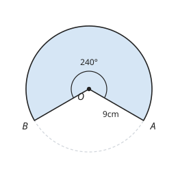

# 중1 수학 서술형 문항 (t1_sector) — 총 10점

- 성취기준: 9수03-06 / 역량: 추론, 문제해결, 의사소통 / 과제 패턴: judge_claim
- 출제 의도: 1-1은 반지름과 중심각이 주어진 부채꼴의 호의 길이와 넓이를 공식에 맞게 구하는 기본 계산 능력을 평가하며, D·E 수준을 겨냥한다. 1-2는 한 원에서 중심각의 크기와 호의 길이가 비례한다는 관계를 이용해 호의 길이와 넓이가 정해지는 과정을 자신의 말로 설명하는 능력을 평가하며, C·D 수준을 겨냥한다. 1-3은 반지름을 바꾸었을 때 호의 길이와 넓이가 어떻게 달라지는지에 대한 친구의 주장을 앞 문항의 계산 결과를 근거로 판단하고, 그 이유를 논리적으로 서술하는 추론·의사소통 능력을 평가하며, A·B 수준을 겨냥한다.
- 사용 숫자: {'r': 9, 'theta': 240} (수치 명세 sector_arc_area_v1, 템플릿 방식 — 숫자만 바꾸기 가능)

## 평가 문항

지민이는 미술 시간에 반지름이 9 cm인 원형 도화지에서 중심각의 크기가 240°인 부채꼴 모양 조각을 오려 내어 장식 카드를 만들고 있다. 이 부채꼴의 중심을 O, 두 반지름의 끝점을 각각 A, B라 하고, 곡선 부분인 호 AB를 따라 색 테이프를 붙이려 한다. 또 부채꼴 안쪽 전체에는 색종이를 붙일 계획이다. 지민이는 같은 중심각으로 반지름만 다르게 한 부채꼴도 만들어 보려 한다. 그림은 지민이가 오려 낸 부채꼴이다.

**1-1.** 지민이가 오려 낸 반지름이 9 cm, 중심각의 크기가 240°인 부채꼴 OAB의 호 AB의 길이와 넓이를 각각 구하시오. 풀이 과정을 함께 쓰시오. [2점]

**1-2.** 1-1에서 호 AB의 길이와 부채꼴 OAB의 넓이를 구할 때 이용한 원리를 〈조건〉에 맞게 설명하시오. [3점]

> 〈조건〉 한 원에서 부채꼴의 중심각의 크기와 호의 길이 사이의 관계를 포함할 것

> 〈조건〉 원 전체의 둘레와 넓이에 비교하여 이 부채꼴의 호의 길이와 넓이가 정해지는 과정을 쓸 것

**1-3.** 지민이는 중심각의 크기는 240°로 그대로 두고 반지름만 2배인 18 cm로 한 부채꼴을 만들면서 "반지름을 2배로 하면 호의 길이와 넓이도 모두 2배가 된다."라고 말했다. 지민이의 말이 옳은지 판단하고, 〈조건〉에 맞게 그 이유를 설명하시오. [5점]

> 〈조건〉 반지름이 18 cm인 부채꼴의 호의 길이와 넓이를 구하여 1-1의 결과와 비교할 것

> 〈조건〉 호의 길이와 넓이가 각각 몇 배가 되는지 밝히고, 그 이유를 식의 구조와 관련지어 설명할 것

## 채점기준표

| 문항 | 평가 요소 | 채점 요소 | 배점 | 수행 수준 |
|---|---|---|---|---|
| 1-1 | 반지름과 중심각이 주어진 부채꼴의 호의 길이와 넓이 구하기 | 호의 길이와 넓이를 식과 함께 구하기 | 2 | 중심각에 비례하는 관계를 이용해 호의 길이와 넓이를 모두 식과 함께 정확하게 구함. |
| 1-1 | 반지름과 중심각이 주어진 부채꼴의 호의 길이와 넓이 구하기 | 호의 길이와 넓이를 식과 함께 구하기 | 1 | 호의 길이와 넓이 중 하나만 구했거나, 식은 세웠으나 계산에 오류가 있음. |
| 1-2 | 중심각의 크기와 호의 길이 사이의 관계를 이용하여 호의 길이와 넓이가 정해지는 과정 설명하기 | 중심각에 비례하는 관계와 호의 길이·넓이를 구하는 과정 설명하기 | 3 | 한 원에서 호의 길이와 넓이가 중심각의 크기에 정비례함을 원 전체와의 비율로 연결하여 호의 길이와 넓이를 구하는 과정을 정확하게 설명함. |
| 1-2 | 중심각의 크기와 호의 길이 사이의 관계를 이용하여 호의 길이와 넓이가 정해지는 과정 설명하기 | 중심각에 비례하는 관계와 호의 길이·넓이를 구하는 과정 설명하기 | 2 | 중심각에 비례한다는 관계는 설명했으나 원 전체와의 비율을 이용해 호의 길이와 넓이를 구하는 과정의 설명에 일부 오류나 부족함이 있음. |
| 1-2 | 중심각의 크기와 호의 길이 사이의 관계를 이용하여 호의 길이와 넓이가 정해지는 과정 설명하기 | 중심각에 비례하는 관계와 호의 길이·넓이를 구하는 과정 설명하기 | 1 | 중심각과 호의 길이 사이의 관계를 부분적으로만 언급하거나 구하는 과정의 설명에 어려움이 있음. |
| 1-3 | 반지름이 다른 부채꼴의 호의 길이와 넓이 구하기 | 반지름을 바꾼 부채꼴의 호의 길이와 넓이 구하기 | 2 | 반지름을 바꾼 부채꼴의 호의 길이와 넓이를 식과 함께 모두 정확하게 구함. |
| 1-3 | 반지름이 다른 부채꼴의 호의 길이와 넓이 구하기 | 반지름을 바꾼 부채꼴의 호의 길이와 넓이 구하기 | 1 | 호의 길이와 넓이 중 하나만 구했거나, 식은 세웠으나 계산에 오류가 있음. |
| 1-3 | 지민이의 주장이 옳은지 판단하고 이유 설명하기 | 주장 판단과 근거 설명하기 | 3 | 1-1의 결과와 비교하여 지민이의 말이 옳지 않음을 판단하고, 호의 길이는 반지름에 비례하고 넓이는 반지름의 제곱에 비례하기 때문임을 수학적으로 설명함. |
| 1-3 | 지민이의 주장이 옳은지 판단하고 이유 설명하기 | 주장 판단과 근거 설명하기 | 2 | 지민이의 말이 옳지 않음을 판단하고 호의 길이와 넓이의 변화를 비교했으나 그렇게 되는 이유의 설명이 일부 부족함. |
| 1-3 | 지민이의 주장이 옳은지 판단하고 이유 설명하기 | 주장 판단과 근거 설명하기 | 1 | 지민이의 말이 옳지 않다고만 판단하거나 근거와 판단이 어긋나는 등 판단과 설명에 어려움이 있음. |

## 예시답안

- **1-1** (공식 이용(호의 길이 $l=2\pi r\times\frac{x}{360}$, 넓이 $S=\pi r^2\times\frac{x}{360}$)): 호의 길이는 $2\pi\times9\times\frac{ 240 }{360}=12 \pi$ (cm)이다. 넓이는 $\pi\times9^2\times\frac{ 240 }{360}=54 \pi$ (cm²)이다. 따라서 호의 길이는 $12 \pi$ cm, 넓이는 $54 \pi$ cm²이다.
- **1-1** (비례식 이용(중심각 : 360° = 부채꼴 : 원)): 호의 길이를 $l$이라 하면 $l:(2\pi\times9)=240:360$이므로 $l=2\pi\times9\times\frac{ 240 }{360}=12 \pi$ (cm)이다. 넓이를 $S$라 하면 $S:(\pi\times9^2)=240:360$이므로 $S=\pi\times9^2\times\frac{ 240 }{360}=54 \pi$ (cm²)이다.
- **1-2** (공식 이용(호의 길이 $l=2\pi r\times\frac{x}{360}$, 넓이 $S=\pi r^2\times\frac{x}{360}$)): 한 원에서 부채꼴의 호의 길이와 넓이는 중심각의 크기에 정비례한다. 중심각이 360°이면 호는 원 전체의 둘레, 부채꼴은 원 전체가 된다. 이 부채꼴의 중심각 240°는 360°의 $\frac{ 240 }{360}=\frac{2}{3}$배이므로, 호의 길이는 원의 둘레 $2\pi\times9$의 $\frac{2}{3}$배인 $12 \pi$ cm이고, 넓이는 원의 넓이 $\pi\times9^2$의 $\frac{2}{3}$배인 $54 \pi$ cm²이다.
- **1-2** (비례식 이용(중심각 : 360° = 부채꼴 : 원)): 한 원에서 중심각의 크기가 정해지면 호의 길이와 넓이도 같은 비율로 정해지므로 중심각 : 360° = 호의 길이 : 원의 둘레 = 부채꼴의 넓이 : 원의 넓이이다. 따라서 호의 길이는 $l:(2\pi\times9)=240:360$에서 $l=12 \pi$ cm이고, 넓이는 $S:(\pi\times9^2)=240:360$에서 $S=54 \pi$ cm²이다.
- **1-3** (공식 이용(호의 길이 $l=2\pi r\times\frac{x}{360}$, 넓이 $S=\pi r^2\times\frac{x}{360}$)): 반지름이 18 cm이고 중심각이 240°인 부채꼴의 호의 길이는 $2\pi\times18\times\frac{ 240 }{360}=24 \pi$ cm이고, 넓이는 $\pi\times18^2\times\frac{ 240 }{360}=216 \pi$ cm²이다. 1-1의 결과와 비교하면 호의 길이는 $12 \pi$ cm에서 $24 \pi$ cm로 2배가 되지만, 넓이는 $54 \pi$ cm²에서 $216 \pi$ cm²로 4배가 된다. 따라서 넓이가 2배가 되지 않으므로 지민이의 말은 옳지 않다. 호의 길이 공식에는 반지름이 한 번 곱해지고 넓이 공식에는 반지름이 두 번 곱해지므로, 반지름이 2배가 되면 호의 길이는 2배, 넓이는 $2\times2=4$배가 된다.
- **1-3** (비례식 이용(중심각 : 360° = 부채꼴 : 원)): 원래 반지름을 $r$, 중심각을 $x$°라 하고 반지름을 $2r$로 바꾸면, 호의 길이는 $2\pi\times(2r)\times\frac{x}{360}=2\times\left(2\pi r\times\frac{x}{360}\right)$이므로 2배가 된다. 넓이는 $\pi\times(2r)^2\times\frac{x}{360}=4\times\left(\pi r^2\times\frac{x}{360}\right)$이므로 4배가 된다. 이 문제의 수로 확인하면 호의 길이는 $12 \pi$ cm에서 $24 \pi$ cm로, 넓이는 $54 \pi$ cm²에서 $216 \pi$ cm²로 변한다. 따라서 호의 길이만 2배가 되고 넓이는 4배가 되므로 지민이의 말은 옳지 않다.

## 채점 시 유의점
- 수와 식으로 표현한 문제해결 과정이 수학적으로 논리적이면 예시답안과 달라도 정답으로 인정한다.
- 성취기준이 호의 길이와 넓이를 구하고 그 관계를 설명하는 것이므로 단위 표기는 평가하지 않는다.
- 1-1의 값이 틀렸더라도 그 값을 바탕으로 1-2의 설명과 1-3의 비교·판단이 논리적이면 해당 수준의 점수를 부여한다.
- 표현 방식이 달라도 이유가 충분히 설명되었으면 정답으로 인정한다.

- 단위: 평가하지 않음

## 교사 확인 사항
- (T1, 1-1, 1-3) π를 3.14 등 근삿값으로 계산한 답을 인정할지 사전에 협의한다.
- (T2, 1-1, 1-3) 공식에 대입하는 과정의 계산 실수와, 호의 길이와 넓이가 반지름에 따라 달라지는 방식에 대한 개념 이해 오류를 구분하여 채점한다.

## 피드백 시 유의점
- 호의 길이와 넓이가 중심각에 정비례하는 이유를 원 전체의 둘레와 넓이에 대한 비율로 다시 설명해 보게 한다.
- 반지름이 2배가 될 때 호의 길이와 넓이가 각각 몇 배가 되는지 표로 정리하여, 반지름이 한 번 곱해지는지 두 번 곱해지는지와 연결해 보게 한다.
- 호의 길이만 확인하고 넓이를 확인하지 않은 채 주장을 판단한 경우, 두 값을 각각 비교해야 함을 안내한다.

## 검증 결과
- 오류 0개, 경고 0개

## AI 점검 의견 (수정 권고)
- [보통] 1-3 채점기준(주장 판단과 근거 설명하기, 3점 수준): '넓이는 반지름의 제곱에 비례한다'는 서술을 만점 요건으로 요구하는데, 제곱에 비례하는 관계는 중1 정비례 범위를 넘는다. 성취기준(9수03-06)이 다루는 관계는 중심각과 호의 길이·넓이 사이의 관계이다. -> 만점 요건을 '호의 길이 식에는 반지름이 한 번, 넓이 식에는 두 번 곱해지므로 각각 2배, 4배가 된다'처럼 식의 구조로 서술하게 바꾼다. 예시답안은 이미 이 방식이므로 채점기준만 맞추면 된다.
- [보통] 제시문 및 1-1: 중심각이 240°여서 점 A, B 사이에는 두 호가 있는데, 중1에서 '호 AB'는 보통 짧은 쪽 호(120°)를 가리킨다. 학생이 호 AB를 120°짜리 호로 읽을 여지가 있어 호의 길이가 둘로 나올 수 있다. -> 제시문이나 1-1에 '부채꼴 OAB의 곡선 부분 전체(중심각 240°에 해당하는 호)'라고 명시한다. 또는 그림에 호가 어느 쪽인지 표시한다.
- [보통] 1-1 채점기준(2점 수준): 발문은 풀이 과정만 요구하는데 2점 수준은 '중심각에 비례하는 관계를 이용해'라고 방법을 요구한다. 방법이 1-2의 평가 요소와 겹치고, 공식에 바로 대입한 학생에게 불리할 수 있다. -> 2점 수준을 '호의 길이와 넓이를 모두 식과 함께 정확하게 구함'으로 줄인다. 중심각과의 관계 설명은 1-2에서만 평가한다.
- [보통] 1-2 채점기준(3점·2점·1점 수준): 2점의 '일부 오류나 부족함'과 1점의 '어려움이 있음'이 모호해 서로 구별되지 않는다. 호의 길이만 설명한 경우와 넓이만 설명한 경우를 어느 수준에 둘지도 알 수 없다. -> 수준을 조건별로 나눈다. 예를 들어 2점은 '호의 길이 또는 넓이 중 한쪽만 원 전체와의 비율로 설명함', 1점은 '중심각과의 비례 관계만 언급하고 원 전체와의 비교는 없음'으로 쓴다.
- [경미] 1-3 채점기준 구조: '1-1과 비교하여 옳지 않음을 판단'이 첫 번째 요소(C1)와 두 번째 요소의 3점 수준에 모두 들어 있어 평가 내용이 겹친다. 1점 수준도 '판단만 함'과 '근거와 판단이 어긋남'이라는 서로 다른 경우를 한 문장에 묶고 있다. -> 첫 번째 요소는 계산, 두 번째 요소는 판단과 이유 설명으로 역할을 나눈다. 1점 수준의 두 경우는 문장을 나누어 쓴다.
- [경미] 제시문: 반지름 9 cm인 원형 도화지에서 오려 낸다고 했는데, 1-3은 반지름 18 cm인 부채꼴을 만든다고 해서 같은 도화지로는 만들 수 없다. 상황의 개연성이 떨어진다. -> '반지름이 9 cm인 부채꼴 모양 조각을 만든다'로 고치고 도화지 크기 언급은 뺀다. 또는 1-3에서 '더 큰 도화지로 반지름이 18 cm인 부채꼴을 만든다'고 쓴다.

---
사용량: 호출 6회, 입력 40467 토큰, 출력 26193 토큰, 추정 비용 약 $0.514 (단가는 추정)