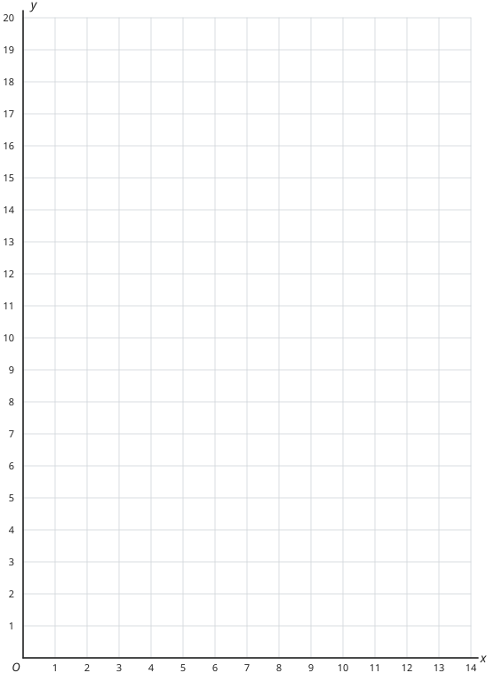

# 중1 수학 서술형 문항 (t4_0207_cheonjae_kim_dongjae) — 총 10점

- 성취기준: 9수02-07 / 역량: 추론, 의사소통, 연결 / 과제 패턴: multi_representation
- 출제 의도: 1-1은 D·E 수준에서 표를 완성하며 한 양이 2배, 3배가 될 때 다른 양의 변화를 파악하는 능력을 본다. 1-2는 C·D 수준에서 일정한 속력 상황을 식으로 나타내는 과정을 말과 식으로 설명하는 능력을 본다. 1-3은 C·D 수준에서 일정한 거리에서의 속력과 시간 관계를 표로 정리하고 좌표평면에 그래프로 나타내는 능력을 본다. 1-4는 A·B 수준에서 두 관계의 표, 식, 그래프의 특징을 비교하여 판단하고 그 이유를 수학적 용어로 논리적으로 설명하는 추론·의사소통 능력을 본다.
- 사용 숫자: {'v': 7, 'k': 2, 'j': 3} (수치 명세 m1_9s02-07_multi_representation_v1, 템플릿 방식 — 숫자만 바꾸기 가능)

## 평가 문항

하윤이는 노약자의 이동을 돕는 자율 주행 버스의 운행 계획을 세우는 일을 맡고 있다. 이 버스는 보호 구역에서 일정한 속력 시속 7 km로 달리도록 설정되어 있다. 하윤이는 출발한 뒤 지난 시간에 따른 이동 거리를 표 T1에 정리하려고 한다. 또 이 버스가 마을 회관에서 보건소까지 36 km를 이동할 때 속력을 시속 2 km, 4 km, 6 km, 12 km로 바꾸어 설정하면 걸리는 시간이 달라지는 것을 알았다. 이때의 속력과 걸린 시간은 표 T2에 정리하고, 그림 F1의 좌표평면을 이용하려고 한다.

**일정한 속력으로 달리는 버스의 시간과 이동 거리**

| 시간(시간) | 1 | 2 | 3 | 4 | 5 |
|---|---|---|---|---|---|
| 이동 거리(km) | 7 |  |  |  |  |

**36 km를 이동할 때 속력과 걸린 시간**

| 속력(km/h) | 2 | 4 | 6 | 12 |
|---|---|---|---|---|
| 걸린 시간(시간) |  |  |  |  |

**1-1.** 표 T1의 빈칸에 알맞은 이동 거리를 써넣어 표를 완성하시오. [2점]

**1-2.** 시간을 $x$시간, 이동 거리를 $y$ km라 할 때, 1-1의 표를 이용하여 $x$와 $y$ 사이의 관계식을 세우는 과정을 〈조건〉에 맞게 설명하시오. [3점]

> 〈조건〉 1-1의 표에서 시간이 늘어날 때 이동 거리가 어떻게 변하는지 말로 쓸 것

> 〈조건〉 세운 식에 나타난 수가 무엇을 뜻하는지 문장으로 쓸 것

**1-3.** 표 T2의 빈칸을 채워 표를 완성하고, 표의 순서쌍을 〈조건〉에 맞게 그림 F1의 좌표평면에 나타내어 그래프를 그리시오. [2점]

> 〈조건〉 표 T2의 순서쌍(속력, 걸린 시간)을 모두 그림 F1의 좌표평면에 점으로 찍을 것

**1-4.** 시간과 이동 거리 사이의 관계 (가)와 속력과 걸린 시간 사이의 관계 (나)가 각각 정비례 관계인지 반비례 관계인지 1-1의 표, 1-2의 식, 1-3의 그래프를 바탕으로 판단하고, 그 근거를 〈조건〉에 맞게 설명하시오. [3점]

> 〈조건〉 표에서 한 양이 2배, 3배가 될 때 다른 양이 어떻게 변하는지 (가), (나) 각각에 대하여 쓸 것

> 〈조건〉 (가), (나) 각각에 대하여 $x$와 $y$ 사이의 관계식을 쓸 것 (단, (나)는 속력을 $x$, 걸린 시간을 $y$로 한다.)

> 〈조건〉 (가), (나)의 그래프가 각각 어떤 모양인지 쓸 것

## 채점기준표

| 문항 | 평가 요소 | 채점 요소 | 배점 | 수행 수준 |
|---|---|---|---|---|
| 1-1 | 표에서 한 양이 2배, 3배가 될 때 다른 양의 변화 파악하기 | 표 T1의 빈칸을 정확한 값으로 채우기 | 2 | 표 T1의 빈칸 네 칸의 이동 거리를 모두 정확하게 구함. |
| 1-1 | 표에서 한 양이 2배, 3배가 될 때 다른 양의 변화 파악하기 | 표 T1의 빈칸을 정확한 값으로 채우기 | 1 | 표 T1의 빈칸 네 칸 중 일부만 정확하게 구함. |
| 1-2 | 실생활 상황에서 두 양 사이의 관계를 식으로 나타내는 과정 설명하기 | 관계식을 세우고 표의 규칙과 식에 나타난 수의 뜻으로 그 과정 설명하기 | 3 | 관계식을 바르게 세우고, 표의 변화 규칙(조건 C1)과 식에 나타난 수의 뜻(조건 C2)을 모두 옳게 설명함. |
| 1-2 | 실생활 상황에서 두 양 사이의 관계를 식으로 나타내는 과정 설명하기 | 관계식을 세우고 표의 규칙과 식에 나타난 수의 뜻으로 그 과정 설명하기 | 2 | 관계식을 바르게 세웠으나 조건 C1과 C2 중 한 가지만 옳게 설명함. |
| 1-2 | 실생활 상황에서 두 양 사이의 관계를 식으로 나타내는 과정 설명하기 | 관계식을 세우고 표의 규칙과 식에 나타난 수의 뜻으로 그 과정 설명하기 | 1 | 관계식은 바르게 세웠으나 조건 C1과 C2를 모두 설명하지 못함. 표의 값을 이용해 식을 세우려 했으나 식에 오류가 있음. |
| 1-3 | 정비례 또는 반비례 관계를 좌표평면 위에 그래프로 나타내기 | 표 T2를 완성하고 순서쌍을 점으로 찍어 그래프 그리기 | 2 | 표 T2의 빈칸 네 칸을 모두 정확하게 구하고, 네 순서쌍을 모두 정확한 위치에 점으로 찍어 점들의 배열에 맞게 이어 그래프를 그림. |
| 1-3 | 정비례 또는 반비례 관계를 좌표평면 위에 그래프로 나타내기 | 표 T2를 완성하고 순서쌍을 점으로 찍어 그래프 그리기 | 1 | 표 T2의 빈칸을 일부만 구했거나, 점을 일부만 찍었거나, 점은 모두 찍었으나 이어서 그래프로 나타내지 않음. |
| 1-4 | 두 관계를 표, 식, 그래프의 특징으로 비교하여 판단하고 설명하기 | 두 관계의 종류를 판단하고 표의 변화, 관계식, 그래프 모양을 근거로 설명하기 | 3 | (가), (나)를 모두 옳게 판단하고, 조건 C1~C3의 근거(표의 변화, 관계식, 그래프 모양)를 두 관계 모두에 대해 옳게 설명함. |
| 1-4 | 두 관계를 표, 식, 그래프의 특징으로 비교하여 판단하고 설명하기 | 두 관계의 종류를 판단하고 표의 변화, 관계식, 그래프 모양을 근거로 설명하기 | 2 | (가), (나)를 모두 옳게 판단하고, 조건 C1~C3 중 두 가지 이상의 근거를 옳게 설명함. |
| 1-4 | 두 관계를 표, 식, 그래프의 특징으로 비교하여 판단하고 설명하기 | 두 관계의 종류를 판단하고 표의 변화, 관계식, 그래프 모양을 근거로 설명하기 | 1 | (가), (나)를 모두 옳게 판단했으나 조건 C1~C3 중 한 가지 이하의 근거만 설명함. (가), (나) 중 한 관계만 옳게 판단함. |

## 예시답안

- **1-1** (표에서 변화 규칙(배수 관계, 비율 또는 곱이 일정함) 이용): 시간이 1시간일 때 이동 거리는 7 km이다. 시간이 2배, 3배, 4배, 5배가 되면 이동 거리도 2배, 3배, 4배, 5배가 되므로 2시간: $7\times 2=14$, 3시간: $7\times 3=21$, 4시간: $7\times 4=28$, 5시간: $7\times 5=35$이다. 따라서 빈칸에는 차례로 14, 21, 28, 35를 써넣는다.
- **1-1** (공식(거리=속력×시간) 이용): 거리=속력×시간이고 속력이 시속 7 km이므로 2시간: $7\times 2=14$, 3시간: $7\times 3=21$, 4시간: $7\times 4=28$, 5시간: $7\times 5=35$이다. 따라서 빈칸에는 차례로 14, 21, 28, 35를 써넣는다.
- **1-2** (표에서 변화 규칙(배수 관계, 비율 또는 곱이 일정함) 이용): 표에서 시간이 1시간씩 늘어날 때마다 이동 거리는 7 km씩 늘어나고, 시간이 2배, 3배, 4배, 5배가 되면 이동 거리도 7의 2배인 14, 3배인 21, 4배인 28, 5배인 35가 된다. 또 $y\div x$의 값이 항상 일정하다. 예를 들어 $14\div 2=7$, $35\div 5=7$이다. 따라서 $y$는 $x$에 정비례하고 관계식은 $y=7x$이다. 식에서 곱해지는 수 7은 1시간 동안 이동하는 거리, 즉 버스의 속력(시속 7 km)을 뜻한다.
- **1-2** (공식(거리=속력×시간) 이용): 버스는 일정한 속력으로 달리므로 (이동 거리)=(속력)×(시간)이다. 속력이 시속 7 km이므로 1시간에 7 km를 이동한다. 시간이 $x$시간일 때 이동 거리는 $y=7\times x$, 즉 $y=7x$이다. 표에서 확인하면 $x=4$일 때 $y=7\times 4=28$로 표의 값과 같다. 식에서 곱해지는 수 7은 1시간 동안 이동하는 거리, 즉 속력을 뜻한다.
- **1-3** (표에서 변화 규칙(배수 관계, 비율 또는 곱이 일정함) 이용): 속력이 시속 2 km일 때 걸린 시간은 $36\div 2=18$(시간)이다. 속력이 2의 2배인 4이면 걸린 시간은 $\frac{1}{2}$배가 되어 $18\div 2=9$, 속력이 3배인 6이면 $\frac{1}{3}$배가 되어 $18\div 3=6$, 속력이 6배인 12이면 $\frac{1}{6}$배가 되어 $18\div 6=3$이다. 표 T2의 빈칸에는 차례로 18, 9, 6, 3을 써넣는다. 순서쌍 $(2, 18)$, $(4, 9)$, $(6, 6)$, $(12, 3)$를 좌표평면에 점으로 찍고 점들을 매끄러운 곡선으로 잇는다. 그래프는 오른쪽으로 갈수록 아래로 내려가는 곡선이다.
- **1-3** (공식(거리=속력×시간) 이용): (걸린 시간)=(거리)÷(속력)이므로 $36\div 2=18$, $36\div 4=9$, $36\div 6=6$, $36\div 12=3$이다. 표 T2의 빈칸에는 차례로 18, 9, 6, 3을 써넣는다. 그림 F1에서 가로축은 속력, 세로축은 걸린 시간이므로 점 $(2, 18)$, $(4, 9)$, $(6, 6)$, $(12, 3)$를 찍고 점들을 매끄러운 곡선으로 잇는다. 그래프는 속력이 커질수록 걸린 시간이 줄어드는 모양이다.
- **1-4** (표에서 변화 규칙(배수 관계, 비율 또는 곱이 일정함) 이용): (가) 표에서 시간이 2배, 3배가 되면 이동 거리가 7에서 14, 21로 2배, 3배가 된다. 이때 $y\div x$의 값이 7로 일정하여 식은 $y=7x$이고, 그래프는 원점을 지나는 직선이다. 따라서 (가)는 정비례 관계이다. (나) 속력이 2에서 4로 2배, 6으로 3배가 되면 걸린 시간은 18에서 9, 6으로 $\frac{1}{2}$배, $\frac{1}{3}$배가 된다. 이때 속력과 걸린 시간의 곱이 항상 36으로 일정하므로 $xy=36$, 즉 $y=\frac{ 36 }{x}$이고, 그래프는 원점을 지나지 않고 좌표축에 가까워지면서 오른쪽 아래로 뻗는 매끄러운 곡선이다. 따라서 (나)는 반비례 관계이다. 두 관계의 차이는 한 양이 커질 때 다른 양이 같은 배로 커지는가(정비례) 그 역수만큼의 배가 되는가(반비례)이다.
- **1-4** (공식(거리=속력×시간) 이용): (가) 속력이 일정하면 (거리)=(속력)×(시간)에서 $y=7x$ 꼴이므로, 0이 아닌 일정한 수 7이 있어 $y$는 $x$에 정비례한다. 표에서도 시간이 2배, 3배가 되면 거리가 2배, 3배가 되고, 그래프는 원점을 지나는 직선이다. (나) 거리가 일정하면 (속력)×(시간)=(거리)에서 속력을 $x$, 걸린 시간을 $y$라 할 때 $xy=36$, 즉 $y=\frac{ 36 }{x}$이다. 0이 아닌 일정한 수 36에 대해 이 식이 성립하므로 $y$는 $x$에 반비례한다. 표에서 $2\times 18$, $12\times 3$이 모두 36으로 같고, 속력이 커지면 걸린 시간이 줄어드는 곡선 모양의 그래프가 된다. 따라서 (가)는 정비례, (나)는 반비례 관계이다.

## 채점 시 유의점
- 앞 소문항의 값이 틀렸더라도 그 값을 바탕으로 이후 계산·판단이 논리적이면 해당 수준 점수를 부여한다. 특히 1-4는 1-2의 식이나 1-3의 표·그래프가 틀렸더라도 학생이 쓴 결과에 근거해 정비례·반비례를 일관되게 판단했으면 근거 설명의 수준에 따라 채점한다.
- 성취기준이 값을 구하는 것이므로 단위 표기는 평가하지 않는다.
- 표현 방식이 달라도 이유가 충분히 설명되었으면 정답으로 인정한다. 1-4에서 '$y\div x$의 값이 일정함', '두 양의 곱이 일정함'처럼 표의 변화를 비율이나 곱으로 설명한 경우도 인정한다.
- 대략 비슷한 위치에 점을 찍거나 그래프의 모양이 크게 벗어나지 않으면 정답으로 인정한다.

- 단위: 평가하지 않음

## 교사 확인 사항
- (T1, 1-3) 1-3에서 네 점을 모두 찍고 꺾인 선분으로 이은 그래프와 매끄러운 곡선으로 이은 그래프의 처리를 사전에 협의한다.
- (T2, 1-4) 1-4에서 정비례 관계 (가)와 반비례 관계 (나)를 구분해 답했는지 확인하고, 두 관계의 근거를 섞어 쓴 경우의 처리를 협의한다.
- (T3, 1-1, 1-3) 1-3에서 시간을 나눗셈 대신 곱셈으로 구한 경우처럼 개념 이해 오류와, 나눗셈 과정의 단순 계산 실수를 구분해 채점한다.

## 피드백 시 유의점
- 표 T2의 걸린 시간을 속력과 같은 배수로 늘려 채우는 학생이 있다. 속력과 걸린 시간의 곱이 항상 거리와 같은지 직접 계산해 보게 하여, 한 양이 2배가 될 때 다른 양이 $\frac{1}{2}$배가 됨을 확인하게 한다.
- '한 양이 커질 때 다른 양도 커지면 정비례' 또는 '한 양이 커질 때 다른 양이 작아지면 반비례'라고만 쓰는 학생이 많다. 표에서 두 양이 정확히 몇 배가 되는지, 비율이나 곱이 일정한지를 확인하여 근거로 쓰게 한다.
- 반비례 관계의 그래프를 점들을 꺾은 선분으로 잇거나 직선으로 그리는 학생이 있다. 점과 점 사이의 속력에 해당하는 걸린 시간도 식 $y=\frac{a}{x}$로 구해 점을 추가해 보게 하여 매끄러운 곡선이 됨을 확인하게 한다.

## 검증 결과
- 오류 0개, 경고 1개
  - 경고: W3 1-3: 평가 요소 '정비례 또는 반비례 관계를 좌표평면 위에 그래프로 나타내기'는 '~하기' 형태가 아니다

## AI 점검 의견 (수정 권고)
- [보통] 1-4: 발문이 (가)와 (나) 모두 '1-1의 표, 1-2의 식, 1-3의 그래프'를 바탕으로 판단하라고 하지만, 1-2는 (가)의 식만, 1-3은 (나)의 그래프와 표 T2만 다룬다. (가)의 그래프와 (나)의 식은 앞 소문항에 없고, 조건 C1의 '표'가 T1인지 T2인지도 밝혀져 있지 않다. -> 발문을 '(가)는 표 T1과 1-2의 식, (나)는 표 T2와 1-3의 그래프를 바탕으로'처럼 대응을 밝혀 쓰거나, (가)의 그래프와 (나)의 식은 스스로 구하도록 조건에 명시한다. 조건 C1에는 어느 표인지 적는다.
- [보통] 1-4 채점기준: 3점은 '두 관계 모두에 대해 C1~C3', 2점은 'C1~C3 중 두 가지 이상'이라 근거를 관계별로 세는지 조건별로 세는지 불분명하다. 예를 들어 (가)에 C1~C3를 모두 쓰고 (나)에는 C1만 쓴 답안이 2점인지 3점인지, 또는 두 수준에 걸치는지 알 수 없다. -> 근거 여섯 개(2관계×3조건) 중 몇 개를 옳게 쓰는지로 수준을 가른다(예: 6개 / 4~5개 / 3개 이하). 또는 (가), (나) 각각에 대해 셀 수 있는 단위로 쓴다.
- [보통] 1-3 채점기준·채점 시 유의점: 수준 서술은 '정확한 위치'와 '매끄러운 곡선'을 요구하는데, 유의점은 '대략 비슷한 위치'를 인정한다고 한다. 꺾은선으로 이은 그래프의 처리는 teacherChecks T1이 '사전 협의'로 미뤄 두어 채점자마다 점수가 달라질 수 있다. 1점 수준의 '일부만'도 몇 칸·몇 점인지 불분명하다. -> 점 위치의 허용 오차(예: 눈금 반 칸 이내)와 꺾은선 처리를 수준 서술이나 유의점에 확정해 쓴다. '일부'는 '네 칸 중 1~3칸'처럼 개수로 바꾼다.
- [보통] 1-3: 한 발문이 표 완성, 점 찍기, 그래프 그리기를 함께 묻는데 채점 요소는 하나이고 수준은 2개뿐이다. 1점 서술에 서로 다른 세 가지 결함이 섞여 있어 표는 맞고 점이 틀린 답안과 점은 맞고 이어 그리지 않은 답안이 구별되지 않는다. '이어서 그래프로 나타내기'는 조건 C1에도 없어 C4와 맞지 않는다. -> 표 완성(계산)과 그래프 그리기를 별도 채점 요소로 나누고 각 1점으로 한다. 그래프를 이어 그리는 것도 조건에 넣거나 수준 서술에서 뺀다.
- [보통] 제시문, 1-3, 1-4 예시답안: 제시문은 속력을 네 가지 값으로 설정한다고 했는데 예시답안은 점들을 매끄러운 곡선으로 잇는다. 이는 중간 속력도 가능하다는 전제가 필요하다. 또 시간이 0 이상이면 (가)의 그래프는 원점에서 시작하는 반직선인데 '원점을 지나는 직선'이라고만 썼다. -> 제시문에 '속력과 시간은 0보다 큰 어떤 값도 될 수 있다고 생각한다'는 취지의 문장을 넣는다. 예시답안에서는 (가)를 '원점에서 오른쪽 위로 뻗는 직선 모양'처럼 맥락에 맞게 쓴다.
- [경미] 1-2 채점기준: 식 세우기와 표의 규칙·식의 수의 뜻 설명이 한 채점 요소에 묶여 있다. 식은 틀렸으나 설명이 옳은 답안은 1점 서술의 두 번째 항목과 의미가 겹쳐 수준이 모호하다. 식이 틀리면 C1·C2를 아무리 잘 설명해도 최대 1점이 되어 설명 능력이 반영되지 않는다. -> 식 세우기와 설명(C1, C2)을 별도 채점 요소로 나눈다. 식이 틀려도 설명이 논리적이면 설명 요소에 해당 수준을 주도록 유의점에 쓴다.

---
사용량: 호출 6회, 입력 63607 토큰, 출력 34720 토큰, 추정 비용 약 $0.474 (단가는 추정)