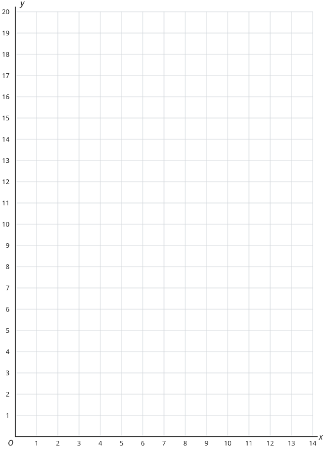

# 중1 수학 서술형 문항 (t4_0207_dong_a) — 총 10점

- 성취기준: 9수02-07 / 역량: 추론, 의사소통, 연결 / 과제 패턴: multi_representation
- 출제 의도: 일정한 속력으로 이동할 때의 시간과 거리, 일정한 거리를 이동할 때의 속력과 시간이라는 두 상황으로 정비례와 반비례 관계를 이해하는지 평가한다. 1-1은 표의 빈칸을 규칙에 따라 채우는 기본 계산 능력(성취수준 C~E), 1-2는 표에서 정비례 여부를 판단하고 이유를 말하는 능력(성취수준 C~D)을 본다. 1-3은 반비례 관계의 값을 구해 좌표평면에 점으로 나타내고 그래프의 모양을 표현하는 능력(성취수준 B~C)을 본다. 1-4는 표, 식, 그래프를 연결해 정비례와 반비례의 뜻을 설명하고 그래프가 나타내는 의미를 실생활 맥락에서 추론해 말하는 능력(성취수준 A~B)을 평가한다. 추론, 의사소통, 연결 역량이 드러나도록 구성했다.
- 사용 숫자: {'v': 7, 'k': 2, 'j': 3} (수치 명세 m1_9s02-07_multi_representation_v1, 템플릿 방식 — 숫자만 바꾸기 가능)

## 평가 문항

서아는 과학 동아리에서 자율 주행 배송 로봇의 이동을 실험하고 있다. 이 로봇은 속력을 정해 주면 그 속력을 일정하게 유지하며 직선 도로를 달린다. 먼저 로봇이 시속 7 km로 일정하게 달릴 때, 달린 시간 $x$시간에 따른 이동 거리 $y$ km를 [표 1]에 정리하려고 한다. 이어서 36 km 떨어진 두 지점 사이를 속력 $x$ km/h로 달릴 때 걸리는 시간 $y$시간을 [표 2]와 [그림]에 정리하려고 한다. [그림]은 가로축을 속력, 세로축을 걸린 시간으로 하는 좌표평면이다.

**[표 1] 시속 7 km로 일정하게 달릴 때 달린 시간과 이동 거리**

| 달린 시간 $x$ (시간) | 1 | 2 | 3 | 4 | 5 |
|---|---|---|---|---|---|
| 이동 거리 $y$ (km) | ( ) | ( ) | ( ) | ( ) | ( ) |

**[표 2] 36 km를 이동할 때 속력과 걸린 시간**

| 속력 $x$ (km/h) | 2 | 4 | 6 | 12 |
|---|---|---|---|---|
| 걸린 시간 $y$ (시간) | ( ) | ( ) | ( ) | ( ) |

**1-1.** 로봇이 시속 7 km로 일정하게 달릴 때, [표 1]의 빈칸에 알맞은 이동 거리를 구하여 써넣으시오. [2점]

**1-2.** 1-1에서 완성한 [표 1]을 보고, 달린 시간 $x$와 이동 거리 $y$가 정비례 관계인지 판단하고, 그 이유를 〈조건〉에 맞게 설명하시오. [2점]

> 〈조건〉 [표 1]에서 $x$의 값 두 개 이상과 그에 대응하는 $y$의 값을 인용하여, $x$의 값과 $y$의 값이 변하는 배수를 비교할 것

**1-3.** 36 km 떨어진 두 지점 사이를 속력 $x$ km/h로 달릴 때 걸리는 시간 $y$시간을 구하여 [표 2]의 빈칸을 채우고, 〈조건〉에 맞게 [그림]의 좌표평면에 점으로 나타내고 점들이 늘어선 모양을 설명하시오. [3점]

> 〈조건〉 [표 2]의 값을 순서쌍 $(x, y)$로 하는 점 4개를 [그림]에 모두 나타낼 것

> 〈조건〉 점들이 늘어선 모양을 한 문장으로 설명할 것

**1-4.** 1-2의 [표 1]과 1-3의 [표 2]에서 $x$의 값이 2배, 3배가 될 때 $y$의 값이 어떻게 변하는지 각각 비교하여 두 관계의 이름과 뜻을 설명하고, 1-3의 [그림]에 나타낸 점들이 로봇의 이동에서 의미하는 바를 〈조건〉에 맞게 설명하시오. [3점]

> 〈조건〉 [표 1]과 [표 2]에서 값을 각각 한 쌍 이상 인용할 것

> 〈조건〉 [그림]의 의미를 설명하는 문장에 '속력'과 '시간'이라는 말을 모두 쓸 것

## 채점기준표

| 문항 | 평가 요소 | 채점 요소 | 배점 | 수행 수준 |
|---|---|---|---|---|
| 1-1 | 일정한 속력으로 이동할 때 시간에 따른 이동 거리를 표로 나타내기 | 달린 시간에 따른 이동 거리를 구하여 [표 1]의 빈칸 채우기 | 2 | [표 1]의 빈칸 5칸의 이동 거리를 모두 정확하게 구함. |
| 1-1 | 일정한 속력으로 이동할 때 시간에 따른 이동 거리를 표로 나타내기 | 달린 시간에 따른 이동 거리를 구하여 [표 1]의 빈칸 채우기 | 1 | [표 1]의 빈칸 중 일부만 정확하게 구하거나 이동 거리를 구하는 규칙을 적용하는 데 어려움이 있음. |
| 1-2 | 표를 보고 정비례 관계인지 판단하여 이유 설명하기 | 정비례 관계의 뜻에 비추어 표의 값을 근거로 판단과 이유 설명하기 | 2 | 두 양의 관계를 정비례로 바르게 판단하고, 조건 C1에 맞게 표의 값을 인용하여 $x$와 $y$가 변하는 배수를 비교해 이유를 설명함. |
| 1-2 | 표를 보고 정비례 관계인지 판단하여 이유 설명하기 | 정비례 관계의 뜻에 비추어 표의 값을 근거로 판단과 이유 설명하기 | 1 | 두 양의 관계를 판단했으나 표의 값을 인용하지 않았거나 두 값이 변하는 배수의 비교가 불완전하여 이유 설명에 어려움이 있음. |
| 1-3 | 일정한 거리를 이동할 때 속력과 시간의 관계를 표와 그래프로 나타내기 | [표 2]를 채우고 좌표평면에 점으로 나타낸 뒤 점들의 모양 설명하기 | 3 | [표 2]의 빈칸 4칸을 모두 정확하게 구하고 점 4개를 모두 정확한 위치에 나타내며 점들이 늘어선 모양을 바르게 설명함. |
| 1-3 | 일정한 거리를 이동할 때 속력과 시간의 관계를 표와 그래프로 나타내기 | [표 2]를 채우고 좌표평면에 점으로 나타낸 뒤 점들의 모양 설명하기 | 2 | [표 2]의 빈칸 4칸은 모두 정확하게 구했으나 점을 나타내는 데 일부 오류가 있거나 점들의 모양 설명이 부정확하거나 없음. |
| 1-3 | 일정한 거리를 이동할 때 속력과 시간의 관계를 표와 그래프로 나타내기 | [표 2]를 채우고 좌표평면에 점으로 나타낸 뒤 점들의 모양 설명하기 | 1 | [표 2]의 빈칸을 일부만 정확하게 구했거나 구한 값을 좌표평면에 점으로 나타내지 못함. |
| 1-4 | 정비례와 반비례의 뜻을 설명하고 그래프의 의미를 실생활 맥락으로 해석하기 | 두 표를 비교하여 두 관계의 이름과 뜻을 설명하고 그래프가 나타내는 의미 해석하기 | 3 | 두 표의 값을 인용하여 두 관계의 이름과 뜻을 모두 바르게 설명하고, 그래프가 나타내는 속력과 시간의 변화를 로봇의 이동 상황과 연결하여 바르게 해석함. |
| 1-4 | 정비례와 반비례의 뜻을 설명하고 그래프의 의미를 실생활 맥락으로 해석하기 | 두 표를 비교하여 두 관계의 이름과 뜻을 설명하고 그래프가 나타내는 의미 해석하기 | 2 | 두 표의 값을 인용하여 두 관계의 이름과 뜻은 바르게 설명했으나 그래프의 의미를 해석하지 못하거나 해석에 오류가 있음. |
| 1-4 | 정비례와 반비례의 뜻을 설명하고 그래프의 의미를 실생활 맥락으로 해석하기 | 두 표를 비교하여 두 관계의 이름과 뜻을 설명하고 그래프가 나타내는 의미 해석하기 | 1 | 두 관계 중 하나의 이름과 뜻만 설명하거나 관계의 이름만 쓰고 뜻을 설명하는 데 어려움이 있음. |

## 예시답안

- **1-1** (표의 값을 비교하며 변화 규칙 이용): 시속 7 km로 일정하게 달리므로 1시간이 늘 때마다 이동 거리가 7 km씩 늘어난다. 따라서 이동 거리는 1시간일 때 7 km, 2시간일 때 14 km, 3시간일 때 21 km, 4시간일 때 28 km, 5시간일 때 35 km이다.
- **1-1** (관계식($y=ax$, $y=\frac{a}{x}$) 이용): (이동 거리)=(속력)×(시간)이므로 $y=7x$이다. $x=1, 2, 3, 4, 5$를 대입하면 $y=7, 14, 21, 28, 35$이다.
- **1-2** (표의 값을 비교하며 변화 규칙 이용): [표 1]에서 $x$가 2에서 4로 2배가 될 때 $y$는 14에서 28로 2배가 된다. 또 $x$가 1에서 3으로 3배가 될 때 $y$는 7에서 21로 3배가 된다. $x$의 값이 2배, 3배가 될 때 $y$의 값도 2배, 3배가 되므로 $x$와 $y$는 정비례 관계이다.
- **1-2** (관계식($y=ax$, $y=\frac{a}{x}$) 이용): [표 1]에서 $x=1$일 때 $y=7$이고, $x=2$일 때 $y=14$이므로 $y$의 값은 항상 $x$의 값의 7배이다. 따라서 $y=7x$ 꼴이므로 $x$와 $y$는 정비례 관계이다.
- **1-3** (표의 값을 비교하며 변화 규칙 이용): 속력이 2 km/h일 때 걸린 시간은 $36 \div 2 = 18$(시간)이다. 속력이 2배인 4 km/h이면 시간은 $\frac{1}{2}$배인 9시간, 속력이 3배인 6 km/h이면 $\frac{1}{3}$배인 6시간, 속력이 6배인 12 km/h이면 $\frac{1}{6}$배인 3시간이다. 순서쌍 $(2, 18)$, $(4, 9)$, $(6, 6)$, $(12, 3)$를 [그림]의 좌표평면에 점으로 나타낸다. 이 점들은 오른쪽으로 갈수록 아래로 내려가며 직선이 아니라 구부러진 곡선 위에 놓인다. 점들을 매끄러운 곡선으로 이으면 두 좌표축에 점점 가까워지는 모양이 된다.
- **1-3** (관계식($y=ax$, $y=\frac{a}{x}$) 이용): (시간)=(거리)÷(속력)이므로 $y=\frac{ 36 }{x}$이다. $x=2, 4, 6, 12$를 대입하면 $y=18, 9, 6, 3$이다. 순서쌍 $(2, 18)$, $(4, 9)$, $(6, 6)$, $(12, 3)$를 [그림]의 좌표평면에 점으로 나타낸다. 이 점들은 직선 위에 있지 않고, 오른쪽으로 갈수록 아래로 내려가며 곡선 모양으로 늘어선다. 점들을 매끄러운 곡선으로 이으면 제1사분면에서 두 좌표축에 점점 가까워지는 곡선이 된다.
- **1-4** (표의 값을 비교하며 변화 규칙 이용): [표 1]에서 $x$가 2배, 3배가 될 때 $y$도 2배, 3배가 된다(예: $x$가 1에서 2로 될 때 $y$는 7에서 14로). 이와 같이 $x$의 값이 2배, 3배, …가 될 때 $y$의 값도 2배, 3배, …가 되는 관계가 정비례이다. [표 2]에서 $x$가 2에서 4로 2배가 될 때 $y$는 18에서 9로 $\frac{1}{2}$배가 되고, $x$가 2에서 6으로 3배가 될 때 $y$는 18에서 6으로 $\frac{1}{3}$배가 된다. 이와 같이 $x$의 값이 2배, 3배, …가 될 때 $y$의 값이 $\frac{1}{2}$배, $\frac{1}{3}$배, …가 되는 관계가 반비례이다. [그림]의 점들은 오른쪽으로 갈수록 아래로 내려간다. 이는 같은 거리를 달릴 때 로봇의 속력이 커질수록 걸리는 시간이 줄어든다는 뜻이다. 속력이 2배가 되면 걸리는 시간은 절반이 된다(예: 속력 6 km/h에서 12 km/h로 2배가 되면 시간은 6시간에서 3시간으로 줄어든다).
- **1-4** (관계식($y=ax$, $y=\frac{a}{x}$) 이용): [표 1]에서 $y$의 값은 항상 $x$의 값의 7배이므로 $y=7x$이다. $y=ax$ 꼴이므로 정비례이다. [표 2]에서 $x$와 $y$의 곱은 $2 \times 18 = 12 \times 3 = 36$으로 일정하므로 $y=\frac{ 36 }{x}$이다. $y=\frac{a}{x}$ 꼴이므로 반비례이다. [그림]의 점들은 이 식을 만족하는 점으로, 속력 $x$가 커질수록 걸린 시간 $y$가 줄어들며 0이 되지는 않고 점점 0에 가까워지는 곡선을 이룬다. 즉 같은 거리를 이동할 때 속력이 클수록 시간은 줄어들고, 속력과 시간의 곱은 이동 거리와 같다.

## 채점 시 유의점
- 수와 식으로 표현한 문제해결 과정이 수학적으로 논리적이면 예시답안과 달라도 정답으로 인정한다.
- 성취기준이 값을 구하는 것이므로 단위 표기는 평가하지 않는다.
- 앞 소문항의 값이 틀렸더라도 그 값을 바탕으로 이후 계산·판단이 논리적이면 해당 수준 점수를 부여한다. 특히 1-4는 자신이 구한 표의 값을 근거로 한 설명이면 논리에 따라 채점한다.
- 대략 비슷한 위치에 점을 찍거나 그래프의 모양이 크게 벗어나지 않으면 정답으로 인정한다.

- 단위: 평가하지 않음

## 교사 확인 사항
- (T1, 1-3) 1-3에서 점이 눈금에서 살짝 벗어난 경우의 처리와, 점 4개를 직선(꺾은선)으로 이은 경우 점들이 늘어선 모양 설명을 인정할지 사전에 협의한다.
- (T2, 1-1, 1-3) 1-3에서 구한 [표 2]의 값을 학생이 잘못 구했더라도 그 값을 일관되게 점으로 나타내고 설명했으면 인정하는 기준을 정하고, 계산 실수와 정비례·반비례 개념 이해 오류를 구분하여 채점한다.
- (T3, 1-4) 1-4에서 정비례와 반비례를 각각 구분하여 [표 1]과 [표 2]에 대응해 답했는지 확인한다.

## 피드백 시 유의점
- 'x가 커질 때 y가 커지면 정비례, 작아지면 반비례'라고만 판단하는 학생이 많으므로, 표에서 x가 2배, 3배가 될 때 y가 정확히 몇 배가 되는지 확인하게 하여 정비례와 반비례를 배수 관계로 구분하게 한다.
- [표 2]에서 시간을 $D \times x$로 곱해 구하는 학생에게는 (시간)=(거리)÷(속력)임을 단위(km, km/h, 시간)로 확인하게 하고, 속력이 커질수록 시간이 줄어든다는 직관으로 값이 타당한지 검토하게 한다.
- 그래프의 점을 직선으로 잇는 학생에게는 속력 4와 6 사이의 속력(예: 한 값)에 대한 시간을 추가로 구해 점을 더 찍어 보게 하여 점들이 곡선 위에 놓임을 확인하게 한다.

## 검증 결과
- 오류 0개, 경고 2개
  - 경고: W3 1-1: 평가 요소 '일정한 속력으로 이동할 때 시간에 따른 이동 거리를 표로 나타내기'는 '~하기' 형태가 아니다
  - 경고: W3 1-3: 평가 요소 '일정한 거리를 이동할 때 속력과 시간의 관계를 표와 그래프로 나타내기'는 '~하기' 형태가 아니다

## AI 점검 의견 (수정 권고)
- [보통] 1-4: 발문 하나에 두 표의 배수 비교, 두 관계의 이름과 뜻 설명, 그래프 의미 해석이 모두 들어 있다. 채점기준도 3점짜리 요소 하나에 합쳐 있어(R5) 어느 수행이 부족한지 가려 채점하기 어렵다. -> 정비례·반비례의 이름과 뜻을 설명하는 소문항과 그래프의 의미를 해석하는 소문항으로 나누거나, 채점 요소를 둘로 나누어 발문에 각각 드러낸다.
- [보통] 1-3: 한 발문에서 표 채우기, 점 찍기, 모양 설명을 모두 요구하고, 채점기준도 3점짜리 한 요소에 합쳐 있다. 계산 실수와 그래프 표현, 설명을 따로 채점하지 못한다. -> 표 채우기와 점 나타내기를 한 소문항으로, 모양 설명을 다른 소문항으로 나누거나 채점 요소를 계산·그래프·설명으로 나눈다. 표의 값이 틀려도 그 값을 일관되게 점으로 나타내면 해당 수준을 준다는 유의점은 1-3 채점기준에도 쓴다.
- [보통] 1-3 채점기준: 점이 일부 틀린 경우와 점을 아예 못 나타낸 경우의 경계가 수준 2와 수준 1에서 겹친다. 표는 맞고 점이 없는 답안은 어느 수준인지 정해져 있지 않다. 또 채점 시 유의점의 '대략 비슷한 위치'는 셀 수 있는 기준이 없다. -> '4개 중 3개 이상 정확', '표는 맞으나 점을 찍지 않음'처럼 개수로 수준을 가른다. 허용 오차는 '눈금 한 칸 이내'처럼 관찰 가능한 기준으로 쓴다.
- [보통] 1-4: '점들이 로봇의 이동에서 의미하는 바'가 무엇을 설명하라는 것인지 분명하지 않다. 점 하나의 좌표가 뜻하는 바를 쓸지, 점들이 내려가는 경향을 쓸지 정해져 있지 않다. -> '점의 $x$좌표와 $y$좌표가 각각 무엇을 나타내는지, 점들이 오른쪽으로 갈수록 낮아지는 것이 뜻하는 바를 설명하시오'처럼 설명할 대상을 구체적으로 쓴다.
- [경미] 1-3, 1-4 채점기준: 1-3의 '한 문장'과 1-4의 '속력·시간 용어 사용', '각 표에서 한 쌍 이상 인용'이 수준 서술에 충분히 반영되지 않았다. 1-4의 수준 2와 수준 1에는 값을 인용하지 않은 경우나 용어를 쓰지 않은 경우가 어느 수준인지 나와 있지 않다. -> 조건을 지키지 않았을 때 해당하는 수준을 수준 서술에 쓴다. 예: '표의 값을 인용하지 않고 뜻만 설명함', '그래프 의미 설명에 속력과 시간 중 하나만 씀'.
- [경미] 1-2 예시답안(M2)와 채점기준: M2는 $x=1, 2$ 두 값만 확인하고 '항상 7배'라고 일반화하여 논리가 약하다. 채점기준 수준 1은 판단을 했으나 근거가 부족한 경우만 다루어, 판단 자체가 틀린 답안의 수준이 정해져 있지 않다. -> M2에서는 $x=1,2,3,4,5$ 모두에서 $y\div x=7$임을 확인하는 서술로 고친다. 판단이 틀린 경우도 1점 수준에 포함해 서술한다.

---
사용량: 호출 6회, 입력 63408 토큰, 출력 26720 토큰, 추정 비용 약 $0.394 (단가는 추정)