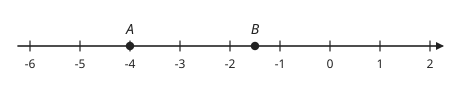

# 중1 수학 서술형 문항 (w_9s01-04_1023_141915) — 총 10점

- 성취기준: 9수01-04 / 역량: 추론, 의사소통, 문제해결 / 과제 패턴: judge_claim
- 출제 의도: 해수면을 기준으로 한 터널 안 지점의 높이를 수직선에서 읽고(1-1, 성취수준 D·E·C), 두 수의 위치를 근거로 대소 관계를 말로 설명하며(1-2, 성취수준 C·B), 대소 관계에 대한 잘못된 주장을 수직선과 수의 성질을 활용해 반박하는 능력(1-3, 성취수준 A·B)을 평가한다. 수학적 추론, 수학적 의사소통, 문제 해결 역량을 함께 살핀다.
- 사용 숫자: {'a': 8, 'b': 3} (수치 명세 m1_9s01-04_judge_claim_v1__w_9s01-04_1023_141915, 템플릿 방식 — 숫자만 바꾸기 가능)

## 평가 문항

충남 보령에는 바닷속을 지나는 보령 해저 터널이 있다. 서윤이는 이 터널을 견학하면서 터널 안의 서로 다른 두 지점 A, B의 높이를 해수면을 기준으로 조사하였다. 해수면의 높이를 0 m로 하고, 해수면보다 높은 곳은 양수, 낮은 곳은 음수로 나타내어 두 지점의 높이를 아래 수직선에 점으로 표시하였다. 수직선에서 오른쪽에 있는 점일수록 높은 곳이고, 눈금 한 칸의 길이는 1 m이다.

**1-1.** 수직선에 표시된 두 지점 A, B의 높이를 각각 구하시오. 정수가 아닌 수는 분수나 소수로 나타내시오. [2점]

**1-2.** 1-1에서 구한 두 지점 A, B의 높이를 비교하여 더 높은 지점이 어느 곳인지 판단하고, 〈조건〉에 맞게 그 이유를 설명하시오. [4점]

> 〈조건〉 해수면의 높이 0을 나타내는 점(원점)과 두 점 A, B의 위치 관계를 포함하여 설명할 것

> 〈조건〉 1-1에서 구한 두 수의 대소 관계를 부등호를 사용하여 나타낼 것

**1-3.** 지민이는 "A, B 중 해수면의 높이 0 m에서 더 멀리 떨어진 지점이 더 높은 곳이다."라고 말했다. 지민이의 말이 옳은지 판단하고, 〈조건〉에 맞게 그 이유를 설명하시오. [4점]

> 〈조건〉 두 지점이 각각 해수면의 높이 0 m에서 떨어진 거리를 구하여 설명에 사용할 것

> 〈조건〉 지민이의 말이 가리키는 지점과 1-2에서 판단한 더 높은 지점을 비교할 것

## 채점기준표

| 문항 | 평가 요소 | 채점 요소 | 배점 | 수행 수준 |
|---|---|---|---|---|
| 1-1 | 수직선 위의 점이 나타내는 수를 구하기 | 두 지점의 높이를 부호와 크기를 맞게 수로 나타내기 | 2 | 두 지점의 높이를 부호와 크기 모두 바르게 읽어 수로 나타냄. |
| 1-1 | 수직선 위의 점이 나타내는 수를 구하기 | 두 지점의 높이를 부호와 크기를 맞게 수로 나타내기 | 1 | 한 지점의 높이만 바르게 나타내거나, 두 지점 모두 크기는 읽었으나 부호를 바르게 나타내지 못함. |
| 1-2 | 수직선 위의 두 수의 위치로 대소 관계 판단하기 | 두 수의 대소 관계를 부등호로 나타내고 더 높은 지점 판단하기 | 2 | 1-1에서 구한 두 수의 대소 관계를 부등호로 바르게 나타내고 더 높은 지점을 바르게 판단함. |
| 1-2 | 수직선 위의 두 수의 위치로 대소 관계 판단하기 | 두 수의 대소 관계를 부등호로 나타내고 더 높은 지점 판단하기 | 1 | 부등호 표현과 더 높은 지점 판단 중 한 가지만 바르게 함. |
| 1-2 | 수직선 위의 두 수의 위치로 대소 관계 판단하기 | 원점과 두 점의 위치를 근거로 대소 관계의 이유 설명하기 | 2 | 원점과 두 점의 위치 관계를 이용하여 더 높은 지점이 되는 이유를 정확하게 설명함. |
| 1-2 | 수직선 위의 두 수의 위치로 대소 관계 판단하기 | 원점과 두 점의 위치를 근거로 대소 관계의 이유 설명하기 | 1 | 원점과의 위치 관계 없이 비교 결과만 서술하거나, 위치 관계 설명에 일부 오류가 있음. |
| 1-3 | 음수끼리의 대소 관계에 대한 주장을 수직선과 수의 성질로 반박하기 | 원점으로부터의 거리를 구하여 지민이의 말이 가리키는 지점 확인하기 | 2 | 두 지점이 원점에서 떨어진 거리를 모두 바르게 구하고, 지민이의 말이 가리키는 지점을 1-2에서 판단한 더 높은 지점과 비교함. |
| 1-3 | 음수끼리의 대소 관계에 대한 주장을 수직선과 수의 성질로 반박하기 | 원점으로부터의 거리를 구하여 지민이의 말이 가리키는 지점 확인하기 | 1 | 한 지점의 거리만 바르게 구했거나, 거리는 구했으나 지민이의 말이 가리키는 지점과 1-2의 결과를 비교하지 않음. |
| 1-3 | 음수끼리의 대소 관계에 대한 주장을 수직선과 수의 성질로 반박하기 | 주장의 옳고 그름을 판단하고 수직선과 수의 성질로 이유 설명하기 | 2 | 지민이의 말이 옳지 않다고 판단하고, 음수끼리는 원점에서 멀수록 수직선에서 더 왼쪽에 있어 더 낮다는 이유를 수직선 위치 또는 수의 성질로 바르게 설명함. |
| 1-3 | 음수끼리의 대소 관계에 대한 주장을 수직선과 수의 성질로 반박하기 | 주장의 옳고 그름을 판단하고 수직선과 수의 성질로 이유 설명하기 | 1 | 지민이의 말이 옳지 않다고 판단했으나 이유 설명이 부분적이거나 거리 계산 결과만 나열함. |

## 예시답안

- **1-1** (수직선 위 위치 비교(오른쪽에 있는 수가 더 큼)): 점 A는 원점에서 왼쪽으로 $4$ m 떨어져 있고, 점 B는 원점에서 왼쪽으로 $\frac{3}{2}$ m 떨어져 있다. 원점의 왼쪽은 음수이므로 A의 높이는 $-4$ m, B의 높이는 $- \frac{3}{2}$ m이다.
- **1-2** (수직선 위 위치 비교(오른쪽에 있는 수가 더 큼)): A의 높이는 $-4$, B의 높이는 $- \frac{3}{2}$이다. 두 수를 비교하면 $-4 < - \frac{3}{2}$이다. 수직선에서는 오른쪽에 있는 점일수록 높은 곳이다. 두 점은 모두 원점의 왼쪽에 있고, 높이가 $- \frac{3}{2}$인 점이 높이가 $-4$인 점보다 오른쪽에 있다. 따라서 높이가 $- \frac{3}{2}$ m인 지점이 더 높다.
- **1-2** (부호와 0으로부터의 거리 이용(음수끼리는 0에서 더 먼 수가 더 작음)): 두 지점의 높이 $-4$와 $- \frac{3}{2}$는 모두 음수이므로 두 점은 모두 원점의 왼쪽에 있다. 원점에서 떨어진 거리는 높이가 $-4$인 점이 $4$, 높이가 $- \frac{3}{2}$인 점이 $\frac{3}{2}$이다. 음수끼리는 원점에서 멀리 떨어진 수가 더 작으므로 $-4 < - \frac{3}{2}$이고, 높이가 $- \frac{3}{2}$ m인 지점이 더 높다.
- **1-3** (수직선 위 위치 비교(오른쪽에 있는 수가 더 큼)): 원점에서 떨어진 거리는 높이가 $-4$인 지점이 $4$ m, 높이가 $- \frac{3}{2}$인 지점이 $\frac{3}{2}$ m이다. 지민이의 말대로라면 해수면에서 더 멀리 떨어진 지점, 즉 높이가 $-4$인 지점이 더 높아야 한다. 그러나 수직선에서 두 점은 모두 원점의 왼쪽에 있고, 원점에서 더 먼 점이 더 왼쪽에 있다. 오른쪽에 있는 점이 더 높으므로 더 높은 지점은 높이가 $- \frac{3}{2}$인 지점이며, 이 지점은 원점에서 더 가까이 있다. 두 점 사이의 거리 $\frac{5}{2}$ m만큼 원점에서 먼 점이 더 낮다. 따라서 지민이의 말은 옳지 않다.
- **1-3** (부호와 0으로부터의 거리 이용(음수끼리는 0에서 더 먼 수가 더 작음)): 두 지점의 높이 $-4$, $- \frac{3}{2}$는 모두 음수이다. 양수끼리는 절댓값이 큰 수가 더 크지만, 음수끼리는 절댓값이 큰 수가 더 작다. 절댓값은 $|-4| = 4$, $|- \frac{3}{2}| = \frac{3}{2}$로 높이가 $-4$인 지점의 절댓값이 $\frac{5}{2}$만큼 더 크다. 지민이의 말이 가리키는 지점은 높이가 $-4$인 지점인데, 1-2에서 더 높은 지점은 높이가 $- \frac{3}{2}$인 지점이다. 해수면보다 낮은 곳에서는 해수면에서 멀수록 더 깊은 곳이므로 더 낮다. 따라서 지민이의 말은 옳지 않다.

## 채점 시 유의점
- 수와 식으로 표현한 문제해결 과정이 수학적으로 논리적이면 예시답안과 달라도 정답으로 인정한다.
- 앞 소문항의 값이 틀렸더라도 그 값을 바탕으로 이후 비교와 판단이 논리적이면 해당 수준 점수를 부여한다.
- 수직선 위의 위치를 이용했든 부호와 절댓값을 이용했든 표현 방식이 달라도 이유가 충분히 설명되었으면 정답으로 인정한다.
- 높이의 단위(m) 표기는 평가하지 않는다.

- 단위: 평가하지 않음

## 교사 확인 사항
- (T1, 1-1) 1-1에서 부호를 빠뜨려 양수로 읽은 경우와 눈금을 잘못 읽은 경우를 구분하여, 계산 실수인지 개념 이해 오류인지 협의한 뒤 채점한다.
- (T2, 1-2, 1-3) 1-2, 1-3에서 부등호의 방향, '원점', '절댓값', '오른쪽에 있을수록 크다'와 같은 용어와 기호를 정확히 사용했는지 확인한다.
- (T3, 1-2, 1-3) 1-2, 1-3에서 점 A와 점 B를 구분하여 답했는지, 더 높은 지점과 지민이의 말이 가리키는 지점을 혼동하지 않았는지 확인한다.

## 피드백 시 유의점
- '4가 3/2보다 크므로 -4가 -3/2보다 크다'처럼 부호를 무시하고 수의 크기만 비교하는 오개념이 있는지 확인하고, 수직선에 두 점을 직접 찍어 오른쪽에 있는 수가 더 큼을 확인하게 한다.
- '원점에서 멀수록 큰 수'라는 생각은 양수에서만 성립함을 짚어 준다. 양수 두 개와 음수 두 개의 예를 수직선에 나란히 나타내어 절댓값이 큰 음수가 더 왼쪽에 놓임을 비교하게 한다.
- 1-1에서 눈금 사이에 있는 점을 정수로 어림하여 읽는 학생에게는 눈금 한 칸을 반으로 나누어 분수나 소수로 읽게 한다.

## 검증 결과
- 오류 0개, 경고 0개

## AI 점검 의견 (수정 권고)
- [보통] 제시문: 제시문의 "수직선에서 오른쪽에 있는 점일수록 높은 곳이다"가 1-2와 1-3에서 평가하려는 판단 기준을 그대로 알려 준다. 학생이 두 수의 위치로 대소를 스스로 판단하는 과정이 평가되지 않는다. -> 이 문장을 지우고 "해수면보다 높은 곳은 양수, 낮은 곳은 음수"까지만 제시한다. 위치와 높이의 관계는 학생이 설명에서 직접 쓰게 한다.
- [보통] 1-2, 1-3 채점기준: 1-2의 "정확하게 설명함"과 "일부 오류가 있음", 1-3의 "설명이 부분적"은 교사마다 다르게 읽을 수 있다. 어떤 요소가 몇 개 있어야 2점이고 1점인지 셀 수 있는 단위로 쓰여 있지 않다. -> 2점 수준은 "두 점이 모두 원점의 왼쪽에 있음"과 "B가 A보다 오른쪽에 있음"을 모두 쓴 경우처럼 필수 요소를 나열한다. 1점 수준은 "그중 한 가지만 씀"처럼 개수로 구분한다.
- [보통] 1-3 채점기준: 원소 1의 2점 수준과 원소 2의 2점 수준 모두에 "1-2의 결과와 비교함"과 "거리 계산 결과 활용"이 들어 있다. 같은 수행이 두 요소에서 중복 채점될 수 있고, 거리 나열만 한 답안이 양쪽 1점 수준에 걸린다. -> 원소 1은 "두 거리를 구함"만, 원소 2는 "지민이가 가리키는 지점이 1-2의 더 높은 지점과 다름을 보이고 이유를 설명함"만 평가하도록 나눈다. 수준 서술도 겹치지 않게 다시 쓴다.
- [경미] 1-1, 1-2, 1-3 채점기준: 각 요소의 최하 수준이 1점인데, 그 서술이 "하나도 맞게 쓰지 못한 답안"을 포함하지 않는다. 예를 들어 1-1에서 두 지점 모두 크기가 틀린 답안은 어느 수준에도 해당하지 않는다. -> 최하 수준(1점)에 "해당 대상을 바르게 나타내지 못했으나 시도한 흔적이 있음"처럼 하위 답안을 포괄하는 서술을 추가한다. 그러면 전체 수준 서술의 포괄성이 확보된다.
- [경미] 1-1: 발문의 "정수가 아닌 수는 분수나 소수로 나타내시오"가 두 지점 중 하나가 정수가 아님을 미리 알려 준다. 눈금 사이의 점을 스스로 알아차리는 부분이 평가되지 않는다. -> "필요하면 분수나 소수로 나타내시오"처럼 쓰거나 표현 방식을 자유롭게 허용한다.
- [경미] 제시문: 실제 시설인 보령 해저 터널을 쓰면서 -4 m, -1.5 m 같은 가상의 값을 "조사한 값"처럼 제시한다. 실제 터널의 깊이와 맞지 않아 사실처럼 읽힐 수 있다. -> "어느 해저 터널"처럼 가상의 시설로 바꾸거나, 수치가 가상임을 밝힌다.

---
사용량: 호출 7회, 입력 60505 토큰, 출력 30779 토큰, 추정 비용 약 $0.429 (단가는 추정)