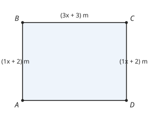
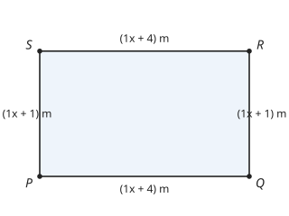

# 중1 수학 서술형 문항 (w_9s02-02_1021_103035) — 총 10점

- 성취기준: 9수02-02 / 역량: 추론, 의사소통, 문제해결 / 과제 패턴: context_compute_judge
- 출제 의도: 달리기 트랙처럼 각 구간의 길이가 일차식으로 주어진 상황에서 일차식의 덧셈과 뺄셈 원리를 이해하고 계산하는 능력을 평가한다. 1-1은 D·E 수준에서 일차식의 덧셈 계산을, 1-2는 C·D 수준에서 괄호가 있는 뺄셈 계산 과정을 단계별로 쓰는 능력을 본다. 1-3은 B·C 수준에서 괄호 앞의 '-' 부호가 괄호 안의 각 항에 미치는 영향을 자신의 말로 설명하는 능력을 본다. 1-4는 A·B 수준에서 앞의 결과를 바탕으로 두 경로가 공정한지 판단하고 수학적 근거를 들어 논리적으로 서술하는 추론·의사소통·문제해결 능력을 평가한다.
- 사용 숫자: {'a': 1, 'b': 2, 'c': 3, 'd': 3, 'm': 1, 'n': 4, 'k': 1, 'l': 1} (수치 명세 m1_9s02-02_context_compute_judge_v1, 템플릿 방식 — 숫자만 바꾸기 가능)

## 평가 문항

체육 시간에 지민이와 현우가 운동장에 그려진 두 달리기 경로 가, 나 중 하나를 골라 달리기로 했다. 경로 가는 점 A에서 출발하여 B, C를 거쳐 점 D까지 달리며, 선분 AD 구간은 달리지 않는다. 경로 나는 직사각형 모양의 트랙을 점 P에서 출발하여 한 바퀴 돌아 다시 P로 돌아온다. 각 구간의 길이는 $x$를 사용한 일차식으로 나타내었고, 길이의 단위는 m이다. (단, $x$는 양수이고 그림은 실제 길이와 다를 수 있다.)

**1-1.** 경로 가의 전체 길이와 경로 나의 전체 길이를 각각 $x$를 사용한 일차식으로 나타내시오. 일차식의 덧셈을 이용한 계산 과정을 함께 쓰시오. [2점]

**1-2.** 경로 가의 길이에서 경로 나의 길이를 뺀 값을 괄호가 있는 일차식의 뺄셈으로 나타내시오. 괄호를 풀고 동류항끼리 정리하는 과정을 단계별로 쓰시오. [2점]

**1-3.** 1-2의 계산에서 $-(4x+10)$의 괄호를 풀면 $-4x-10$가 된다. 이처럼 괄호 앞에 '$-$'가 있을 때 괄호 안의 부호가 바뀌는 이유를 <조건>에 맞게 설명하시오. [2점]

> 〈조건〉 괄호 안의 두 항 $4x$와 $10$의 부호가 각각 어떻게 되는지 언급하며 설명할 것

**1-4.** 현우는 "$x$의 값에 관계없이 두 경로의 길이가 같으므로 어느 경로를 골라도 공정하다."라고 말했다. 현우의 말이 옳은지 판단하고, <조건>에 맞게 그 이유를 설명하시오. [4점]

> 〈조건〉 앞에서 구한 두 경로의 길이 또는 길이의 차를 이용하여 계산 과정을 쓸 것

> 〈조건〉 $x$의 값에 따라 어느 경로가 더 긴지(또는 같은지)를 구분하여 말할 것

## 채점기준표

| 문항 | 평가 요소 | 채점 요소 | 배점 | 수행 수준 |
|---|---|---|---|---|
| 1-1 | 각 구간의 길이를 일차식의 덧셈으로 나타내어 계산하기 | 두 경로의 전체 길이를 일차식의 덧셈으로 세워 동류항끼리 정리하기 | 2 | 두 경로 모두 각 구간의 길이를 더하는 식을 바르게 세우고 동류항끼리 정확하게 정리하여 일차식으로 나타냄. |
| 1-1 | 각 구간의 길이를 일차식의 덧셈으로 나타내어 계산하기 | 두 경로의 전체 길이를 일차식의 덧셈으로 세워 동류항끼리 정리하기 | 1 | 한 경로만 정확하게 구했거나, 식은 세웠으나 동류항 정리에 오류가 있음. |
| 1-2 | 괄호가 있는 일차식의 뺄셈을 단계별로 계산하며 부호 변화 적용하기 | 뺄셈식을 세우고 괄호를 풀어 정리하는 과정을 단계별로 쓰기 | 2 | 뺄셈식을 바르게 세우고 괄호를 풀 때 부호를 올바르게 바꾸어 동류항끼리 정리하는 과정을 단계별로 정확하게 씀. |
| 1-2 | 괄호가 있는 일차식의 뺄셈을 단계별로 계산하며 부호 변화 적용하기 | 뺄셈식을 세우고 괄호를 풀어 정리하는 과정을 단계별로 쓰기 | 1 | 뺄셈식은 세웠으나 괄호를 풀 때 부호 처리나 동류항 정리에 오류가 있거나 과정을 거의 쓰지 않음. |
| 1-3 | 괄호가 있는 일차식의 뺄셈에서 부호 변화의 원리를 설명하기 | 괄호 앞의 '$-$'가 괄호 안의 모든 항에 작용하는 이유 설명하기 | 2 | C1 조건에 따라 괄호 안의 두 항의 부호가 각각 어떻게 되는지 언급하며, 괄호 앞의 '$-$'가 괄호 안 전체에 작용하는 이유를 타당하게 설명함. |
| 1-3 | 괄호가 있는 일차식의 뺄셈에서 부호 변화의 원리를 설명하기 | 괄호 앞의 '$-$'가 괄호 안의 모든 항에 작용하는 이유 설명하기 | 1 | 부호가 바뀐다는 사실만 말했거나, C1 조건과 달리 한 항에 대해서만 부호 변화를 언급하여 이유 설명이 부족함. |
| 1-4 | 일차식의 덧셈과 뺄셈 과정을 단계별로 설명하며 계산하기 | 두 경로의 길이를 비교하는 근거를 일차식의 계산으로 마련하기 | 2 | C1 조건에 따라 앞에서 구한 길이 또는 길이의 차를 이용하여 부호까지 바르게 계산한 과정을 쓰고 비교의 근거를 정확하게 마련함. |
| 1-4 | 일차식의 덧셈과 뺄셈 과정을 단계별로 설명하며 계산하기 | 두 경로의 길이를 비교하는 근거를 일차식의 계산으로 마련하기 | 1 | C1 조건에 따라 비교를 시도했으나 계산이나 부호 처리에 오류가 있거나 계산 과정이 부족하여 근거가 부분적으로만 마련됨. |
| 1-4 | 부호 변화를 바르게 적용한 계산 결과로 판단 근거 설명하기 | 공정성을 판단하고 $x$의 값에 따른 경우를 논리적으로 설명하기 | 2 | 현우의 말이 옳지 않다고 판단하고, C2 조건에 따라 $x$의 값에 따라 더 긴 경로가 달라지거나 같아지는 경우를 계산 결과에 근거하여 구분해 설명함. |
| 1-4 | 부호 변화를 바르게 적용한 계산 결과로 판단 근거 설명하기 | 공정성을 판단하고 $x$의 값에 따른 경우를 논리적으로 설명하기 | 1 | 현우의 말이 옳지 않다고만 판단했거나, C2 조건과 달리 $x$의 값에 따른 구분이 부족하거나 계산 결과와 어긋남. |

## 예시답안

- **1-1** (괄호가 있는 뺄셈으로 두 길이의 차를 구해 그 식의 값과 부호로 판단): 경로 가: $(1x+2)+(3x+3)+(1x+2) = (1+3+1)x+(2+3+2) = 5x+7$ (m)
경로 나: $(1x+4)+(1x+1)+(1x+4)+(1x+1) = (1+1+1+1)x+(4+1+4+1) = 4x+10$ (m)
- **1-2** (괄호가 있는 뺄셈으로 두 길이의 차를 구해 그 식의 값과 부호로 판단): (경로 가)-(경로 나) $= (5x+7)-(4x+10)$
$= 5x+7-4x-10$ (괄호 앞이 '$-$'이므로 괄호 안의 부호를 모두 바꾸어 푼다.)
$= (5-4)x+(7-10)$ (동류항끼리 모은다.)
$= 1x-3$ (m)
- **1-3** (괄호가 있는 뺄셈으로 두 길이의 차를 구해 그 식의 값과 부호로 판단): 어떤 수를 빼는 것은 그 수의 반대 부호의 수를 더하는 것과 같다. 괄호 안의 두 항 $4x$와 $10$는 둘 다 빼는 것이므로 $4x$를 빼면 $-4x$를 더한 것이 되고, $10$를 빼면 $-10$를 더한 것이 된다. 즉 $-(4x+10) = (-1)\times(4x+10) = -4x-10$ 로 괄호 안의 각 항에 $-1$이 곱해져 두 항의 부호가 모두 바뀐다. 상수항의 부호를 바꾸지 않으면 $-4x+10$가 되어 상수항이 $7+10=17$로 잘못 계산된다.
- **1-4** (괄호가 있는 뺄셈으로 두 길이의 차를 구해 그 식의 값과 부호로 판단): 1-2에서 (경로 가)-(경로 나) $= 1x-3$ 이다.
$x=3$이면 이 차가 $0$이므로 두 경로의 길이가 같다.
$x$가 $3$보다 크면 차가 양수이므로 경로 가가 더 길고, $x$가 $3$보다 작으면 차가 음수이므로 경로 나가 더 길다.
따라서 $x$의 값에 따라 두 경로의 길이가 다르므로 현우의 말은 옳지 않다. (두 길이가 같은 경우는 $x=3$일 때뿐이다.)
- **1-4** (두 경로의 길이를 각각 동류항끼리 정리한 뒤 항별로 비교하여 판단): 경로 가의 길이는 $5x+7$, 경로 나의 길이는 $4x+10$이다.
$x$의 계수는 경로 가가 경로 나보다 $1$ 크고, 상수항은 경로 나가 경로 가보다 $3$ 크다.
$x$가 작으면 상수항의 차이가 더 크게 작용하여 경로 나가 더 길고, $x$가 커지면 $x$항의 차이가 커져 경로 가가 더 길다. $x=3$일 때는 $x$항의 차이 $1x$가 상수항의 차이 $3$와 같아져 두 길이가 같다.
따라서 $x$의 값에 따라 더 긴 경로가 달라지므로 현우의 말은 옳지 않다.

## 채점 시 유의점
- 수와 식으로 표현한 문제해결 과정이 수학적으로 논리적이면 예시답안과 달라도 정답으로 인정한다.
- 성취기준이 일차식의 덧셈과 뺄셈을 계산하는 것이므로 단위 표기는 평가하지 않는다.
- 앞 소문항의 값이 틀렸더라도 그 값을 바탕으로 이후 계산·판단이 논리적이면 해당 수준 점수를 부여한다.
- 표현 방식이 달라도 부호가 바뀌는 이유나 판단의 근거가 충분히 설명되었으면 정답으로 인정한다.

- 단위: 평가하지 않음

## 교사 확인 사항
- (T1, 1-2, 1-3) 1-2에서 괄호를 풀 때 부호를 바꾸지 않은 오류(개념 이해 오류)와 단순한 덧셈·뺄셈 계산 실수를 구분하여 채점한다.
- (T2, 1-1, 1-4) 1-1과 1-4에서 경로 가와 경로 나의 식을 서로 바꾸어 쓰거나 어느 경로가 더 긴지 혼동하지 않았는지, 두 경로를 구분해 답했는지 확인한다.
- (T3, 1-2, 1-3, 1-4) 등호를 이어 쓰는 과정에서 식이 같지 않은 등호를 쓰거나 동류항·계수·상수항 같은 용어를 잘못 사용하지 않았는지 확인한다.

## 피드백 시 유의점
- 괄호 앞에 '$-$'가 있을 때 괄호 안의 모든 항의 부호가 바뀌는 이유를 수 모형이나 구체적인 수를 넣은 예로 다시 확인하게 한다.
- 일차식의 값은 $x$에 따라 달라지므로 '항상 같다'고 단정하기 전에 $x$에 몇 가지 값을 넣어 보게 한다.
- 계산 과정을 '괄호 풀기 → 동류항 모으기 → 정리하기' 순서로 한 줄씩 쓰는 습관을 지도한다.

## 검증 결과
- 오류 0개, 경고 0개

## AI 점검 의견 (수정 권고)
- [보통] 제시문(그림 F1·F2의 변 길이 표기)과 1-1·1-2 예시답안: '(1x + 2) m', '1x−3'처럼 계수 1을 생략하지 않고 쓰고 있어, 중1에서 배우는 문자 사용 식의 표기 약속(1은 생략)과 어긋난다. 학생이 이 표기를 그대로 따라 쓰거나 혼란을 겪을 수 있다. -> 그림의 변 길이와 제시문, 예시답안의 $1x$를 모두 $x$로 바꾸어 $(x+2)$ m, $x-3$처럼 표기한다. 계수 1이 보이지 않아도 동류항 정리가 되도록 예시답안의 계산 과정은 $(1+3+1)x$ 등으로 풀어 쓴다.
- [보통] 1-4 발문·조건 C2·예시답안: $x-3=0$이 되는 $x$의 값을 찾고 $x$의 값에 따라 차의 부호를 나누어 어느 경로가 더 긴지 판정하는 것은 일차방정식·부등식의 성격이 강하다. 이는 일차식의 덧셈·뺄셈 성취기준(9수02-02)의 범위를 넘어서며, 문항의 standardCodes에도 반영되어 있지 않다. -> 발문을 '두 경로의 길이의 차가 $x$에 관계없이 항상 $0$인지 판단하고, $x$에 몇 가지 값을 대입해 확인하라'는 형태로 바꾼다. C2도 '$x$의 값에 따라 길이가 달라질 수 있음을 보일 것' 정도로 낮춘다.
- [경미] 1-4 발문과 제시문: '공정하다'의 기준이 제시되지 않아, 학생이 길이 외에 모퉁이 수나 경로 모양 같은 다른 기준으로 판단할 여지가 있다. 현우의 말에서 공정함이 두 경로의 길이가 같다는 뜻임이 분명하지 않다. -> 발문에 '두 경로의 길이가 같으면 공정하다고 하자'와 같은 약속을 한 문장 추가한다.
- [경미] 1-3 예시답안: $-(4x+10)=(-1)\times(4x+10)$처럼 일차식에 음수를 곱하는 계산을 설명의 근거로 삼고 있다. 일차식의 덧셈·뺄셈 성취기준 범위에서 (일차식)×(수)를 근거로 써도 되는지 불분명하다. -> 예시답안의 주된 설명을 '빼는 것은 반대 부호의 수를 더하는 것'과 수 모형, 구체적인 수 대입 확인으로 하고 $-1$을 곱한다는 설명은 보조로 둔다.
- [경미] 1-3 수준 서술(점수 2): '이유를 타당하게 설명함'이 학생 답의 어떤 요소를 가리키는지 구체적이지 않아, 채점자마다 2점과 1점의 경계가 달라질 수 있다. -> 점수 2의 서술을 '$4x$는 $-4x$, $10$은 $-10$이 됨을 말하고, 빼는 것을 반대 부호를 더하는 것으로 보거나 구체적인 수·모형으로 근거를 듦'처럼 필요한 요소로 구체화한다.
- [경미] 1-2 수준 서술(점수 1): '부호 처리나 동류항 정리에 오류가 있음'과 '과정을 거의 쓰지 않음'이라는 서로 다른 두 상황이 한 수준에 섞여 있다. 결과는 맞지만 과정이 없는 답의 처리가 불명확하다. -> '과정 생략' 경우를 별도 문장으로 분리하고, 결과만 맞고 단계별 과정이 없는 답을 어느 수준에 둘지 명시한다.

---
사용량: 호출 7회, 입력 56195 토큰, 출력 39368 토큰, 추정 비용 약 $0.759 (단가는 추정)