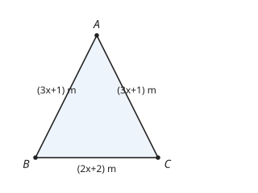
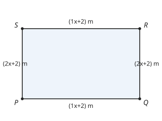

# 중1 수학 서술형 문항 (w_9s02-02_1119_174507) — 총 10점

- 성취기준: 9수02-02 / 역량: 추론, 의사소통, 문제해결 / 과제 패턴: context_compute_judge
- 출제 의도: 1-1은 일차식과 수의 곱셈을 이용해 도형의 둘레를 일차식으로 나타내고 동류항을 정리하는 기본 계산 능력을 확인하며 C~E 수준을 겨냥한다. 1-2는 두 일차식의 차를 구할 때 괄호를 풀고 동류항을 정리하는 과정을 식과 말로 설명하는 능력을 확인하며 C~D 수준을 겨냥한다. 1-3은 괄호를 풀 때 상수항의 부호를 바꾸지 않은 가상의 학생 풀이에서 오류를 찾아 바르게 고치고 그 이유를 논리적으로 설명하는 능력을 확인하며 A~B 수준을 겨냥한다.
- 사용 숫자: {'a': 3, 'b': 1, 'c': 2, 'd': 2, 'm': 1, 'n': 2, 'k': 2, 'l': 2} (수치 명세 m1_9s02-02_context_compute_judge_v1, 템플릿 방식 — 숫자만 바꾸기 가능)

## 평가 문항

서윤이와 도현이는 동네에 있는 이등변삼각형 모양의 공원 가와 직사각형 모양의 공원 나의 둘레에 각각 울타리를 새로 세우는 일을 돕고 있다. 그림과 같이 공원 가에서 길이가 같은 두 변은 각각 $(3x+1)$ m이고, 나머지 한 변은 $(2x+2)$ m이다. 공원 나는 가로가 $(1x+2)$ m, 세로가 $(2x+2)$ m이다. 여기서 $x$는 양수이고, 울타리는 두 공원의 둘레를 따라 빈틈없이 세운다.

**1-1.** 공원 가와 공원 나의 둘레의 길이를 각각 계산 과정과 함께 $x$에 대한 가장 간단한 일차식으로 나타내시오. [3점]

**1-2.** 1-1에서 구한 두 식을 이용하여 공원 가의 둘레에서 공원 나의 둘레를 뺀 값을 구하는 과정을 〈조건〉에 맞게 설명하시오. [3점]

> 〈조건〉 괄호를 푸는 과정을 식으로 쓰고, 빼는 식의 각 항의 부호가 어떻게 되는지 말로 쓸 것

> 〈조건〉 동류항이 어느 항끼리인지 밝히고, 그 항들을 계산하는 과정을 쓸 것

**1-3.** 지민이는 1-1에서 구한 두 식을 이용하여 공원 가의 둘레에서 공원 나의 둘레를 뺀 값을 다음과 같이 계산하였다.
$(8x+4)-(6x+8)$
$=8x+4-6x+8$
$=(8-6)x+(4+8)$
$=2x+12$
지민이의 풀이에서 틀린 부분을 찾아 바르게 고치고, 1-2에서 바르게 구한 차와 비교하여 지민이의 결과가 옳지 않은 이유를 〈조건〉에 맞게 설명하시오. [4점]

> 〈조건〉 지민이의 풀이에서 처음으로 틀린 줄을 지적하고, 그 줄을 바르게 고쳐 쓸 것

> 〈조건〉 지민이의 결과와 바르게 구한 차를 비교하여 서로 다른 항을 밝힐 것

> 〈조건〉 그 항이 달라진 이유를 괄호를 푸는 과정과 관련지어 쓸 것

## 채점기준표

| 문항 | 평가 요소 | 채점 요소 | 배점 | 수행 수준 |
|---|---|---|---|---|
| 1-1 | 일차식과 수의 곱셈을 이용하고 동류항을 정리하여 도형의 둘레를 일차식으로 나타내기 | 두 공원의 둘레를 일차식과 수의 곱셈으로 식을 세우고 동류항을 정리하여 나타내기 | 3 | 두 공원의 둘레를 모두 일차식과 수의 곱셈을 이용한 식으로 세우고, 동류항을 정리하여 일차식으로 정확하게 나타냄. |
| 1-1 | 일차식과 수의 곱셈을 이용하고 동류항을 정리하여 도형의 둘레를 일차식으로 나타내기 | 두 공원의 둘레를 일차식과 수의 곱셈으로 식을 세우고 동류항을 정리하여 나타내기 | 2 | 한 공원의 둘레만 정확하게 정리하여 나타냈거나, 두 공원 모두 식은 세웠으나 동류항을 정리하는 계산에 일부 오류가 있음. |
| 1-1 | 일차식과 수의 곱셈을 이용하고 동류항을 정리하여 도형의 둘레를 일차식으로 나타내기 | 두 공원의 둘레를 일차식과 수의 곱셈으로 식을 세우고 동류항을 정리하여 나타내기 | 1 | 둘레를 구하는 식을 한 공원에서만 세웠거나 세우는 데 어려움이 있어, 정리된 일차식을 구하지 못함. |
| 1-2 | 괄호를 풀고 동류항을 정리하는 일차식의 뺄셈 과정 설명하기 | 두 둘레의 차를 구하는 과정을 식과 말로 설명하기 | 3 | 괄호를 푸는 식과 빼는 식의 각 항의 부호 변화(C1), 동류항의 계산 과정(C2)을 모두 쓰고 차를 일차식으로 정확하게 구함. |
| 1-2 | 괄호를 풀고 동류항을 정리하는 일차식의 뺄셈 과정 설명하기 | 두 둘레의 차를 구하는 과정을 식과 말로 설명하기 | 2 | 차의 식은 바르게 구했으나 C1과 C2 중 한 가지의 설명이 빠졌거나 동류항 계산에 일부 오류가 있음. |
| 1-2 | 괄호를 풀고 동류항을 정리하는 일차식의 뺄셈 과정 설명하기 | 두 둘레의 차를 구하는 과정을 식과 말로 설명하기 | 1 | C1과 C2의 설명이 모두 없거나, 괄호를 푸는 과정에서 빼는 식의 부호를 처리하지 못해 차를 구하지 못함. |
| 1-3 | 일차식의 뺄셈 풀이에서 틀린 부분을 찾아 바르게 고치기 | 처음으로 틀린 줄을 찾아 바르게 고치기 | 2 | 처음으로 틀린 줄을 정확하게 지적하고 그 줄을 바르게 고쳐 씀. |
| 1-3 | 일차식의 뺄셈 풀이에서 틀린 부분을 찾아 바르게 고치기 | 처음으로 틀린 줄을 찾아 바르게 고치기 | 1 | 틀린 줄을 정확히 지적하지 못하고 바른 식만 쓰거나, 틀린 줄은 지적했으나 바르게 고치지 못함. |
| 1-3 | 괄호를 푸는 원리를 이용하여 결과가 옳지 않은 이유 설명하기 | 바른 차와 비교하여 틀린 이유를 괄호를 푸는 과정과 관련지어 설명하기 | 2 | 지민이의 결과와 바른 차에서 서로 다른 항을 밝히고, 그 항이 달라진 이유를 괄호를 푸는 과정과 관련지어 논리적으로 설명함. |
| 1-3 | 괄호를 푸는 원리를 이용하여 결과가 옳지 않은 이유 설명하기 | 바른 차와 비교하여 틀린 이유를 괄호를 푸는 과정과 관련지어 설명하기 | 1 | 서로 다른 항은 밝혔으나 그 항이 달라진 이유의 설명이 부족하거나 이유가 옳지 않음. |

## 예시답안

- **1-1** (분배법칙으로 괄호를 먼저 풀고 동류항 정리): 공원 가는 길이가 같은 두 변이 각각 $(3x+1)$ m이고 나머지 한 변이 $(2x+2)$ m이므로, 분배법칙을 이용하면
(둘레) $=2(3x+1)+(2x+2)=6x+2+2x+2$
동류항끼리 모아 계산하면 $=(6+2)x+(2+2)=8x+4$
공원 나는 마주 보는 변의 길이가 각각 같으므로
(둘레) $=2(1x+2)+2(2x+2)=2x+4+4x+4=(2+4)x+(4+4)=6x+8$
답: 공원 가 $(8x+4)$ m, 공원 나 $(6x+8)$ m
- **1-1** (x의 계수끼리, 상수항끼리 따로 계산한 뒤 합치기): 공원 가의 둘레에서 x의 계수와 상수항을 따로 계산한다.
x의 계수: $2\times3+2=8$
상수항: $2\times1+2=4$
따라서 공원 가의 둘레는 $(8x+4)$ m이다.
공원 나는 가로와 세로의 합의 2배이므로
x의 계수: $2\times(1+2)=6$
상수항: $2\times(2+2)=8$
따라서 공원 나의 둘레는 $(6x+8)$ m이다.
답: 공원 가 $(8x+4)$ m, 공원 나 $(6x+8)$ m
- **1-2** (분배법칙으로 괄호를 먼저 풀고 동류항 정리): (공원 가의 둘레)-(공원 나의 둘레) $=(8x+4)-(6x+8)$
빼는 식 $6x+8$의 각 항의 부호를 모두 바꾸어 더하면 괄호가 풀리므로
$=8x+4-6x-8$
동류항끼리 모으면 $=8x-6x+4-8$
($x$가 있는 항끼리, 상수항끼리가 각각 동류항이다.)
분배법칙을 이용하여 계수끼리 계산하면 $=(8-6)x+(4-8)=2x-4$
답: $(2x-4)$ m
- **1-2** (x의 계수끼리, 상수항끼리 따로 계산한 뒤 합치기): 두 식의 차를 구할 때 빼는 식의 각 항의 부호를 바꾸어 더하므로, $x$가 있는 항과 상수항으로 나누어 따로 계산한다.
$x$가 있는 항(동류항): $8x-6x=(8-6)x=2x$
상수항(동류항): $4-8=-4$
두 결과를 합치면 $2x+(-4)=2x-4$
답: $(2x-4)$ m
- **1-3** (분배법칙으로 괄호를 먼저 풀고 동류항 정리): 지민이가 처음으로 틀린 줄은 괄호를 푼 둘째 줄 $=8x+4-6x+8$이다.
괄호 앞에 $-$가 있으므로 빼는 식 $6x+8$의 각 항의 부호를 모두 바꾸어야 한다. 그런데 지민이는 $x$가 있는 항의 부호만 바꾸고 상수항 $8$의 부호는 바꾸지 않았다.
바르게 고치면 $=8x+4-6x-8$
이어서 계산하면 $=(8-6)x+(4-8)=2x-4$
지민이의 결과 $2x+12$와 비교하면 $x$의 계수 $2$는 같고 상수항이 다르다. 지민이는 $-8$을 $+8$로 바꾸지 않고 써서 $4+8=12$로 계산했지만, 부호를 모두 바꾸면 $4-8=-4$이다. 즉 괄호를 풀 때 상수항의 부호를 바꾸지 않아 상수항이 달라졌다.
답: 바른 차는 $(2x-4)$ m이다.
- **1-3** (x에 구체적인 수를 대입하여 결과 검산): $x=1$을 대입하여 확인한다.
공원 가의 둘레는 $8\times1+4=12$, 공원 나의 둘레는 $6\times1+8=14$이므로 실제 차는 $12-14=-2$이다.
지민이의 결과 $2x+12$에 $x=1$을 대입하면 $2+12=14$로 실제 차와 다르므로 지민이의 풀이는 틀렸다.
지민이의 결과와 바른 차는 $x$의 계수가 같고 상수항만 다르다. 두 상수항의 차는 $12-(-4)=16$이고 이는 $2\times8$과 같으므로, 상수항 $8$의 부호를 바꾸지 않아 생긴 오류임을 알 수 있다. 따라서 둘째 줄을 $=8x+4-6x-8$로 고쳐야 한다.
바르게 계산하면 $(8-6)x+(4-8)=2x-4$이고, $x=1$을 대입하면 $2-4=-2$로 실제 차와 같다.
답: 바른 차는 $(2x-4)$ m이다.

## 채점 시 유의점
- 수와 식으로 표현한 문제해결 과정이 수학적으로 논리적이면 예시답안과 달라도 정답으로 인정한다.
- 성취기준이 값을 구하는 것이므로 단위 표기는 평가하지 않는다.
- 앞 소문항의 값이 틀렸더라도 그 값을 바탕으로 이후 계산·판단이 논리적이면 해당 수준 점수를 부여한다. 1-2는 학생이 1-1에서 구한 식을 사용했다면 그 식을 기준으로 괄호 풀이와 동류항 정리를 채점하고, 1-3은 지민이의 풀이가 제시되어 있으므로 1-2의 값이 틀렸더라도 바르게 다시 계산하여 비교했다면 해당 수준 점수를 부여한다.
- 표현 방식이 달라도 이유가 충분히 설명되었으면 정답으로 인정한다.

- 단위: 평가하지 않음

## 교사 확인 사항
- (T1, 1-2, 1-3) 1-2와 1-3에서 괄호를 풀 때 빼는 식의 일부 항만 부호를 바꾼 경우는 개념 이해 오류로, 계수끼리의 덧셈·뺄셈 실수는 계산 실수로 구분하여 채점할지 사전에 협의한다.
- (T2, 1-3) 1-3에서 '빼는 식'이나 '상수항'이라는 용어를 쓰지 않고 '뒤의 숫자 부호를 안 바꿨다'처럼 일상적인 표현으로 이유를 쓴 경우 수학 용어 사용을 어느 정도 인정할지 협의한다.

## 피드백 시 유의점
- 괄호를 풀 때 '$-$ 뒤 괄호 안의 첫째 항만 부호를 바꾼다'는 오개념이 있는지 확인하고, 빼는 식의 각 항의 부호를 모두 바꾸어 더한다는 규칙을 $x=1$ 같은 값을 대입한 결과와 비교하며 확인하게 한다.
- 1-1에서 $2(3x+1)$를 계산할 때 상수항에 2를 곱하지 않는 오류가 있는지 확인하고, 분배법칙으로 각 항에 수를 곱한다는 점을 도형의 변 길이를 직접 더해 보며 확인하게 한다.
- $x$가 있는 항과 상수항을 하나로 합치는 오류가 있는지 확인하고, 동류항은 문자가 같고 차수도 같은 항임을 밑줄이나 색깔로 구분하여 모으는 활동으로 지도한다.

## 검증 결과
- 오류 0개, 경고 2개
  - 경고: W3 1-1: 평가 요소 '일차식과 수의 곱셈을 이용하고 동류항을 정리하여 도형의 둘레를 일차식으로 나타내기'는 '~하기' 형태가 아니다
  - 경고: W3 1-3: 평가 요소 '일차식의 뺄셈 풀이에서 틀린 부분을 찾아 바르게 고치기'는 '~하기' 형태가 아니다

## AI 점검 의견 (수정 권고)
- [보통] 1-3: 발문의 '결과가 옳지 않은 이유'와 조건 C3의 '괄호를 푸는 과정과 관련지어'가 풀이가 틀렸다는 결론과 오류의 위치(괄호 풀이)를 미리 알려 준다. 학생이 풀이를 점검하고 오류의 원인을 스스로 찾는 활동이 줄어든다. -> 발문은 '지민이의 풀이가 옳은지 판단하고, 옳지 않다면 틀린 부분을 찾아 바르게 고치시오'처럼 판단과 근거를 요구하는 형태로 바꾼다. C3은 '이유를 수학 용어를 사용하여 한 문장 이상 쓸 것'처럼 오류의 위치를 알려 주지 않는 형식 조건으로 바꾼다.
- [보통] 제시문, 그림 F2, 예시답안 1-1: '(1x+2) m'처럼 계수 1을 쓴 표기는 중1에서 배우는 곱셈 기호 생략 규칙(1x는 x로 쓴다)에 어긋난다. 학생에게 올바른 표기를 보여 주지 못하고, 예시답안의 '2(1x+2)'에도 같은 표기가 쓰였다. -> 제시문, 그림 라벨, 예시답안의 '1x'를 모두 'x'로 고쳐 $(x+2)$ m로 쓴다.
- [보통] 1-2 채점기준 2점 수준: '차의 식은 바르게 구했으나 … 동류항 계산에 일부 오류가 있음'은 서로 모순된다. 차를 바르게 구했다면 계산 오류가 없어야 하므로 2점과 1점 수준의 경계가 흐려진다. -> 2점 수준을 '괄호 풀이와 동류항 계산은 바르게 했으나 C1과 C2 중 한 가지 설명이 빠짐' 또는 '두 설명은 모두 썼으나 동류항 계산에서 한 항의 계산이 틀려 차가 틀림'처럼 셀 수 있는 경우로 나누어 쓴다.
- [보통] 1-3 예시답안 M1: '지민이는 -8을 +8로 바꾸지 않고 써서 4+8=12로 계산했다'는 서술이 사실과 반대다. 지민이는 +8을 -8로 바꾸지 않았으며, 이 문장은 학생에게 오류의 방향을 잘못 알려 줄 수 있다. -> '지민이는 빼는 식의 상수항 +8을 -8로 바꾸지 않고 그대로 두어 4+8=12로 계산했지만, 부호를 바꾸면 4-8=-4이다'로 고친다.
- [경미] 1-3 채점기준(이유 설명 요소): 1점 수준은 '서로 다른 항은 밝혔으나 이유가 부족하거나 옳지 않음'만 다룬다. 이유는 맞게 썼으나 다른 항을 밝히지 않은 답안이 들어갈 수준이 없고, '부족함'도 판단 기준이 모호하다. -> 2점은 '다른 항 밝히기와 이유 설명 두 가지를 모두 함', 1점은 '두 가지 중 한 가지만 함'처럼 개수로 구분한다. 이유는 '상수항의 부호를 바꾸지 않았다는 내용을 포함'처럼 확인 가능한 단위로 쓴다.
- [경미] 1-1 채점기준: 2점 수준의 '일부 오류가 있음'과 1점 수준의 '세우는 데 어려움이 있어'는 대상과 범위가 분명하지 않아 교사마다 다르게 채점할 수 있다. 1점 수준에는 두 공원의 식을 모두 세웠지만 둘 다 정리하지 못한 답안도 걸린다. -> 오류의 대상을 '곱셈에서 상수항에 수를 곱하지 않음'이나 '동류항 계수 계산이 틀림'처럼 구체적으로 쓰고, 식을 세운 공원의 수와 정리에 성공한 공원의 수를 각각 세어 수준을 나눈다.

---
사용량: 호출 6회, 입력 58828 토큰, 출력 35230 토큰, 추정 비용 약 $0.47 (단가는 추정)