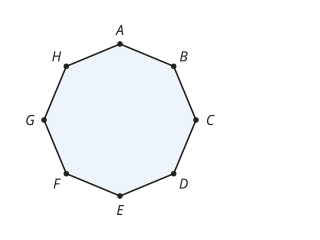

# 중1 수학 서술형 문항 (y_0305_dong_a) — 총 10점

- 성취기준: 9수03-05 / 역량: 추론, 의사소통, 문제해결 / 과제 패턴: compare_methods_apply
- 출제 의도: 1-1은 D·E·C 수준을 겨냥하며, 두 학생이 제시한 분할 방법 중 하나를 골라 다각형 위에 선을 긋고 만들어진 삼각형의 개수를 구하는 기본 능력을 본다. 1-2는 C·B 수준을 겨냥하며, 선택한 방법으로 내각의 크기의 합을 구하는 과정을 논리적으로 서술하고, 내각과 외각의 관계를 이용해 외각의 크기의 합을 확인한 뒤 조건에 맞는 다각형을 판단하는 추론과 의사소통 능력을 평가한다. 1-3은 A·B 수준을 겨냥하며, 두 학생의 대각선 개수 구하는 방법을 비교해 타당성을 따지고, 이를 더 큰 다각형에 일반화하여 적용하는 문제해결 능력을 평가한다.
- 사용 숫자: {'n': 8, 'p': 7, 'm': 10} (수치 명세 m1_9s03-05_compare_methods_apply_v1, 템플릿 방식 — 숫자만 바꾸기 가능)

## 평가 문항

미술 시간에 서윤과 도현이 다각형 모양의 판에 색유리 조각을 붙여 모자이크 미술 작품을 만들고 있다. 두 학생은 그림과 같은 8각형 모양의 판을 삼각형 조각으로 나누어 붙이려고 하는데, 서윤은 판 안쪽에 점 P를 하나 잡고 점 P와 모든 꼭짓점을 선분으로 이어 나누자고 하였고, 도현은 한 꼭짓점 A에서 다른 꼭짓점으로 선분을 그어 나누자고 하였다. 두 학생은 7각형 모양의 판에 장식 선을 넣기 위해 대각선의 개수도 구해 보았다. 서윤은 '각 꼭짓점에서 대각선을 4개씩 그을 수 있고 꼭짓점이 7개이므로 7×4개이다.'라고 하였고, 도현은 '꼭짓점 A에서 대각선 4개를 세고, 다음 꼭짓점부터는 새로 생기는 대각선만 차례로 4개, 3개, …, 1개를 세어 모두 더하면 된다.'라고 하였다. 두 학생은 이 방법을 이용해 10각형 모양의 큰 작품도 만들 계획이다.

**1-1.** 서윤과 도현이 제안한 방법 중 한 가지를 선택하여, 그 방법에 따라 8각형 모양의 판 위에 선분을 그어 나타내고 나누어진 삼각형의 개수를 구하시오. [2점]

**1-2.** 1-1에서 선택한 방법으로 8각형의 내각의 크기의 합을 구하는 과정을 서술하시오. 또 현우는 '8각형 모양의 판보다 10각형 모양의 판이 내각의 크기의 합이 더 크므로 외각의 크기의 합도 더 크다.'라고 하였다. 현우의 주장이 옳은지 〈조건〉에 맞게 판단하시오. [4점]

> 〈조건〉 1-1에서 선택한 방법으로 나눈 삼각형의 개수를 이용하여 내각의 크기의 합을 구할 것

> 〈조건〉 한 꼭짓점에서 내각과 외각의 크기의 합이 180°임을 이용할 것

> 〈조건〉 8각형과 10각형의 외각의 크기의 합을 각각 구하여 비교할 것

**1-3.** 서윤과 도현이 7각형의 대각선의 개수를 구한 두 방법이 각각 타당한지 판단하고 그 이유를 설명한 뒤, 〈조건〉에 맞게 10각형의 대각선의 개수를 구하는 과정을 서술하시오. [4점]

> 〈조건〉 두 학생의 방법을 7각형에 각각 적용하여 얻은 대각선의 개수를 구해 비교할 것

> 〈조건〉 10각형의 대각선의 개수를 구하는 식을 쓰고, 식에 쓰인 각 수가 무엇을 뜻하는지 설명할 것

## 채점기준표

| 문항 | 평가 요소 | 채점 요소 | 배점 | 수행 수준 |
|---|---|---|---|---|
| 1-1 | 다각형의 내각의 크기의 합을 구하는 과정 설명하기 | 선택한 방법대로 다각형 위에 선분을 긋고 나누어진 삼각형의 개수 구하기 | 2 | 선택한 방법에 맞게 선분을 모두 바르게 긋고 나누어진 삼각형의 개수를 정확하게 구함. |
| 1-1 | 다각형의 내각의 크기의 합을 구하는 과정 설명하기 | 선택한 방법대로 다각형 위에 선분을 긋고 나누어진 삼각형의 개수 구하기 | 1 | 선택한 방법에 맞는 그림과 삼각형의 개수 중 한 가지만 바르게 나타냈거나, 선분의 일부를 잘못 그어 개수를 구하는 데 어려움이 있음. |
| 1-2 | 다각형의 내각의 크기의 합을 구하는 과정 설명하기 | 선택한 방법으로 나눈 삼각형의 개수를 이용하여 내각의 크기의 합을 구하는 과정 서술하기 | 2 | 1-1에서 선택한 방법으로 나눈 삼각형의 개수와 삼각형의 내각의 크기의 합을 이용한 설명이 논리적으로 타당하고 내각의 크기의 합을 정확하게 구함. |
| 1-2 | 다각형의 내각의 크기의 합을 구하는 과정 설명하기 | 선택한 방법으로 나눈 삼각형의 개수를 이용하여 내각의 크기의 합을 구하는 과정 서술하기 | 1 | 삼각형의 개수는 썼으나 내각의 크기의 합을 구하는 과정에 오류가 있거나, 과정 없이 내각의 크기의 합만 구함. |
| 1-2 | 다각형의 외각의 크기의 합을 이용하여 조건에 맞는 다각형 판단하기 | 내각과 외각의 관계로 두 다각형의 외각의 크기의 합을 구해 비교하여 현우의 주장을 판단하기 | 2 | 한 꼭짓점에서 내각과 외각의 크기의 합이 180°임을 이용해 두 다각형의 외각의 크기의 합을 각각 구하여 비교하고, 현우의 주장이 옳은지를 근거와 함께 올바르게 판단함. |
| 1-2 | 다각형의 외각의 크기의 합을 이용하여 조건에 맞는 다각형 판단하기 | 내각과 외각의 관계로 두 다각형의 외각의 크기의 합을 구해 비교하여 현우의 주장을 판단하기 | 1 | 두 다각형 중 한 가지의 외각의 크기의 합만 구했거나, 조건 C2의 관계를 이용하지 않고 외각의 크기의 합을 바로 썼거나, 구한 결과를 판단과 연결하지 못함. |
| 1-3 | 다각형의 대각선의 개수를 구하는 과정 설명하기 | 두 학생의 방법을 비교하여 각 방법의 타당성을 이유와 함께 판단하기 | 2 | 두 방법으로 구한 대각선의 개수를 각각 구해 비교하고, 각 방법이 타당한지를 대각선을 세는 방식에 근거하여 올바르게 판단함. |
| 1-3 | 다각형의 대각선의 개수를 구하는 과정 설명하기 | 두 학생의 방법을 비교하여 각 방법의 타당성을 이유와 함께 판단하기 | 1 | 두 방법 중 한 가지만 개수를 구해 판단했거나, 두 방법의 개수를 구했으나 타당성을 판단하는 이유를 설명하지 못함. |
| 1-3 | 다각형의 대각선의 개수를 구하는 과정 설명하기 | 대각선의 개수를 구하는 식을 세워 큰 다각형에 적용하기 | 2 | 10각형에 적용하는 식을 바르게 세우고 식에 쓰인 각 수의 뜻을 설명하여 대각선의 개수를 정확하게 구함. |
| 1-3 | 다각형의 대각선의 개수를 구하는 과정 설명하기 | 대각선의 개수를 구하는 식을 세워 큰 다각형에 적용하기 | 1 | 식은 세웠으나 계산에 오류가 있거나 각 수의 뜻을 설명하지 못했거나, 같은 대각선을 중복하여 센 식으로 구했거나, 식 없이 값만 구함. |

## 예시답안

- **1-1** (한 꼭짓점에서 대각선을 그어 삼각형으로 나누기 / 한 꼭짓점에서 그을 수 있는 대각선 수에 꼭짓점 수를 곱해 2로 나누기): [그림] 꼭짓점 A에서 이웃한 두 꼭짓점을 제외한 나머지 꼭짓점 5개와 각각 선분으로 연결한다. 이 선분은 모두 대각선이다. 이렇게 나누면 8각형이 삼각형 6개로 나누어진다. 따라서 삼각형의 개수는 6개이다.
- **1-1** (다각형 내부의 한 점과 꼭짓점을 연결하기 / 모든 두 꼭짓점을 잇는 선분 수에서 변의 수 빼기): [그림] 판 안쪽에 점 P를 잡고 점 P와 8개의 꼭짓점을 각각 선분으로 연결한다. 이렇게 나누면 8각형이 삼각형 8개로 나누어진다. 따라서 삼각형의 개수는 8개이다.
- **1-2** (한 꼭짓점에서 대각선을 그어 삼각형으로 나누기 / 한 꼭짓점에서 그을 수 있는 대각선 수에 꼭짓점 수를 곱해 2로 나누기): [내각의 크기의 합] 꼭짓점 A에서 대각선을 그으면 삼각형 6개로 나누어지고, 삼각형 한 개의 내각의 크기의 합은 $180^\circ$이다. 이 삼각형들의 내각을 모두 합하면 8각형의 내각의 크기의 합이 되므로 $180^\circ \times 6 = 1080^\circ$이다.\n[외각의 크기의 합] 8각형은 꼭짓점이 8개이고 각 꼭짓점에서 (내각의 크기)+(외각의 크기)=$180^\circ$이므로 모든 내각과 외각의 합은 $180^\circ \times 8 = 1440^\circ$이다. 따라서 외각의 크기의 합은 $1440^\circ - 1080^\circ = 360^\circ$이다.\n10각형의 내각의 크기의 합은 $180^\circ \times (10-2) = 1440^\circ$이고, 모든 내각과 외각의 합은 $180^\circ \times 10 = 1800^\circ$이므로 외각의 크기의 합은 $1800^\circ - 1440^\circ = 360^\circ$이다.\n두 다각형의 외각의 크기의 합이 $360^\circ$로 같으므로 현우의 주장은 옳지 않다.
- **1-2** (다각형 내부의 한 점과 꼭짓점을 연결하기 / 모든 두 꼭짓점을 잇는 선분 수에서 변의 수 빼기): [내각의 크기의 합] 판 안쪽의 점 P와 8개의 꼭짓점을 이으면 삼각형 8개로 나누어지고, 이 삼각형들의 내각의 크기의 합은 $180^\circ \times 8 = 1440^\circ$이다. 이 중 점 P 둘레에 모인 각의 크기의 합 $360^\circ$는 8각형의 내각이 아니므로 뺀다. 따라서 내각의 크기의 합은 $1440^\circ - 360^\circ = 1080^\circ$이다.\n[외각의 크기의 합] 각 꼭짓점에서 (내각의 크기)+(외각의 크기)=$180^\circ$이므로 8개의 꼭짓점의 모든 내각과 외각의 합은 $1440^\circ$이다. 따라서 외각의 크기의 합은 $1440^\circ - 1080^\circ = 360^\circ$이다.\n10각형도 같은 방법으로 삼각형 10개로 나누면 내각의 크기의 합은 $180^\circ \times 10 - 360^\circ = 1440^\circ$이고, 모든 내각과 외각의 합은 $1800^\circ$이므로 외각의 크기의 합은 $1800^\circ - 1440^\circ = 360^\circ$이다.\n두 다각형의 외각의 크기의 합이 같으므로 현우의 주장은 옳지 않다.
- **1-3** (한 꼭짓점에서 대각선을 그어 삼각형으로 나누기 / 한 꼭짓점에서 그을 수 있는 대각선 수에 꼭짓점 수를 곱해 2로 나누기): [두 방법 비교] 서윤의 방법으로 7각형의 대각선의 개수를 구하면 $7 \times 4 = 28$(개)이다. 그런데 이 방법은 한 대각선을 양 끝 꼭짓점에서 두 번씩 세므로 2로 나누어야 하고, 그러면 $7 \times 4 \div 2 = 14$(개)이다.\n도현의 방법으로 구하면 $4 + (4 + 3 + \cdots + 1) = 4 + 10 = 14$(개)이다. 이 값은 2로 나눈 값 14개와 같고, 이미 센 대각선을 다시 세지 않으므로 도현의 방법은 타당하다. 서윤의 방법은 같은 대각선을 두 번씩 세어 28개가 되므로 그대로는 타당하지 않다.\n[10각형] 10각형은 한 꼭짓점에서 그을 수 있는 대각선이 $10-3 = 7$(개)이고 꼭짓점이 10개이므로 $10 \times 7$개를 세는데, 각 대각선이 두 번씩 세어졌으므로 2로 나눈다. 따라서 대각선의 개수는 $10 \times 7 \div 2 = 35$(개)이다.\n(도현의 방법으로도 $7 + 28 = 35$(개)로 같다.)
- **1-3** (다각형 내부의 한 점과 꼭짓점을 연결하기 / 모든 두 꼭짓점을 잇는 선분 수에서 변의 수 빼기): [두 방법 비교] 모든 두 꼭짓점을 잇는 선분의 수를 먼저 구한다. 7각형의 각 꼭짓점에서 자신을 제외한 나머지 모든 꼭짓점으로 선분을 그으면 모두 $42$개이고, 각 선분이 양 끝에서 두 번씩 세어지므로 2로 나누어 $21$개이다. 이 중 변 7개를 빼면 대각선의 개수는 $21 - 7 = 14$(개)이다.\n서윤의 값 28개는 이 값과 다르고 도현의 값 14개는 같다. 따라서 도현의 방법은 타당하고, 서윤의 방법은 대각선을 두 번씩 세었으므로 그대로는 타당하지 않다.\n[10각형] 각 꼭짓점에서 자신을 제외한 나머지 모든 꼭짓점으로 선분을 그으면 모두 $90$개이고, 두 번씩 세어졌으므로 2로 나누어 모든 두 꼭짓점을 잇는 선분의 수는 $45$개이다. 여기서 변 10개를 빼면 대각선의 개수는 $45 - 10 = 35$(개)이다.

## 채점 시 유의점
- 수와 식으로 표현한 문제해결 과정이 수학적으로 논리적이면 예시답안과 달라도 정답으로 인정한다. 1-1에서 서로 다른 선분을 그은 경우에는 선택한 방법과 일치하는지, 그은 선분으로 실제로 나누어진 삼각형의 개수와 답이 맞는지를 확인한다.
- 앞 소문항의 값이 틀렸더라도 그 값을 바탕으로 이후 계산·판단이 논리적이면 해당 수준 점수를 부여한다. 1-3에서 타당성 판단이 틀렸더라도 자신이 고른 방법을 10각형에 일관되게 적용했으면 두 번째 채점 요소의 해당 수준 점수를 부여한다.
- 표현 방식이 달라도 이유가 충분히 설명되었으면 정답으로 인정한다.
- 성취기준이 값을 구하는 것이므로 단위 표기는 평가하지 않는다.

- 단위: 평가하지 않음

## 교사 확인 사항
- (T1, 1-1, 1-3) 1-1에서 서윤과 도현 중 어느 방법을 선택했는지 밝혔는지, 1-3에서 두 학생의 방법을 구분하여 각각의 타당성을 답했는지 확인한다.
- (T2, 1-2, 1-3) 계산 실수와 개념 이해 오류를 구분하여 채점한다. 예를 들어 1-2에서 점 P 둘레의 각을 빼지 않은 경우와 단순 덧셈 실수를, 1-3에서 2로 나누는 것을 빠뜨린 경우와 곱셈 실수를 구분한다.

## 피드백 시 유의점
- 1-2에서 '변의 수가 늘면 외각의 크기의 합도 커진다'고 생각하는 오개념이 있는지 확인한다. 변의 수가 4, 5, 6일 때 (모든 내각과 외각의 합)−(내각의 합)을 표로 계산하게 하여 외각의 크기의 합이 변하지 않음을 확인하도록 지도한다.
- 1-3에서 서윤처럼 꼭짓점 수와 한 꼭짓점에서 그은 대각선 수의 곱을 그대로 답하는 학생에게는 사각형에 대각선을 직접 그려 개수를 세어 보게 한다. 곱으로 구한 값과 실제 개수를 비교하여 한 대각선이 두 번씩 세어짐을 발견하도록 지도한다.
- 점 P를 이용한 방법에서 점 P 둘레의 각 $360^\circ$를 빼지 않고 내각의 크기의 합을 $180^\circ\times n$으로 답하는 경우가 있다. 꼭짓점 A를 이용한 방법의 결과와 비교하게 하여 점 P 둘레의 각이 다각형의 내각이 아님을 스스로 확인하게 한다.

## 검증 결과
- 오류 0개, 경고 0개

## AI 점검 의견 (수정 권고)
- [보통] solutionMethods·modelAnswers의 M2 (1-1, 1-2, 1-3): M2는 '점 P 둘레의 각 360°를 뺀다'는 내용(1-2)과, 모든 두 꼭짓점을 잇는 선분 수 $\frac{p(p-1)}{2}$에서 변의 수를 빼는 방법(1-3)을 쓴다. 두 내용 모두 교과서 목록(textbookItems 3, 6, 13, 14)에 근거가 없고, $\frac{p(p-1)}{2}$는 조합식과 같은 꼴이다. -> M2의 근거를 교과서 항목으로 보이거나, 중1 범위로 쓸 수 있는 풀이로 바꾼다. 점 P를 이용하는 풀이는 점 P 둘레의 각 $360^\circ$를 발문이나 제시문에서 알려 준다. 대각선 개수의 M2는 빼거나 항목 2·3의 방법으로 바꾼다.
- [보통] 1-2, 1-3 발문: 1-2는 내각의 합 서술과 현우 주장 판단, 1-3은 두 방법의 타당성 판단과 10각형 대각선 개수 서술을 한 발문에 묶었다. 1-2의 판단 부분은 '근거'를 요구하는 말도 발문에 없다. 소문항 하나가 한 가지 수행만 묻는 원칙에 맞지 않는다. -> 1-2와 1-3을 각각 두 소문항으로 나누거나, 발문에 수행을 번호로 나누어 드러낸다. 판단 문장은 '옳은지 판단하고 그 근거를 설명하시오'로 쓴다.
- [보통] 1-1 채점기준: 1점 수준이 '한 가지만 바르게 나타냈거나', '구하는 데 어려움이 있음'처럼 정도만 쓴 표현이어서 R1·R3에 어긋난다. '선분의 일부를 잘못 그었으나 그은 선분에 맞는 개수를 씀'과 '그림은 맞고 개수만 틀림'의 구별도 분명하지 않다. -> '그림은 맞고 개수가 틀림', '선분 일부가 틀렸으나 그린 그림에 맞는 개수를 씀'처럼 관찰 가능한 단위로 나누어 쓴다. '어려움이 있음'은 쓰지 않는다.
- [보통] 제시문(도현의 방법)과 1-1: 도현의 '한 꼭짓점 A에서 다른 꼭짓점으로 선분을 그어'는 이웃한 꼭짓점(변)까지 포함하는 것으로 읽힐 수 있고, 일부 꼭짓점에만 긋는 경우도 막지 못한다. 예시답안은 이웃하지 않는 5개 꼭짓점 모두에 긋는 것을 전제한다. -> '꼭짓점 A에서 이웃하지 않는 모든 꼭짓점으로 선분을 그어'처럼 대상을 분명히 쓴다.
- [경미] 1-1, 1-2의 evaluationElements 문구: 1-1의 평가 요소는 '내각의 크기의 합을 구하는 과정 설명하기'인데, 실제 채점 요소는 선분을 긋고 삼각형 개수를 구하는 것이다. 1-2의 '조건에 맞는 다각형 판단하기'는 실제로는 현우의 주장을 판단하는 것이어서 평가 요소 문구와 내용이 어긋난다. -> 1-1은 '다각형을 삼각형으로 나누고 개수 구하기', 1-2는 '외각의 크기의 합을 구해 주장의 옳고 그름 판단하기'로 평가 요소 문구를 고친다. intent의 '조건에 맞는 다각형을 판단하는'도 함께 고친다.
- [경미] 1-3 dependsOn: 1-3은 1-1, 1-2의 결과를 쓰지 않는데 dependsOn에 두 소문항이 올라 있어 앞 소문항 결과 사용 규칙과 맞지 않는다. -> dependsOn을 빈 배열로 바꾼다. 채점 시 '앞 소문항 값이 틀려도 논리가 맞으면 인정'하는 유의점도 1-3에는 해당하지 않으므로 고친다.

---
사용량: 호출 6회, 입력 88278 토큰, 출력 56117 토큰, 추정 비용 약 $1.107 (단가는 추정)